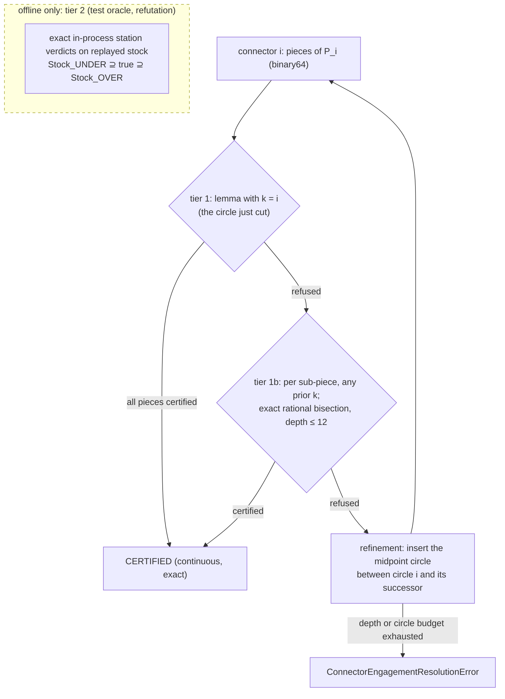

# Held connector engagement

Every Held connector can be certified against the stock actually left at that
moment. The check is exact, holds for every point of the motion (no stations),
and needs no stock replay. When connector *i* runs, the remaining stock is a
subset of Ω minus any single annulus cut before it. The tool rim minus one
annulus is at most two disjoint arcs. Their angles depend only on the distance
*d* from the tool centre to that annulus's centre, and are monotone or convex
in *d*. So the worst point of a straight connector piece is an endpoint, or one
critical distance whose test is rational. Each comparison against the cap is a
sign test on rationals built from the binary64 inputs and the cap's chord
surrogate.

The certificate is implemented as a typed, exact module,
`benchmarks/held_connector_engagement.py`: `ConnectorEngagementAssessment`
decides every connector (tier 1 with the circle just cut, else tier 1b with any
earlier circle per sub-piece), and the post-gate
`ConnectorEngagementCertificate.build` raises
`UncertifiedConnectorEngagementError`, naming every connector left without a
certificate. On the five Held workloads tier 1 alone certifies almost every
moving connector, and with the refinement repair wired, tiers 1 + 1b leave
none, seam included ([Measurement](#measurement)). Before the wiring the
tiers left a few connectors on the Figure 8 workloads; on the actual replayed
stock none of those exceeded the cap at any exact station
([Tier 2](#tier-2-on-the-actual-stock)).

Design, in one line: tier 1 / 1b go into the refinement acceptance predicate
(`refine_figure5_engagement`). A refused connector is repaired the way a
refused circle pair already is, by inserting the midpoint circle. The
post-gate re-proves all N connectors, the seam included. Tiers 1 + 1b run in
well under the 0.5 s budget on every workload, Monstera included. The exact
replay of the actual stock (tier 2) is the test oracle and the refutation tool,
never part of generation.

!!! note "Status (2026-10-22): polygon path and Ω\* gate and repair wired."
    **Polygon Ω.** Tiers 1 / 1b sit in the refinement acceptance
    (connector repair by midpoint circles,
    [Where it plugs in](#where-it-plugs-in-and-what-happens-on-violation)).
    The seam connector is gated and repaired by appended circles. The
    post-gate stage `connector_certificate` of
    `benchmarks/held_toolpath_benchmark.py` re-proves every connector, seam
    included, and the [Measurement](#measurement) table shows none left.
    **Ω\*.** The exact gate covers line, arc and
    circle-junction sweeps ([Exact connectors on Ω\*](#exact-omega-connectors)),
    built from the emitted path by `omega_connector_path`. The
    `connector_repair` stage (`repair_omega_connectors`, with the Ω\*
    convex-corner refusal) runs last in the Ω\* generator
    ([Ω\* connector repair](#omega-connector-repair)), and the
    [Ω\* gate measurement](#omega-gate-measurement) on the emitted path
    refuses nothing. The certificate is about the modelled path: the junction
    lines are the model's closure, not emitted motion ([what the certificate
    is about](#what-the-certificate-is-about)). The benchmark's Ω\* post-gate
    (`require_omega_connector_certificate`) still refuses every moving
    connector by name until it is switched to that gate.

## What engagement means for a connector

A Held path is a sequence of full machining circles. Circle *k* has centre
cₖ and guide radius ρₖ, and its tool centre travels a full turn through the
contact qₖ on the radius-r inward offset ∂Ωᵣ. Between circles, a connector
moves the tool centre CCW along ∂Ωᵣ from qᵢ to qᵢ₊₁. It is a polyline of
binary64 points, `Figure5BoundaryTransition.samples`, and crosses offset
vertices as it goes. The seam connector runs from circles[-1] back to
circles[0] (`Figure5BoundaryConnectors`, [seam report](#reproduce)).

The **engagement** at a tool centre p is the angle of the longest connected
arc of the tool rim ∂D(p, r) that lies in the stock remaining at that instant.
This is the pipeline's per-run TEA (`engagement_at(...)[1]`, `max_run_tea`).
The total-contact cap is a separate quantity (plan Task 4.4).

The **actual remaining stock** at a point p of connector i, in emission order:

Sᵢ(p) = Ω ∖ ( ⋃₍ₖ ≤ ᵢ₎ Aₖ ∪ ⋃₍ⱼ < ᵢ₎ (Pⱼ ⊕ Dᵣ) ∪ (Pᵢ[qᵢ, p] ⊕ Dᵣ) )

where Aₖ = { x : hₖ ≤ |x − cₖ| ≤ Rₖ } is circle k's swept annulus, with
Rₖ = ρₖ + r and hₖ = max(ρₖ − r, 0). Pⱼ is connector j's polyline. The
last term is the connector's own swept prefix. Circles after i are not cut
yet. That ordering is what makes this different from the order-free coverage
union in [Held Motion Coverage](held_motion_coverage.md).

Before this page, no connector's engagement was modelled anywhere:
`ToolpathMetrics.max_engagement_deg` covers circle pairs under Held's
predecessor model, and the seam reports only the circle pair
(`seam_engagement_deg`).

## The certificate

### Lemma (single-sweep bound)

Fix any circle k cut before connector i (k ≤ i, and for the seam any k). At
every instant, Sᵢ(p) ⊆ Ω ∖ Aₖ, because stock only shrinks. So each engaged
run lies in ∂D(p, r) ∖ Aₖ. That set is two disjoint arcs, separated by the
annulus: the **outer arc**, outside the disk (cₖ, Rₖ), and the **hole arc**,
inside the open disk (cₖ, hₖ). A connected run lies in one of them. With
d = |p − cₖ|:

- Outer arc: O(d) = 2π − 2·arccos κₒ(d), where κₒ = (d² + r² − R²)/(2dr),
  clamped to [−1, 1]. Its derivative is
  dκₒ/dd = (d² − r² + R²)/(2d²r) > 0 because R > r, so O is non-decreasing
  in d.
- Hole arc (only when ρₖ > r): I(d) = 2·arccos κₕ(d), where
  κₕ = (d² + r² − h²)/(2dr). κₕ is convex in d > 0, with its minimum at
  d* = √(r² − h²) when r > h.
- Along a straight piece [a, b], d is convex. So max O is reached at a or b.
  d sweeps exactly [dₘᵢₙ, dₘₐₓ], where dₘᵢₙ is the foot-point distance, so
  max I is reached at dₘᵢₙ, at dₘₐₓ, or at d* when d* lies inside.

So the engagement over the whole piece is at most the bound evaluated at two
or three rational points. This is a continuous statement, not a station
sample.

### Exact decision

The cap enters only as `EngagementCap`'s exact chord surrogate
s = 4 sin²(θₘₐₓ/2) ∈ (0, 4], a binary64 that is injected exactly. Then
C = 1 − s/4 is cos²(θₘₐₓ/2) in surrogate semantics. That is the same API
semantic the circle-pair cap already uses
([Exact-Kernel Discipline](exactness.md#the-boundary-doctrine-for-transcendental-intent)),
so no new transcendental crosses the seam. With D = d², which is rational
because every coordinate is binary64:

| bound ≤ θₘₐₓ | rational test |
| --- | --- |
| outer arc at D | Nₒ = D + r² − R² ≤ 0 and Nₒ² ≥ 4·C·D·r² |
| hole arc at D > 0 | Nₕ = D + r² − h² ≥ 0 and Nₕ² ≥ 4·C·D·r² |
| hole arc at d* (r > h, Dₘᵢₙ < r² − h² < Dₘₐₓ) | r² − h² ≥ C·r² |
| hole arc at D = 0 | refused (no certificate; never a verdict) |

Dₘᵢₙ is the squared foot distance, rational, computed as in
`_project_to_offset_side`. There is no square root, no epsilon, no `acos` and
no float in the decision. The reported degrees (`acos`) are for humans only.

### Tiers



- **Tier 1** (k = i) is O(pieces) rational arithmetic and needs nothing beyond
  circle i and the connector polyline. The refinement loop already has both
  when it accepts a target.
- **Tier 1b** lets any circle cut before the connector (k ≤ i; every circle
  for the seam) certify a sub-piece, bisecting at exact rational midpoints.
  Candidate circles are pre-filtered in binary64 by distance. The filter only
  chooses which exact question to ask: dropping a circle can lose a
  certificate, never create one. A circle after i is never a candidate. That
  would be a false certificate, and a test pins it.
- **Tier 2** is the oracle. It is not a certificate between stations, and
  it is too slow for generation. See [Tier 2](#tier-2-on-the-actual-stock).

A refusal by tier 1 or 1b means "not proved", never "violated". The lemma
ignores Ω, every other sweep and the connector's own rear half-disk, so it is
loose. Only a tier-2 station that exceeds the cap on `Stock_OVER` is a violation.

### Evidence for the lemma

Every check is a test in `tests/benchmarks/test_held_connector_engagement.py`,
against exact in-process station verdicts (`engagement_line_prefixes`):

| check | test |
| --- | --- |
| Hypothesis: a circle tangent to a wall and a connector along its offset; on a square minus that one annulus, a certified piece has no exceeded station at 46 and at 1,000 stations, and no station's max-run reads above the reported bound | `test_1_wall_connector_certificate_has_no_exceeded_station` |
| Hypothesis: random pieces starting on or near a circle, any heading, cap 20–180°, ρ from 0.05 to 6 r | `test_1_random_piece_certificate_has_no_exceeded_station` |
| Hypothesis: whole open paths along a wall (2–5 circles, kinked non-Pythagorean connectors included); no certified connector has an exceeded station on the tier-2 `Stock_OVER` replay | `test_1_no_false_certificate_on_the_replayed_path` |
| defect injection: hole arc removed, and the outer test without its `N_O² ≥ 4·C·D·r²` half; each creates a false certificate on a fixture the oracle shows exceeded | `test_1_hole_arc_is_checked_and_its_removal_is_caught`, `test_1_loose_outer_test_is_caught` |
| fixture c = 0, ρ = 1.2, r = 1, cap 22°, piece (1.1, 0) → (0.9, 0): both endpoint hole arcs pass, d* refuses, the oracle shows exceeded stations; deleting the d* branch creates the false certificate | `test_3_interior_hole_minimum_refuses` |
| equality certifies, the next binary64 refuses, in both halves of the outer test (`≤`, no epsilon) | `test_4_equality_certifies_in_the_squared_half`, `test_4_equality_certifies_in_the_sign_half` |
| a circle cut after the connector never certifies it; allowing k > i creates the false certificate | `test_5_future_circle_never_certifies` |

The d* branch is reached only when ρ < 2r and the piece straddles d*, which
random draws almost never hit (the design-stage random sweep of 400 segments
missed it entirely). That is why test 3 is a constructed fixture, not a
property draw.

The reporting comparison "max-run ≤ bound" carries a named slack of 1e-4°,
never a decision: near an internal tangency of the rim a reported angle has
square-root-of-ulp error (a Hypothesis draw found 2.6e-6° reported against an
exact bound of 0). The exact check is the exceeded flag.

## Exact connectors on Ω\*: lines, arcs and junctions {#exact-omega-connectors}

An Ω\* connector is not a binary64 polyline. It runs along exact ∂Ω\*
sub-pieces (offset lines, offset arcs, junction arcs) between exact sites with
rational or one-root coordinates, and its binary64 circles pass their sites
within the centre's rounding, not through them
([Held exact centre domain](held_exact_centre_domain.md)). Three pieces make
the certificate decide such connectors exactly. All of them are in
`benchmarks/held_connector_engagement_{range,lines,arcs,exact}.py` and
`benchmarks/held_omega_connector_engagement.py`.

### The lemma reads only the realised range of d

The [single-sweep bound](#lemma-single-sweep-bound) depends on the tool centre
p only through D = |p − cₖ|². The outer arc is non-decreasing in D. The
hole arc is largest where κₕ is smallest, and κₕ is convex in d with its
minimum at d\*. Any sweep is a connected motion, so D takes exactly the values
of an interval [Dₘᵢₙ, Dₘₐₓ]. The bound over the whole sweep is therefore
within the cap iff:

- the outer test holds at Dₘₐₓ;
- the hole test holds at Dₘᵢₙ and Dₘₐₓ;
- the d\* test holds when Dₘᵢₙ < r² − h² < Dₘₐₓ.

A sweep type only has to name a finite set of **realised** values of D that
contains Dₘᵢₙ and Dₘₐₓ. The decision then tests every candidate:

- the outer test at every candidate (it is monotone, so this is the test at
  Dₘₐₓ);
- the hole test at every candidate (they are realised, so no candidate refuses
  what the true range would certify);
- the d\* test when some candidate lies below r² − h² and some above.

No candidate is ever compared with another, so candidates of one sweep may
live in different quadratic extensions (`RangeEngagementLemma`). For a
straight sweep the candidates are the two ends and, when it falls strictly
inside, the foot of cₖ. That is the original lemma.

### Lemma for arc motion

**Lemma.** Let the tool centre move on the circle (q, R) from S to E in
sense σ (S = E is a full turn). Let c be a prior circle's centre and L = |c − q|.

- If L = 0, then D = R² on the whole arc.
- If L > 0, then the minimum and maximum of D over the arc are among D(S),
  D(E), and the values at whichever of these two points lies on the arc:
  - NEAR = q + R(c − q)/L, with D = (L − R)²;
  - FAR = q − R(c − q)/L, with D = (L + R)².

**Proof.** Write p = q + R(cos φ, sin φ), and let φ꜀ be the direction of
c − q. Then

D(φ) = |p − q|² + |q − c|² − 2(p − q)·(c − q) = R² + L² − 2RL·cos(φ − φ꜀).

For L > 0 its derivative 2RL·sin(φ − φ꜀) vanishes only at φ꜀ (NEAR, the global
minimum) and at φ꜀ + π (FAR, the global maximum). A continuous function on a
closed arc takes its extremes at the ends or at interior critical points. ∎

Unlike a line, d is not convex along an arc. The lemma does not need
convexity, only the range of D, which the candidates bound. With the
range-lemma above, this gives the exact arc decision. Every candidate is a
realised value, so the arc test is exactly as sharp as the straight one.

### Exact decision, one-root numbers, and the filter

- **Ends.** D(S) = |S − c|² lies in S's extension, D(E) in E's. They are
  tested one at a time, never combined. S and E may lie in different
  extensions.
- **NEAR / FAR.** (L ∓ R)² = β + R² ∓ 2R√β, with β = |c − q|² rational, is
  one `OneRootNumber` in ℚ(√β). It is its own candidate.
- **Is NEAR / FAR on the arc?** This is an order question on the circle about
  the rational directions ±(c − q). `ArcSweep.order` applies the
  `compare_on_arc` rule (half-turn by orientation, then dot, then
  orientation). The rule reads only signs of cross and dot products about q,
  so the rational points c and 2q − c stand in for NEAR and FAR. Each
  cross-root sign is the exact mixed-radical decomposition of
  `held_one_root.orientation` (sign(u), sign(w), then compare(u², βw²)). A
  dot product is the orientation against the point turned a quarter-turn
  about q. A Hypothesis test pins `ArcSweep.order` to `compare_on_arc`.
- **Tests.** Each test is a sign of a same-extension one-root number
  X + K·Y, or of (X + K·Y)²·C_den − 4C_num·r²·X·Y, with D = X / Y and Y > 0.
- **Filter.** Every sign is asked first of the repo's rigorous dyadic interval
  enclosure (`held_dyadic_interval.Interval`, integer ends rounded outward).
  The exact one-root sign decides only when the enclosure contains 0. The
  filter cut the Figure 5 gate from 40 s to 4.7 s under profiling, at the
  same load of about 400, and it never decides wrongly.

**Exact rational input.** `LineSweep` takes rational or one-root endpoints. A
point such as (7/5, 1/5) is never rounded to binary64, and a test pins that
equality at such a point certifies. When the two ends lie in different
extensions, the sweep must declare its rational supporting line (anchor,
direction), as every ∂Ω\* offset line has. The foot parameter and the
distance to the line are then rational, and each end's parameter is compared
with the foot in its own extension. A cross-extension line without a support
is refused at build (`MixedRootLineSweepError`), because cross-root
arithmetic is never written. Binary64 paths enter through
`ExactConnectorPath.from_figure5`, injected exactly. On Figure 5 it decides
every connector at the same tier as the integer-grid assessment (test).

**Refinement points (tier 1b).**

- Lines split at the exact midpoint when both ends share an extension.
  Across extensions they split at a rational support point strictly between
  the ends.
- Arcs split at a **rational point of the circle**, q + R·u, where u is an
  exactly unit Pythagorean direction (half-angle tangent on the 2⁻⁵⁶ grid,
  `choose_direction`, the same grid as the declared boundary).
- Binary64 only proposes the split point. Whether it lies strictly inside is
  decided exactly (`ArcSweep.order`, parameter signs). A failed proposal is
  the named refusal `SPLIT_UNRESOLVED`, never a rounded point.
- After one split both halves carry rational interior ends, so deeper
  bisection never adds a radical.

### Junctions: binary64 circle → exact site

Circle k is binary64 (centre cₖ, radius ρₖ), and its exact site qₖ is off the
circle by the reported junction gap. The motion model makes the transfer
explicit:

- **Junction point.** Jₖ = cₖ + ρₖ·uₖ, with uₖ an exactly unit rational
  direction proposed from the binary64 direction of qₖ − cₖ. Jₖ is rational
  and lies **exactly** on circle k by construction. Any point of the circle is
  a valid model; this choice keeps the junction as short as the grid allows.
- **Connector i** is the line Jᵢ → qᵢ, then the ∂Ω\* sub-pieces qᵢ → qᵢ₊₁,
  then the line qᵢ₊₁ → Jᵢ₊₁. A junction line joins a rational point to a
  one-root site, so it lives in the site's extension. A fan (two circles on
  one site) is its two junction lines, so it is no longer treated as a
  stationary connector.
- **Priors.** Circle i + 1 is not cut before its entry junction, so the
  priors stay k ≤ i. The seam ends at J₀, and circle 0 is not re-cut.

The junctions are not covered by the adjacent pieces, so they are certified
as sweeps of kind `circle_junction`. On all five workloads every junction line
is sub-picometre, **limited circles included**: the max |J − q| column of the
junction-model table in [Ω\* gate measurement](#omega-gate-measurement)
reports them per workload, free and limited circles apart. A shrunk circle
keeps its centre on the site's inward normal with radius equal to the normal
distance (`held_omega_circles._shrunk`), so it still passes the site within
rounding. The lemma passes the lines with the circle just cut (d ≈ ρ gives an
outer arc of about 0). Whether the junction line lies in Ω\* (a clearance
question) is outside this certificate. The declared-clearance
`SegmentElement` needs a rational support line, and J → q has a one-root end.

#### What the certificate is about {#what-the-certificate-is-about}

The emitted Ω\* path (`OmegaGeneratedToolpath`) carries binary64 circles, each
with a binary64 `contact_point` P, and exact ∂Ω\* connectors from site qᵢ to
site qᵢ₊₁. It carries **no junction element**. The motion from circle k onto
qₖ is implicit, and no Ω\* motion post exists that would emit it. The
certificate's sweeps match the emitted ∂Ω\* pieces exactly: the same one-root
endpoints and the same supports (the "structure mismatches" column of the
junction-model table). The two junction lines Jₖ → qₖ and qₖ → Jₖ are the
model's own closure of that gap. Jₖ is not an emitted point: the table reports
max |J − P| and how few emitted P lie exactly on their circle. So the
certificate speaks about the modelled path. It speaks about the emitted motion
once the emitter carries Jₖ as each circle's lap start and end and emits the
two junction lines. Until then the claim is scoped to the model.

### Refusals

A refused connector names every sweep left without a certificate
(`ExactRefusal`: connector, sweep index, kind, reason). The kinds are
`circle_junction`, `offset_line`, `offset_arc` and `junction_arc`. The reasons
are `NOT_PROVED_AT_DEPTH` (bisection exhausted) and `SPLIT_UNRESOLVED`.
`ExactConnectorCertificate.build` raises `UncertifiedExactConnectorError`, a
subclass of `UncertifiedConnectorEngagementError`, with all of them.

### Evidence

`tests/benchmarks/test_held_connector_engagement_exact.py` checks every
refusal at the cap against exact native station verdicts on a square minus
one annulus. These are stations at prefix parameter 0: the full rim against
the stock, with no own prefix.

| check | test |
| --- | --- |
| rational (non-binary64) line end: equality certifies, the next binary64 refuses | `test_rational_line_endpoints_are_not_binary64_and_equality_certifies` |
| cross-root line (ends in ℚ(√2), ℚ(√3), rational support): the interior foot decides (31.0° refused, 31.2° certified), the station at the foot exceeds 31.0° and clears 31.2° | `test_cross_root_line_is_decided_by_its_interior_foot_and_the_refusal_is_true` |
| arc: interior FAR point equality certifies, the next binary64 refuses; the sub-arc short of FAR certifies there | `test_arc_interior_far_point_equality_certifies_and_next_binary64_refuses` |
| arc refused at the cap: the FAR station exceeds | `test_arc_refused_at_the_cap_is_a_true_exceedance` |
| cross-root arc (ends in ℚ(√19), ℚ(√3), FAR in ℚ(√2)): refused, the FAR station exceeds; certified under a looser cap | `test_cross_root_arc_refuses_at_its_far_point_and_the_station_exceeds` |
| arc NEAR point brings d\* into range (hole branch): equality certifies at s = 1, the next binary64 refuses, the d\* station exceeds 56° | `test_arc_near_point_brings_the_interior_hole_minimum_into_range` |
| Hypothesis: certified one-root arcs (ends in two extensions, both senses, caps 20–180°) have no exceeded station among 97 | `test_certified_one_root_arc_has_no_exceeded_station` |
| split points are rational, exactly on the circle, strictly inside; full turns cover both extremes | `test_arc_split_point_is_rational_on_the_circle_and_strictly_inside`, `test_full_circle_arc_covers_both_extremes` |
| filtered arc order = `compare_on_arc` (Hypothesis) | `test_filtered_arc_order_equals_compare_on_arc` |
| junction point is rational and exactly on the binary64 circle; short junctions certify (rational and cross-root); a long junction is refused by name, and its station exceeds | `test_circle_junction_point_is_rational_and_exactly_on_the_binary64_circle`, `test_short_junction_connector_is_certified`, `test_cross_root_junction_connector_is_certified`, `test_long_junction_is_refused_by_name_and_is_a_true_exceedance` |
| contract: discontinuous sweeps, count / seam mismatch, a connector off its junctions, a future circle | `test_discontinuous_connector_is_named`, `test_connector_count_must_match_the_seam`, `test_connector_must_start_and_end_at_its_circles_junctions`, `test_a_future_circle_never_certifies` |
| binary64 injection decides as the integer grid on Figure 5 | `test_binary64_injection_agrees_with_the_integer_grid_on_figure5` |

Defect injection (mutants in `build/oc/mutants/`):

- Dropping NEAR and FAR (ends only) is caught by 4 tests.
- Inverting the on-arc test is caught by 3.
- Dropping FAR alone is caught by the property test and the cross-root
  fixture.
- Dropping NEAR alone is caught only by the constructed hole-branch fixture.
  Random draws miss it, like the straight d\* branch, which is why that
  fixture exists.

### Ω\* gate measurement {#omega-gate-measurement}

Generated by `tools/held_omega_connector_gate_results.py`
(`pixi run held-omega-connector-gate`). It generates every workload in one
process, in sequence, and assesses it through `omega_connector_path` and
`ExactConnectorAssessment`. The record is in
`benchmarks/results/held_omega_connector_gate.{json,md}`. The emitted path is
the one after the `connector_repair` stage, so its gate refuses nothing. The
"Before repair" table is the same gate on the NOTHING-stage circles, the
repair stage's input. The tool fails loudly unless its refused connectors are
exactly the ones the stage repaired and the stage's verdicts equal a fresh
gate of the emitted path. Gate time includes building the exact path. The
ratio is gate time over generation time in the same process; generation now
includes the repair stage's own gate. The tool also renders the tier-1 bound
range (reporting) and the junction-model check against the emitted path.

--8<-- "benchmarks/results/held_omega_connector_gate.md"

What the refusals are:

- Every refusal (the "Before repair" table) is `NOT_PROVED_AT_DEPTH` (the
  "refusal reasons" column). No split was unresolved.
- Every refused connector also has a refused entry junction. It sits at the
  end of the refused piece, at the same place.
- The tier-1 bound at the refusals (the "refused sweeps °" column of the
  "Before repair" table) lies a little over the cap. That is the lemma-tight
  class the polygon path also had (its "left" connectors), and there it is
  repaired by midpoint-circle refinement; on Ω\* the same repair is
  [Ω\* connector repair](#omega-connector-repair).
- No tier-2 replay exists for arc sweeps. So these refusals are "not proved",
  not shown to be violations.

Budget: not met. The gate costs the "gate / gen" fraction of the Ω\*
generation time, in Python one-root arithmetic behind the interval filter. The
lever is native: the same decisions on CGAL `Sqrt_extension`, which is the C++
slot's work.

### Ω\* connector repair {#omega-connector-repair}

Ruling (polygon path, applied to Ω\*): a connector without a tier-1 or tier-1b
certificate is repaired by refinement. `repair_omega_connectors`
(`benchmarks/held_omega_connector_repair.py`) runs on the emitted circles,
after the NOTHING pass, because removing a circle can leave a connector
unproved:

1. It gates every connector once (`assess_omega_connectors` logic).
2. For each refused connector i (circles i → i+1), it inserts the
   refinement's midpoint circle (`omega_midpoint_circle`). The circle sits on
   an exact ∂Ω\* site strictly between the two sites, has the mean guide
   radius and is contained in Ω\* exactly. Then it subdivides depth-first
   until every sub-connector is accepted. A sub-connector is accepted when:
    - its circle pair is within the cap by the exact standard-model decision,
      re-decided for every inserted circle;
    - its exact connector (junction lines and ∂Ω\* sweeps) is certified by
      tier 1 or 1b (`OmegaConnectorGate.decide`, the post-gate's own lemma,
      candidate index and bisection).
3. The seam is repaired by appending circles. Circle 0 is never re-cut, and
   the closing pair is report-only.

**Gouge-free by construction.** Every inserted circle is contained in Ω\*
exactly, and every connector is an exact ∂Ω\* chain. The audit re-decides
both.

**One pass suffices.** An insertion between i and i+1 leaves every other
connector's two circles adjacent. It only adds priors to the connectors after
it. Tier 1 reads only the circle just cut. Tier 1b gains candidates, so every
sub-sweep keeps a certifying circle and the bisection tree is unchanged. The
input verdicts are therefore carried over with renumbered circle indices, and
the result's `verdicts` certify the emitted path. The repair is designed to
replace the post-gate.

**Failure modes** (each one named):

- `OmegaConnectorRepairDepthError(connector, seam, refusals)`: the depth ran
  out on one connector.
- `OmegaConnectorRepairBudgetError`: the global circle budget ran out.
- `OmegaConvexCornerEngagementError(connector, seam, piece)`: see below.

#### Convex corners on Ω\*

The [convex-corner lemma](#convex-corners-an-engagement-floor-no-refinement-removes)
holds on Ω\* verbatim at a vertex V joining two offset **line** pieces. The
proof carries over because:

- Ω\* is locally the wedge T at V;
- the approach to V is straight;
- stock is Ω\* ⊕ D_r ⊆ the pocket.

Its hypothesis is "every tool-centre point cut before, within 2r of V, lies
in T". `sharp_vertex` (`benchmarks/held_omega_convex_corner.py`) checks it
exactly on what has been cut:

- **Emitted circles.** Each circle either lies with its junction line in T
  (disk: n̂ₖ·c − levelₖ ≥ ρ for both lines; site q in T), or the disk of radius
  max(ρ, |q − c|) about c is provably farther than 2r from V. That second test
  uses a rational upper bound from the site's interval box and is decided
  without a square root (the exact hull test below).
- **Every other ∂Ω\* piece.** It lies in T (a line: both ends; an arc: its
  whole circle) or is provably farther than 2r from V. That gives
  Ω\* ∩ B(V, 2r) ⊂ T, because B ∖ T is connected and ∂Ω\* does not meet it,
  so earlier ∂Ω\* connectors are in T near V.
- **No earlier cut reaches V.** A disk in a wedge of angle < π misses the
  apex, and a site at V is excluded.

**Precondition: first arrival.** The lemma bounds the engagement of the motion
that *first* reaches V. Earlier circles keep a positive distance from V (a disk
in a wedge of angle < π misses the apex) and so do junction lines (q ≠ V), but
an earlier ∂Ω\* connector inside T may pass through V itself. The Ω\* generator
emits circles in exact site-key order, one counter-clockwise lap from circle 0,
and repair midpoints lie strictly between their neighbours, so every vertex is
reached once. `sharp_vertex` checks this exactly before claiming a violation:
the emitted site keys are non-decreasing along the lap that starts at circle
0's site, and V's key (`OmegaSite.at_source` of the outgoing piece) is strictly
after the predecessor's. A breach is the caller's contract violation and raises
`OmegaCornerFirstArrivalError`.

**Exact hull test.** "Far" for a circle uses the hull radius max(ρ, √F), where F
is the rational upper bound on |q − c|² from the site's interval box. It is
decided without a square root: D² > (2r + ρ)² when ρ² ≥ F; otherwise
X = D² − 4r² − F > 0 and X² > 16r²F.

When a refused sub-connector crosses exactly one such vertex (sites on its two
pieces, neither at V), and the vertex is convex with u₀·u₁ < 2C − 1 (unit
directions, C the cap surrogate, so β > cap exactly), the repair raises before
any midpoint. Circles a continued refinement could insert cannot change the
verdict. On the outgoing side they are cut after the arrival. On the incoming
side they are contained in Ω\*, so they lie in T near V.

Scope: vertices adjacent to an arc piece are not covered. There the repair's
depth budget names the failure, which is the conservative direction.

#### Measurement {#omega-repair-measurement}

Generated by `tools/held_omega_connector_repair_results.py`
(`pixi run held-omega-connector-repair`): every workload generated live in one
process, in sequence. "Refused before" is the repair stage's own gate on the
NOTHING-stage circles. "Refused after" is a fresh exact assessment of the
emitted path; the tool fails loudly unless it refuses nothing and its tiers
equal the stage's verdicts. The gouge audit is exact, before (NOTHING-stage
circles and their connectors) and after repair. Stage seconds split into the
gate and the insertion pass; "stage / rest" is the same-process ratio to the
other generation stages.

--8<-- "benchmarks/results/held_omega_connector_repair.md"

- Every refused connector is repaired with one midpoint circle (the
  "per repaired connector" column), and no workload reaches the convex-corner
  refusal or the depth / circle budgets.
- The stage is almost all exact gate; the insertion pass is the "pass s"
  column. The gate's cost is the native `Sqrt_extension` work.

## Measurement

Generated by `tools/held_connector_engagement_survey.py`
(`pixi run held-connector-engagement`): every workload generated live, then
assessed. "Moving" excludes zero-motion fan connectors. "Tier 1b certifies"
counts, among the connectors tier 1 refuses, those tier 1b certifies. The
tier-1 bound at the refusals and the hole-arc count (connectors that pass
closer than ρᵢ to circle i's centre, with ρᵢ > r) are reporting only.

--8<-- "benchmarks/results/held_connector_engagement.md"

Every tier-1 refusal on the Figure 8 workloads is a little over the cap, and
none is refused for the hole arc. Hole arcs are where the guide circle reaches
past the offset, which fits the concave-arc gouges in
[Held Qualification](held_qualification.md). The hole arc stays under the cap
on every one of them.

### Tier 2 on the actual stock

Exact in-process station verdicts (46 per piece) on the windowed replay of the
actual stock, for every connector that tiers 1 and 1b leave without a
certificate. Both bracketing stocks are replayed: a station clear on
`Stock_UNDER` is truly clear, and only a station exceeded on `Stock_OVER` is a
violation. Generated by `tools/held_connector_engagement_tier2.py`
(`pixi run held-connector-engagement-tier2`, opt-in: it regenerates every
workload, minutes):

--8<-- "benchmarks/results/held_connector_engagement_tier2.md"

This record predates the refinement wiring (its header names the commit):
it replays the connectors the tiers left before connector repair. With the
repair wired the tiers leave none ([Measurement](#measurement)), so a rerun
has nothing to replay.

The measured/bound ratio shows how tight the lemma is on the refusals: there
the outer arc lies mostly ahead of the tool, so a forward-half refinement of
the lemma would buy little. Refinement, not a looser gate, is the right
response.

**One-off evidence: the full sequential replay.** Every connector, in emission
order, at load 100–200 (design stage, 2026-10-21, `build/` diagnostics; the
committed port is `python -m tools.held_connector_engagement_tier2 --full
WORKLOAD`, about 20 minutes per workload, JSON
`build/held-connector-engagement/<workload>.full.json`). It is not
regenerated by any task, so it is stated here as measured once, not as a
table that tracks the code. The committed port reproduced Figure 5 exactly on
2026-10-21 (same stations, maxima, seam and ratios), with 0 stations over the
cap on `Stock_OVER` as well, in 1,874 s for both stocks:

- `figure5_refined`: 1,993 connectors, 2,054 pieces (1,960 non-Pythagorean),
  94,484 stations, 0 over 80°, maximum 41.57°, seam 22.01°, station
  max-run / bound median 0.81 and maximum 1.000, replay 1,373 s.
- `figure8_crossed_skis_boundary`: 1,614 connectors, 1,711 pieces (all
  non-Pythagorean), 78,706 stations, 0 over 80°, maximum 73.82°, seam 0.65°,
  ratio median 0.86 and maximum 1.000, replay 1,113 s.

A ratio of 1.000 means the bound is attained to reporting precision: the whole
outer arc is material and lies ahead of the tool, so the lemma is sharp, not
just sound. Figure 5's tier-1 refusals read about 27–32° at stations against a
bound just over 80°, and its seam 22.01° against 194.74°: those refusals are
looseness, and tier 1b removes them. The replay times show why tier 2 stays
out of generation: 28 % circle subtraction, 43 % stations, 29 % piece
subtraction, with a final arrangement of about 5,900 vertices.

## Stock tracking

Tier 1 and 1b need **no** stock state. They use one annulus at a time, which
is a superset bound on Sᵢ(p) by construction. This is why the certificate is
cheap. It is also why it can refuse a safe connector.

Tier 2 tracks Sᵢ(p) explicitly, in emission order, with the native exact stock
(`Stock2`, Epeck plus circle–segment traits):

- circle k: the exact annulus (rational centre, squared radii from separately
  injected binary64 ρ and r), `subtract_circle_sweep_local` on `Stock_UNDER`
  and the global `subtract_circle_sweep` on `Stock_OVER`: local surgery after
  an OVER line sweep is a native defect (it raises `LocalDepletionEscapedError`
  or segfaults in `engagement_line_prefixes`; found by the Hypothesis replay
  test, reproduced in the implementation report);
- connector piece: stations first, via `engagement_line_prefixes` at the
  pipeline's 46 prefix parameters (`motion_parameters()`), then
  `subtract_line_sweep_local`. The own prefix is clipped exactly: on the
  station's rim it is the closed rear half-disk (`swept_prefix_engagement_2.h`).
- Line sweeps along a non-Pythagorean direction (almost every connector piece
  on the Held workloads) are under-covered by up to
  1e-4 r, so the replayed stock is `Stock_UNDER` ⊇ true stock. A clear station on
  `Stock_UNDER` is truly clear. To call a station exceeded, replay
  `Stock_OVER` as well (`subtract_line_sweep_over`, true ⊇ `Stock_OVER`), as
  [bracketing](exactness.md#deciding-on-a-model-that-is-only-a-bound-bracket-it)
  requires. Engagement is monotone in the stock (clip monotonicity). Test 10
  pins it: a re-traversal whose only material is the UNDER sliver exceeds a
  tiny cap on `Stock_UNDER` and is clear on `Stock_OVER`, so it is reported
  unresolved, never violated.
- **Windowing is exact.** Engagement at p reads only S ∩ D(p, r). Take a
  window disk W strictly containing every station disk of the connector. Then
  (Ω ∩ W) minus the prior sweeps that meet W equals the full replay inside W.
  Test 9 pins it on a kinked path: every windowed row equals the full
  replay's, on both stocks, bit for bit (the design-stage probe found the same
  on the first 200 Figure 5 connectors).

## Cost model and budget

Budget, set before code, per [the performance policy](performance.md#policy):

| part | budget | measured | where it runs |
| --- | ---: | --- | --- |
| tiers 1 + 1b over all connectors of one workload (Monstera: 4,438 connectors, 4,379 moving pieces) | ≤ 0.5 s (`TIERS_BUDGET_S`) | "tiers 1 + 1b s" in the [Measurement](#measurement) table | refinement acceptance and post-gate |
| circles added by connector refinement | ≤ 2 % of circles | Figure 5 +0, crossed skis +5, upper boundary +6, Monstera +72 (+1.65 %): `tools/held_path_digest.py --check`, current counts against the pre-wiring record | refinement |
| tier 2, one station | none (oracle) | 2.12 ms full stock, 1.5 ms windowed (design stage, Figure 5 prefix, load 11) | tests and opt-in tool |
| tier 2, one subtraction on the global arrangement | none (oracle) | 27.7 ms circle, 29.5 ms piece (same run) | tests and opt-in tool |

Cost model. With n connectors, m pieces and c refinement candidates:

- tier 1 is Θ(c + m) exact sign tests. The assessment puts every binary64
  input on one integer dyadic grid (mm · 2^shift, with 12 spare bits for the
  bisection) and runs the homogeneous tests on Python integers; the same
  tests on `Fraction` were about 7× slower (gcd normalisation dominated the
  profile: 1.0–1.15 s against 0.13–0.15 s on Monstera, same load ~300). A
  Hypothesis test pins that the grid decides as the rationals do
  (`test_1_integer_grid_decides_as_the_rationals_do`);
- tier 1b is (refusals) × (sub-pieces) × (nearby circles). Nearby circles come
  from a binary64 distance filter over numpy arrays; a CGAL
  `box_intersection_d` / Kd-tree index replaces the scan when it lands
  natively;
- a tier-2 full replay costs (n + m)·~30 ms + 46·m·~2 ms. On Monstera that is
  about (4,438 + 4,379)·0.03 + 46·4,379·0.002 ≈ 260 + 400 s. That is two
  orders over the whole generation budget, so it is excluded from generation
  for the same reason the [exact coverage replay](held_motion_coverage.md) was
  set aside.

## Where it plugs in, and what happens on violation

1. **Refinement acceptance (wired).** `refine_figure5_engagement` accepts
   `target` after `predecessor` iff the standard-model pair engagement is
   within the cap and the connector
   `_transition(boundary, lengths, predecessor, target)` is tier-1 or tier-1b
   certified (`_ConnectorGate` in `benchmarks/held_figure5_connector_gate.py`,
   deciding exactly as the post-gate does). A refusal goes down the existing
   path: push target, push `midpoint(predecessor, target)`, depth + 1. Figure 8 enters through
   `refine_boundary_ordered_path`, which calls the same function, so there is
   one integration point. Convergence: as the connector shortens, dₘₐₓ →
   ρᵢ and O → 0, because qᵢ is on circle i. The depth limit stays
   `max_depth`, and exhaustion raises
   `ConnectorEngagementResolutionError(connector, seam, detail)`, a subclass
   of the refinement's refusal; so does a repair midpoint that is itself
   refused. The first arrival at a convex vertex whose exterior angle
   exceeds the cap is refused by name before any midpoint
   (`ConvexCornerEngagementError`, see
   [Convex corners](#convex-corners-an-engagement-floor-no-refinement-removes)).
2. **Post-gate.** After `Figure5BoundaryConnectors.build`, the new stage
   `ConnectorEngagementCertificate.build(circles, connectors, tool, cap)`
   (implemented) re-proves all N connectors (N − 1 when the seam is
   `COINCIDENT`). It records, per piece, the certifying circle and the exact
   dyadic sub-piece breaks (`SubPieceCertificate`). The seam gets every circle as a prior. A connector with no
   certificate raises `UncertifiedConnectorEngagementError`. It is never
   reported and passed. This gate is what the seam needs: the seam is built
   after refinement, so no acceptance rule sees it.
3. **Seam on refusal.** Per the ruling, circles[0] is not re-cut, and the
   circle pair (circles[-1], circles[0]) stays report-only. The seam
   *connector* is gated. If it is refused, the repair is to insert midpoint
   circles between circles[-1] and circles[0] along the seam, as new last
   circles. This is implemented (`close_seam=True`; user ruling 2026-10-21)
   and the coverage-repair flow runs with it. On Monstera no seam circle is
   appended: its seam is certified as emitted.
4. **Reporting.** `ToolpathMetrics` gains `connector_tier1`,
   `connector_tier1b` and `connector_refinements`, as counts. No angle is
   gated, because the certificate is the gate.

## Tests

`tests/benchmarks/test_held_connector_engagement.py`, written red first
(`ModuleNotFoundError`) and numbered as in the design:

1. **Lemma against the oracle (Hypothesis).** Wall-tangent connectors (46 and
   1,000 stations), random near-circle pieces, and whole kinked paths against
   the tier-2 `Stock_OVER` replay: no certified piece or connector has an
   exceeded station; the reported max-run never exceeds the reported bound.
   Defect injections (hole arc removed, loose outer test) each create a false
   certificate on a fixture the oracle shows exceeded. The integer grid
   decides as the rationals do.
2. **Far endpoint decides** on a tangent wall (Hypothesis).
3. **The interior hole minimum d\* is checked**; deleting the branch creates
   the false certificate.
4. **Equality certifies** in both halves of the outer test, the next binary64
   refuses; a chord surrogate outside (0, 4] is
   `InvalidConnectorEngagementInputError`.
5. **Future circles never certify**; allowing k > i creates the false
   certificate.
6. **Seam**: a closed path gets N verdicts and its seam is certified by
   circle 0 through tier 1b; a `COINCIDENT` seam gets N − 1; a seam kind that
   contradicts the connector count is named; a zero-motion fan connector is
   certified without a lemma query.
7. **Repair (certificate side)**: a refused connector between two circles is
   certified after midpoint-circle insertion rounds. The refinement-side
   version (refinement inserts the circle itself) waits on the wiring.
8. **Exhaustion is named** at the post-gate: `UncertifiedConnectorEngagementError`
   names the connector after `MAX_BISECTION_DEPTH`. The refinement-side
   `ConnectorEngagementResolutionError` with `max_depth=0` waits on the wiring.
9. **Windowing contract**: windowed = full replay on both stocks.
10. **Bracket**: an UNDER-band sliver is unresolved, never a violation.
11. **Workloads**: Figure 5's post-gate builds (seam by tier 1b) within
    budget; crossed skis is assessed within budget and the post-gate names
    exactly its refusals. "Every connector certified after refinement" waits
    on the wiring.

## Convex corners: an engagement floor no refinement removes

At a convex vertex V of the centre domain P with interior angle α, the
connector that first reaches V engages at least π − α of rim on the actual
stock, whatever circles were cut before. For α = 90° that is 90°, so no
refinement can bring a right-angle convex corner under a cap below 90°. When
tiers 1 / 1b refuse there, they are right. A refusal at such a corner is a
true violation, not lemma looseness, and the refinement refuses it by name
(`ConvexCornerEngagementError`, a `ConnectorEngagementResolutionError`),
decided exactly and before any midpoint (see
[Implemented refusal](#implemented-refusal-exact-before-any-midpoint)).

**Lemma.** Let T be P's tangent wedge at V, the intersection of the two
closed half-planes of V's incoming and outgoing sides. Let N be its normal
cone: the unit vectors e with e·(y − V) ≤ 0 for every y ∈ T. Its angular
width is π − α. Cut guide circles (ρ > 0) and straight offset connectors in
emission order, every tool-centre point within 2r of V lying in T, and let
connector i be the first motion that reaches V. Then the supremum of the
per-run engagement over connector i is at least π − α.

*Wedge correction (2026-10-22).* The first version of this lemma stated
step 1 for every y ∈ P and defined N over P. That holds for convex P only.
For a non-convex P, the boundary can return within 2r of V outside T, and
then the inequality fails. The statement above needs only the cuts near V to
lie in T. It is implied by "every guide circle inside P" plus an exact
polygon condition: every non-adjacent edge within 2r of V lies in T. Under
that condition P ∩ B(V, 2r) ⊂ T, because:

- B(V, 2r) \ T is connected;
- no boundary edge crosses it;
- P is locally T at the convex vertex V.

Only tool-centre points within 2r of V can reach a rim point V + re, so
nothing farther away matters.

**Proof.**

1. *Only V reaches the cone rim.* For every e ∈ N and every y ∈ T with
   y ≠ V, |V + re − y|² = r² + |y − V|² − 2r·e·(y − V) ≥ r² + |y − V|² > r².
2. *Everything cut before stays away from V.* A circle inside a convex wedge
   of angle α keeps at least ρ(1/sin(α/2) − 1) > 0 from the apex. A
   connector before i ends at a contact before V, and a contact at the apex is
   refused (`_corner_radius_limit`). The earlier pieces of connector i end at
   a sample before V. There are finitely many cuts, so every earlier tool
   centre y satisfies |y − V| ≥ δ for some δ > 0. By 1,
   |V + re − y|² ≥ r² + δ² for all of them.
3. *The cone arc is uncut just before arrival.* Fix a closed sub-arc K of N's
   interior. On the last piece of connector i, take the tool centre p with
   |p − V| = η. Each rim point p + re with e ∈ K lies within η of V + re,
   so once η is small enough to keep the margin from step 2 it lies in no
   earlier disk. The piece's own prefix does not reach it either. The earlier
   centres there are p' = p − s·u, where u = (V − p)/η is the direction of
   motion. Since p − V lies in P's tangent cone, e·u ≥ 0, so
   |p + re − p'|² = r² + s² + 2rs·e·u ≥ r², with equality only at s = 0.
4. *It is stock.* p + re ∈ P ⊕ D_r ⊆ Ω, so the rim arc over K lies in the
   remaining stock and is one connected run. The engagement is at least the
   angle of K. Let K grow to N: the supremum is at least π − α. ∎

The pair model (Held's predecessor engagement) never sees this. It compares
two circles, and the corner is crossed by the connector between them. Tier 1
agrees with the lemma at the inscribed circle (radius ρ, centre
V + ρ(−1, 1) at a right angle): its bound at V is
2π − 2 arccos((ρ − 2r)/(2√2 r)), which falls to 90° as ρ → 0 and never goes
below it. Midpoint repair at a right angle shrinks the corner-limited circles
towards V until a midpoint is not representable. The implemented refusal
below stops this before the first midpoint. At an obtuse corner, π − α can be under the cap and repair
succeeds: the 135° octagon fixture in
`tests/benchmarks/test_held_connector_repair.py` is repaired with one
midpoint.

**Oracle evidence.** Setup:

- Ω: a polygon inscribed in P ⊕ D_r, with chord vertices on the corner arc, so
  that Ω ⊆ P ⊕ D_r.
- Stock: `Stock_OVER` on that polygon, contained in the true stock.

So every reading is a lower bound on the true engagement. Cuts: a circle at
(8, 0) with ρ = 1, then corner-limited circles at (10 − 2⁻ᵏ, 0) with
ρ = 2⁻ᵏ, with their connectors, then the final approach to V = (10, 0). With
k up to 4, 8 and 10, the maximum run on that approach peaks at 91.5°, 89.2°
and 89.5°, and stations from 7.8·10⁻³ mm down to the chord sagitta exceed
80°. `test_right_angle_corner_refusal_is_a_true_engagement_above_the_cap`
pins the k ≤ 4 case.

**The hypothesis is needed: the tooth fixture.**
`test_held_connector_repair.py::test_dstar_refusal_forces_a_midpoint`
certifies a connector across the tooth's vertex 2, (0.5, 0.0625). Its
exterior angle is about 92.8°, above the 80° cap. The certificate is
legitimate. The source circle on side 0 (ρ = 1.8, tangent at (0, 0)) crosses
side 2, so its guide points near V lie outside T and pre-cut the corner rim.
A refusal decided from the vertex alone would refuse a certified connector.
The refusal therefore checks the hypothesis on what has actually been cut.

### Implemented refusal: exact, before any midpoint

User ruling 2026-10-22: refuse by name instead of halving circles toward zero
radius. `_ConnectorGate.sharp_vertex` in
`benchmarks/held_figure5_connector_gate.py` decides it, and the refinement
(`_Emission.require_no_sharp_corner`) raises
`ConvexCornerEngagementError(connector, seam, vertex)` before the gate or any
midpoint is tried. It fires iff all of the following hold:

1. the connector `emitted[-1] → successor` crosses exactly one boundary
   vertex V;
2. V is convex with exterior angle β > cap (`exterior_angle_exceeds_cap`);
3. the two contacts lie on V's incoming and outgoing sides;
4. every emitted guide disk within ρ + 2r of V lies in T, and every
   non-adjacent polygon edge within 2r of V lies in T.

Every test is on exactly injected doubles, in rationals:

- **Convexity:** cross(e₀, e₁) > 0.
- **β > cap:** with D = e₀·e₁, L = |e₀|²|e₁|² and m = 2C − 1 = cos(cap), where
  C = 1 − s/4 is the certificate's exact cap surrogate, β > cap ⟺ D < m√L.
  This is decided by signs and by D² against m²L, with no square root and no
  transcendental.
- **Disk in T:** for each unnormalised outward normal n, (c − V)·n ≤ 0 and
  ((c − V)·n)² ≥ ρ²|n|².
- **Edge distance:** `foot_squared_distance`.

**Why circles not yet cut cannot matter.** Circles a continued refinement
could still insert on this connector lie on V's two sides, between the
contacts:
- on the outgoing side they are cut after the arrival, so they cannot pre-cut
  it;
- on the incoming side, a guide circle inside the centre domain P has every
  point within 2r of V in P ∩ B(V, 2r) ⊂ T, so step 1 applies.

So a continuation that the refusal forgoes would need a guide circle that
crosses the centre-domain boundary within 2r of V: a gouge. No future circle
enters the decision, and no float is read in it.

The emitted circles are checked as they are, exactly. A circle that is
float-tangent to a slanted side can lie an ulp outside T. Condition 4 then
fails, the refusal does not fire, and the gate decides as before (exhaustion
by `ConnectorEngagementResolutionError`). That is conservative and exact.

A connector across several corners is split by the normal refinement until a
sub-connector is the first arrival at one sharp vertex, which is then refused.
The seam is checked the same way (`seam=True`). On the reference workloads the
refusal moves nothing: the path digests are unchanged.

Tests:

- `test_exact_vertex_half_refines_across_the_convex_corner` expects the named
  refusal (user GO for the edit);
- `test_convex_corner_over_the_cap_is_refused_before_any_midpoint`
  (`midpoint` is patched to fail);
- `test_connector_over_two_sharp_corners_is_refused_by_name_at_the_first`;
- `test_seam_over_a_sharp_convex_corner_is_refused_by_name`;
- `test_convex_corner_decision_compares_the_exterior_angle_with_the_cap_exactly`
  (80° and 89° sharp; 91° and 100° not);
- `test_reflex_and_obtuse_vertices_are_never_sharp`;
- the tooth test above stays certified.

Other options for a right-angle corner under an 80° cap remain open for a
later ruling:

- a corner-local cap of at least π − α;
- a different corner motion, for example a filleted connector with an exactly
  bounded corner residual. This trades coverage for engagement and needs a
  coverage-certificate ruling.

## Rejected alternatives

- **Sampled stations as the gate** (the pipeline's `straight_within_cap`).
  The verdicts are exact, but there is no claim between stations
  (`GATE_SAMPLES_PER_MOTION` is "a sampling density, not a certificate"), and
  it needs the sequential replay. At about 2 ms per station it costs minutes
  on Monstera.
- **`certify_segment_tea`.** Its growth-lemma guard is falsified (plan Task
  4.3), and it measures against frozen stock.
- **`continuous_tea_2`'s exact segment oracle.** It takes about 15 s per
  segment ([cost verdict](continuous_engagement_cost.md)) and cannot certify
  straight cuts below 180° until Task 4.2's forward-semicircle mask lands.
- **Tier 2 on the refusals only, in generation.** The windowed replay costs
  0.2–2.2 s per connector (build plus stations, under load ~150), so about
  9 s for Monstera's 46 refusals. That is over budget, and it still proves
  nothing between stations.
- **The full sequential replay in generation.** It is exact, but it costs
  about 660 s on Monstera.

## Open questions

1. *Ruled 2026-10-21:* a refused seam connector is repaired by midpoint
   circles appended as new last circles; circles[0] is never re-cut
   (implemented, `close_seam`).
2. *Ruled 2026-10-21:* connectors left without a certificate are repaired by
   refinement, not accepted as "station-clear". Measured cost: +72 circles
   on Monstera (+1.65 %), inside the 2 % budget; the generated paths and
   baseline counts change accordingly.
3. The certified quantity is per-run engagement. Should the post-gate also
   bound total contact? The lemma bounds it by outer + hole arc at no extra
   cost.
4. Circles are still checked only under Held's predecessor model, not against
   actual stock. The same lemma applies to a circle's own motion. Is that in
   scope next?

## Reproduce

From the worktree root:

```bash
pixi run held-connector-engagement        # tiers 1 + 1b on all five workloads -> benchmarks/results/held_connector_engagement.{json,md}
pixi run held-connector-engagement-tier2  # opt-in, minutes: tier 2 on the uncertified connectors -> benchmarks/results/held_connector_engagement_tier2.{json,md}
pixi run held-connector-engagement-tier2 --full figure5_refined   # one-off, about 20 min: the full sequential replay
pixi run pytest tests/benchmarks/test_held_connector_engagement.py -n auto
pixi run held-omega-connector-gate         # minutes: Ω* gate on all five workloads + junction-model check -> benchmarks/results/held_omega_connector_gate.{json,md}
pixi run held-omega-connector-gate-render  # re-render the .md from the JSON
pixi run pytest tests/benchmarks/test_held_omega_connector_engagement.py tests/benchmarks/test_held_omega_connector_repair.py -n auto
pixi run held-omega-connector-repair       # Ω* connector repair stage on all five workloads -> benchmarks/results/held_omega_connector_repair.{json,md}
pixi run held-omega-coverage               # emitted Ω* paths against T(Ω*) -> benchmarks/results/held_omega_coverage.{json,md}
pixi run pytest tests/benchmarks/test_held_omega_connector_gate_results.py tests/benchmarks/test_held_omega_connector_repair_results.py tests/benchmarks/test_held_omega_coverage_results.py -n auto
```

Seam background: `.superpowers/sdd/2026-10-13-product-pipeline/seam-connector-report.md`
and `seam-consumers-report.md`.
