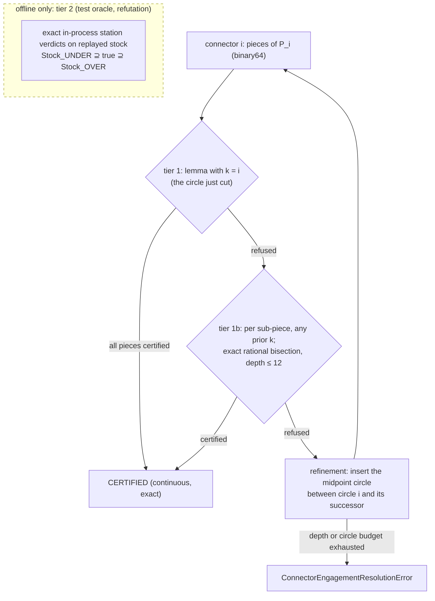

# Held connector engagement

Every Held connector can be certified against the stock actually left at that
moment. The check is exact, holds for every point of the motion (no stations),
and needs no stock replay. When connector *i* runs, the remaining stock is a
subset of Ω minus any single annulus cut before it. The tool rim minus one
annulus is at most two disjoint arcs. Their angles depend only on the distance
*d* from the tool centre to that annulus's centre, and are monotone or convex
in *d*. So the worst point of a straight connector piece is an endpoint, or one
critical distance whose test is rational. Each comparison against the cap is a
sign test on rationals built from the binary64 inputs and the cap's chord
surrogate.

The certificate is implemented as a typed, exact module,
`benchmarks/held_connector_engagement.py`: `ConnectorEngagementAssessment`
decides every connector (tier 1 with the circle just cut, else tier 1b with any
earlier circle per sub-piece), and the post-gate
`ConnectorEngagementCertificate.build` raises
`UncertifiedConnectorEngagementError`, naming every connector left without a
certificate. On the five Held workloads tier 1 alone certifies almost every
moving connector, tier 1b certifies the whole of Figure 5, seam included, and
leaves a few dozen connectors on the Figure 8 workloads
([Measurement](#measurement)). On the actual replayed stock none of those
exceeds the cap at any exact station ([Tier 2](#tier-2-on-the-actual-stock)),
but they are not proved between stations.

Design, in one line: tier 1 / 1b go into the refinement acceptance predicate
(`refine_figure5_engagement`). A refused connector is repaired the way a
refused circle pair already is, by inserting the midpoint circle. The
post-gate re-proves all N connectors, the seam included. Tiers 1 + 1b run in
well under the 0.5 s budget on every workload, Monstera included. The exact
replay of the actual stock (tier 2) is the test oracle and the refutation tool,
never part of generation.

!!! warning "Status (2026-10-21): certificate implemented, not wired."
    The module, its tests (`tests/benchmarks/test_held_connector_engagement.py`)
    and the generated tables below exist. Nothing calls the certificate from
    generation yet: wiring it into `refine_figure5_engagement` and the
    post-gate stage waits on the open questions below. Timings were recorded
    on a heavily loaded machine (load average 150–200), so they are upper
    bounds.

## What engagement means for a connector

A Held path is a sequence of full machining circles. Circle *k* has centre
cₖ and guide radius ρₖ, and its tool centre travels a full turn through the
contact qₖ on the radius-r inward offset ∂Ωᵣ. Between circles, a connector
moves the tool centre CCW along ∂Ωᵣ from qᵢ to qᵢ₊₁. It is a polyline of
binary64 points, `Figure5BoundaryTransition.samples`, and crosses offset
vertices as it goes. The seam connector runs from circles[-1] back to
circles[0] (`Figure5BoundaryConnectors`, [seam report](#reproduce)).

The **engagement** at a tool centre p is the angle of the longest connected
arc of the tool rim ∂D(p, r) that lies in the stock remaining at that instant.
This is the pipeline's per-run TEA (`engagement_at(...)[1]`, `max_run_tea`).
The total-contact cap is a separate quantity (plan Task 4.4).

The **actual remaining stock** at a point p of connector i, in emission order:

Sᵢ(p) = Ω ∖ ( ⋃₍ₖ ≤ ᵢ₎ Aₖ ∪ ⋃₍ⱼ < ᵢ₎ (Pⱼ ⊕ Dᵣ) ∪ (Pᵢ[qᵢ, p] ⊕ Dᵣ) )

where Aₖ = { x : hₖ ≤ |x − cₖ| ≤ Rₖ } is circle k's swept annulus, with
Rₖ = ρₖ + r and hₖ = max(ρₖ − r, 0). Pⱼ is connector j's polyline. The
last term is the connector's own swept prefix. Circles after i are not cut
yet. That ordering is what makes this different from the order-free coverage
union in [Held Motion Coverage](held_motion_coverage.md).

Before this page, no connector's engagement was modelled anywhere:
`ToolpathMetrics.max_engagement_deg` covers circle pairs under Held's
predecessor model, and the seam reports only the circle pair
(`seam_engagement_deg`).

## The certificate

### Lemma (single-sweep bound)

Fix any circle k cut before connector i (k ≤ i, and for the seam any k). At
every instant, Sᵢ(p) ⊆ Ω ∖ Aₖ, because stock only shrinks. So each engaged
run lies in ∂D(p, r) ∖ Aₖ. That set is two disjoint arcs, separated by the
annulus: the **outer arc**, outside the disk (cₖ, Rₖ), and the **hole arc**,
inside the open disk (cₖ, hₖ). A connected run lies in one of them. With
d = |p − cₖ|:

- Outer arc: O(d) = 2π − 2·arccos κₒ(d), where κₒ = (d² + r² − R²)/(2dr),
  clamped to [−1, 1]. Its derivative is
  dκₒ/dd = (d² − r² + R²)/(2d²r) > 0 because R > r, so O is non-decreasing
  in d.
- Hole arc (only when ρₖ > r): I(d) = 2·arccos κₕ(d), where
  κₕ = (d² + r² − h²)/(2dr). κₕ is convex in d > 0, with its minimum at
  d* = √(r² − h²) when r > h.
- Along a straight piece [a, b], d is convex. So max O is reached at a or b.
  d sweeps exactly [dₘᵢₙ, dₘₐₓ], where dₘᵢₙ is the foot-point distance, so
  max I is reached at dₘᵢₙ, at dₘₐₓ, or at d* when d* lies inside.

So the engagement over the whole piece is at most the bound evaluated at two
or three rational points. This is a continuous statement, not a station
sample.

### Exact decision

The cap enters only as `EngagementCap`'s exact chord surrogate
s = 4 sin²(θₘₐₓ/2) ∈ (0, 4], a binary64 that is injected exactly. Then
C = 1 − s/4 is cos²(θₘₐₓ/2) in surrogate semantics. That is the same API
semantic the circle-pair cap already uses
([Exact-Kernel Discipline](exactness.md#the-boundary-doctrine-for-transcendental-intent)),
so no new transcendental crosses the seam. With D = d², which is rational
because every coordinate is binary64:

| bound ≤ θₘₐₓ | rational test |
| --- | --- |
| outer arc at D | Nₒ = D + r² − R² ≤ 0 and Nₒ² ≥ 4·C·D·r² |
| hole arc at D > 0 | Nₕ = D + r² − h² ≥ 0 and Nₕ² ≥ 4·C·D·r² |
| hole arc at d* (r > h, Dₘᵢₙ < r² − h² < Dₘₐₓ) | r² − h² ≥ C·r² |
| hole arc at D = 0 | refused (no certificate; never a verdict) |

Dₘᵢₙ is the squared foot distance, rational, computed as in
`_project_to_offset_side`. There is no square root, no epsilon, no `acos` and
no float in the decision. The reported degrees (`acos`) are for humans only.

### Tiers



- **Tier 1** (k = i) is O(pieces) rational arithmetic and needs nothing beyond
  circle i and the connector polyline. The refinement loop already has both
  when it accepts a target.
- **Tier 1b** lets any circle cut before the connector (k ≤ i; every circle
  for the seam) certify a sub-piece, bisecting at exact rational midpoints.
  Candidate circles are pre-filtered in binary64 by distance. The filter only
  chooses which exact question to ask: dropping a circle can lose a
  certificate, never create one. A circle after i is never a candidate. That
  would be a false certificate, and a test pins it.
- **Tier 2** is the oracle. It is not a certificate between stations, and
  it is too slow for generation. See [Tier 2](#tier-2-on-the-actual-stock).

A refusal by tier 1 or 1b means "not proved", never "violated". The lemma
ignores Ω, every other sweep and the connector's own rear half-disk, so it is
loose. Only a tier-2 station that exceeds the cap on `Stock_OVER` is a violation.

### Evidence for the lemma

Every check is a test in `tests/benchmarks/test_held_connector_engagement.py`,
against exact in-process station verdicts (`engagement_line_prefixes`):

| check | test |
| --- | --- |
| Hypothesis: a circle tangent to a wall and a connector along its offset; on a square minus that one annulus, a certified piece has no exceeded station at 46 and at 1,000 stations, and no station's max-run reads above the reported bound | `test_1_wall_connector_certificate_has_no_exceeded_station` |
| Hypothesis: random pieces starting on or near a circle, any heading, cap 20–180°, ρ from 0.05 to 6 r | `test_1_random_piece_certificate_has_no_exceeded_station` |
| Hypothesis: whole open paths along a wall (2–5 circles, kinked non-Pythagorean connectors included); no certified connector has an exceeded station on the tier-2 `Stock_OVER` replay | `test_1_no_false_certificate_on_the_replayed_path` |
| defect injection: hole arc removed, and the outer test without its `N_O² ≥ 4·C·D·r²` half; each creates a false certificate on a fixture the oracle shows exceeded | `test_1_hole_arc_is_checked_and_its_removal_is_caught`, `test_1_loose_outer_test_is_caught` |
| fixture c = 0, ρ = 1.2, r = 1, cap 22°, piece (1.1, 0) → (0.9, 0): both endpoint hole arcs pass, d* refuses, the oracle shows exceeded stations; deleting the d* branch creates the false certificate | `test_3_interior_hole_minimum_refuses` |
| equality certifies, the next binary64 refuses, in both halves of the outer test (`≤`, no epsilon) | `test_4_equality_certifies_in_the_squared_half`, `test_4_equality_certifies_in_the_sign_half` |
| a circle cut after the connector never certifies it; allowing k > i creates the false certificate | `test_5_future_circle_never_certifies` |

The d* branch is reached only when ρ < 2r and the piece straddles d*, which
random draws almost never hit (the design-stage random sweep of 400 segments
missed it entirely). That is why test 3 is a constructed fixture, not a
property draw.

The reporting comparison "max-run ≤ bound" carries a named slack of 1e-4°,
never a decision: near an internal tangency of the rim a reported angle has
square-root-of-ulp error (a Hypothesis draw found 2.6e-6° reported against an
exact bound of 0). The exact check is the exceeded flag.

## Measurement

Generated by `tools/held_connector_engagement_survey.py`
(`pixi run held-connector-engagement`): every workload generated live, then
assessed. "Moving" excludes zero-motion fan connectors. "Tier 1b certifies"
counts, among the connectors tier 1 refuses, those tier 1b certifies. The
tier-1 bound at the refusals and the hole-arc count (connectors that pass
closer than ρᵢ to circle i's centre, with ρᵢ > r) are reporting only.

--8<-- "benchmarks/results/held_connector_engagement.md"

Every tier-1 refusal on the Figure 8 workloads is a little over the cap, and
none is refused for the hole arc. Hole arcs are where the guide circle reaches
past the offset, which fits the concave-arc gouges in
[Held Qualification](held_qualification.md). The hole arc stays under the cap
on every one of them.

### Tier 2 on the actual stock

Exact in-process station verdicts (46 per piece) on the windowed replay of the
actual stock, for every connector that tiers 1 and 1b leave without a
certificate. Both bracketing stocks are replayed: a station clear on
`Stock_UNDER` is truly clear, and only a station exceeded on `Stock_OVER` is a
violation. Generated by `tools/held_connector_engagement_tier2.py`
(`pixi run held-connector-engagement-tier2`, opt-in: it regenerates every
workload, minutes):

--8<-- "benchmarks/results/held_connector_engagement_tier2.md"

The measured/bound ratio shows how tight the lemma is on the refusals: there
the outer arc lies mostly ahead of the tool, so a forward-half refinement of
the lemma would buy little. Refinement, not a looser gate, is the right
response.

**One-off evidence: the full sequential replay.** Every connector, in emission
order, at load 100–200 (design stage, 2026-10-21, `build/` diagnostics; the
committed port is `python -m tools.held_connector_engagement_tier2 --full
WORKLOAD`, about 20 minutes per workload, JSON
`build/held-connector-engagement/<workload>.full.json`). It is not
regenerated by any task, so it is stated here as measured once, not as a
table that tracks the code. The committed port reproduced Figure 5 exactly on
2026-10-21 (same stations, maxima, seam and ratios), with 0 stations over the
cap on `Stock_OVER` as well, in 1,874 s for both stocks:

- `figure5_refined`: 1,993 connectors, 2,054 pieces (1,960 non-Pythagorean),
  94,484 stations, 0 over 80°, maximum 41.57°, seam 22.01°, station
  max-run / bound median 0.81 and maximum 1.000, replay 1,373 s.
- `figure8_crossed_skis_boundary`: 1,614 connectors, 1,711 pieces (all
  non-Pythagorean), 78,706 stations, 0 over 80°, maximum 73.82°, seam 0.65°,
  ratio median 0.86 and maximum 1.000, replay 1,113 s.

A ratio of 1.000 means the bound is attained to reporting precision: the whole
outer arc is material and lies ahead of the tool, so the lemma is sharp, not
just sound. Figure 5's tier-1 refusals read about 27–32° at stations against a
bound just over 80°, and its seam 22.01° against 194.74°: those refusals are
looseness, and tier 1b removes them. The replay times show why tier 2 stays
out of generation: 28 % circle subtraction, 43 % stations, 29 % piece
subtraction, with a final arrangement of about 5,900 vertices.

## Stock tracking

Tier 1 and 1b need **no** stock state. They use one annulus at a time, which
is a superset bound on Sᵢ(p) by construction. This is why the certificate is
cheap. It is also why it can refuse a safe connector.

Tier 2 tracks Sᵢ(p) explicitly, in emission order, with the native exact stock
(`Stock2`, Epeck plus circle–segment traits):

- circle k: the exact annulus (rational centre, squared radii from separately
  injected binary64 ρ and r), `subtract_circle_sweep_local` on `Stock_UNDER`
  and the global `subtract_circle_sweep` on `Stock_OVER`: local surgery after
  an OVER line sweep is a native defect (it raises `LocalDepletionEscapedError`
  or segfaults in `engagement_line_prefixes`; found by the Hypothesis replay
  test, reproduced in the implementation report);
- connector piece: stations first, via `engagement_line_prefixes` at the
  pipeline's 46 prefix parameters (`motion_parameters()`), then
  `subtract_line_sweep_local`. The own prefix is clipped exactly: on the
  station's rim it is the closed rear half-disk (`swept_prefix_engagement_2.h`).
- Line sweeps along a non-Pythagorean direction (almost every connector piece
  on the Held workloads) are under-covered by up to
  1e-4 r, so the replayed stock is `Stock_UNDER` ⊇ true stock. A clear station on
  `Stock_UNDER` is truly clear. To call a station exceeded, replay
  `Stock_OVER` as well (`subtract_line_sweep_over`, true ⊇ `Stock_OVER`), as
  [bracketing](exactness.md#deciding-on-a-model-that-is-only-a-bound-bracket-it)
  requires. Engagement is monotone in the stock (clip monotonicity). Test 10
  pins it: a re-traversal whose only material is the UNDER sliver exceeds a
  tiny cap on `Stock_UNDER` and is clear on `Stock_OVER`, so it is reported
  unresolved, never violated.
- **Windowing is exact.** Engagement at p reads only S ∩ D(p, r). Take a
  window disk W strictly containing every station disk of the connector. Then
  (Ω ∩ W) minus the prior sweeps that meet W equals the full replay inside W.
  Test 9 pins it on a kinked path: every windowed row equals the full
  replay's, on both stocks, bit for bit (the design-stage probe found the same
  on the first 200 Figure 5 connectors).

## Cost model and budget

Budget, set before code, per [the performance policy](performance.md#policy):

| part | budget | measured | where it runs |
| --- | ---: | --- | --- |
| tiers 1 + 1b over all connectors of one workload (Monstera: 4,366 connectors, 4,307 moving pieces) | ≤ 0.5 s (`TIERS_BUDGET_S`) | "tiers 1 + 1b s" in the [Measurement](#measurement) table | refinement acceptance and post-gate |
| circles added by connector refinement | ≤ 2 % of circles | not wired; about one insertion per refused connector expected | refinement |
| tier 2, one station | none (oracle) | 2.12 ms full stock, 1.5 ms windowed (design stage, Figure 5 prefix, load 11) | tests and opt-in tool |
| tier 2, one subtraction on the global arrangement | none (oracle) | 27.7 ms circle, 29.5 ms piece (same run) | tests and opt-in tool |

Cost model. With n connectors, m pieces and c refinement candidates:

- tier 1 is Θ(c + m) exact sign tests. The assessment puts every binary64
  input on one integer dyadic grid (mm · 2^shift, with 12 spare bits for the
  bisection) and runs the homogeneous tests on Python integers; the same
  tests on `Fraction` were about 7× slower (gcd normalisation dominated the
  profile: 1.0–1.15 s against 0.13–0.15 s on Monstera, same load ~300). A
  Hypothesis test pins that the grid decides as the rationals do
  (`test_1_integer_grid_decides_as_the_rationals_do`);
- tier 1b is (refusals) × (sub-pieces) × (nearby circles). Nearby circles come
  from a binary64 distance filter over numpy arrays; a CGAL
  `box_intersection_d` / Kd-tree index replaces the scan when it lands
  natively;
- a tier-2 full replay costs (n + m)·~30 ms + 46·m·~2 ms. On Monstera that is
  about (4,366 + 4,307)·0.03 + 46·4,307·0.002 ≈ 260 + 400 s. That is two
  orders over the whole generation budget, so it is excluded from generation
  for the same reason the [exact coverage replay](held_motion_coverage.md) was
  set aside.

## Where it plugs in, and what happens on violation

1. **Refinement acceptance.** `refine_figure5_engagement` accepts `target`
   after `predecessor` today iff the standard-model pair engagement is within
   the cap. The new rule adds one condition: the connector
   `_transition(boundary, lengths, predecessor, target)` is tier-1 or tier-1b
   certified. A refusal goes down the existing path: push target, push
   `_midpoint(predecessor, target)`, depth + 1. Figure 8 enters through
   `refine_boundary_ordered_path`, which calls the same function, so there is
   one integration point. Convergence: as the connector shortens, dₘₐₓ →
   ρᵢ and O → 0, because qᵢ is on circle i. The depth limit stays
   `max_depth`, and exhaustion raises
   `ConnectorEngagementResolutionError(connector index, bound)` (to be
   defined with the wiring; not in the module yet, since nothing raises it).
2. **Post-gate.** After `Figure5BoundaryConnectors.build`, the new stage
   `ConnectorEngagementCertificate.build(circles, connectors, tool, cap)`
   (implemented) re-proves all N connectors (N − 1 when the seam is
   `COINCIDENT`). It records, per piece, the certifying circle and the exact
   dyadic sub-piece breaks (`SubPieceCertificate`). The seam gets every circle as a prior. A connector with no
   certificate raises `UncertifiedConnectorEngagementError`. It is never
   reported and passed. This gate is what the seam needs: the seam is built
   after refinement, so no acceptance rule sees it.
3. **Seam on refusal.** Per the ruling, circles[0] is not re-cut, and the
   circle pair (circles[-1], circles[0]) stays report-only. The seam
   *connector* is gated. If it is refused, the repair is to insert midpoint
   circles between circles[-1] and circles[0] along the seam, as new last
   circles. Today no workload needs it: Figure 5's seam is certified by
   tier 1b. Whether this repair is allowed is open (below).
4. **Reporting.** `ToolpathMetrics` gains `connector_tier1`,
   `connector_tier1b` and `connector_refinements`, as counts. No angle is
   gated, because the certificate is the gate.

## Tests

`tests/benchmarks/test_held_connector_engagement.py`, written red first
(`ModuleNotFoundError`) and numbered as in the design:

1. **Lemma against the oracle (Hypothesis).** Wall-tangent connectors (46 and
   1,000 stations), random near-circle pieces, and whole kinked paths against
   the tier-2 `Stock_OVER` replay: no certified piece or connector has an
   exceeded station; the reported max-run never exceeds the reported bound.
   Defect injections (hole arc removed, loose outer test) each create a false
   certificate on a fixture the oracle shows exceeded. The integer grid
   decides as the rationals do.
2. **Far endpoint decides** on a tangent wall (Hypothesis).
3. **The interior hole minimum d\* is checked**; deleting the branch creates
   the false certificate.
4. **Equality certifies** in both halves of the outer test, the next binary64
   refuses; a chord surrogate outside (0, 4] is
   `InvalidConnectorEngagementInputError`.
5. **Future circles never certify**; allowing k > i creates the false
   certificate.
6. **Seam**: a closed path gets N verdicts and its seam is certified by
   circle 0 through tier 1b; a `COINCIDENT` seam gets N − 1; a seam kind that
   contradicts the connector count is named; a zero-motion fan connector is
   certified without a lemma query.
7. **Repair (certificate side)**: a refused connector between two circles is
   certified after midpoint-circle insertion rounds. The refinement-side
   version (refinement inserts the circle itself) waits on the wiring.
8. **Exhaustion is named** at the post-gate: `UncertifiedConnectorEngagementError`
   names the connector after `MAX_BISECTION_DEPTH`. The refinement-side
   `ConnectorEngagementResolutionError` with `max_depth=0` waits on the wiring.
9. **Windowing contract**: windowed = full replay on both stocks.
10. **Bracket**: an UNDER-band sliver is unresolved, never a violation.
11. **Workloads**: Figure 5's post-gate builds (seam by tier 1b) within
    budget; crossed skis is assessed within budget and the post-gate names
    exactly its refusals. "Every connector certified after refinement" waits
    on the wiring.

## Convex corners: an engagement floor no refinement removes

At a convex vertex V of the centre domain P with interior angle α, the
connector that first reaches V engages at least π − α of rim on the actual
stock, whatever circles were cut before. For α = 90° that is 90°, so no
refinement can bring a right-angle convex corner under a cap below 90°. When
tiers 1 / 1b refuse there, they are right. A refusal at such a corner is a
true violation, not lemma looseness, and the refinement must refuse it by name
(`ConnectorEngagementResolutionError`).

**Lemma.** Let N be the normal cone of P at V: the unit vectors e with
e·(y − V) ≤ 0 for every y ∈ P. Its angular width is π − α. Cut guide
circles (inside P, ρ > 0) and straight offset connectors in emission order,
and let connector i be the first motion that reaches V. Then the supremum of
the per-run engagement over connector i is at least π − α.

**Proof.**

1. *Only V reaches the cone rim.* For every e ∈ N and every y ∈ P with
   y ≠ V, |V + re − y|² = r² + |y − V|² − 2r·e·(y − V) ≥ r² + |y − V|² > r².
2. *Everything cut before stays away from V.* A circle inside a convex wedge
   of angle α keeps at least ρ(1/sin(α/2) − 1) > 0 from the apex. A
   connector before i ends at a contact before V, and a contact at the apex is
   refused (`_corner_radius_limit`). The earlier pieces of connector i end at
   a sample before V. There are finitely many cuts, so every earlier tool
   centre y satisfies |y − V| ≥ δ for some δ > 0. By 1,
   |V + re − y|² ≥ r² + δ² for all of them.
3. *The cone arc is uncut just before arrival.* Fix a closed sub-arc K of N's
   interior. On the last piece of connector i, take the tool centre p with
   |p − V| = η. Each rim point p + re with e ∈ K lies within η of V + re,
   so once η is small enough to keep the margin from step 2 it lies in no
   earlier disk. The piece's own prefix does not reach it either. The earlier
   centres there are p' = p − s·u, where u = (V − p)/η is the direction of
   motion. Since p − V lies in P's tangent cone, e·u ≥ 0, so
   |p + re − p'|² = r² + s² + 2rs·e·u ≥ r², with equality only at s = 0.
4. *It is stock.* p + re ∈ P ⊕ D_r ⊆ Ω, so the rim arc over K lies in the
   remaining stock and is one connected run. The engagement is at least the
   angle of K. Let K grow to N: the supremum is at least π − α. ∎

The pair model (Held's predecessor engagement) never sees this. It compares
two circles, and the corner is crossed by the connector between them. Tier 1
agrees with the lemma at the inscribed circle (radius ρ, centre
V + ρ(−1, 1) at a right angle): its bound at V is
2π − 2 arccos((ρ − 2r)/(2√2 r)), which falls to 90° as ρ → 0 and never goes
below it. Midpoint repair at a right angle shrinks the corner-limited circles
towards V until a midpoint is not representable, and the refusal is raised
then, by name. At an obtuse corner, π − α can be under the cap and repair
succeeds: the 135° octagon fixture in
`tests/benchmarks/test_held_connector_repair.py` is repaired with one
midpoint.

**Oracle evidence.** Setup:

- Ω: a polygon inscribed in P ⊕ D_r, with chord vertices on the corner arc, so
  that Ω ⊆ P ⊕ D_r.
- Stock: `Stock_OVER` on that polygon, contained in the true stock.

So every reading is a lower bound on the true engagement. Cuts: a circle at
(8, 0) with ρ = 1, then corner-limited circles at (10 − 2⁻ᵏ, 0) with
ρ = 2⁻ᵏ, with their connectors, then the final approach to V = (10, 0). With
k up to 4, 8 and 10, the maximum run on that approach peaks at 91.5°, 89.2°
and 89.5°, and stations from 7.8·10⁻³ mm down to the chord sagitta exceed
80°. `test_right_angle_corner_refusal_is_a_true_engagement_above_the_cap`
pins the k ≤ 4 case.

**Open (needs a ruling).** A right-angle convex corner under an 80° cap is
infeasible for any path of guide circles inside P with straight offset
connectors. Three options:

- refuse it by name (today's behaviour, now with its proof);
- set a corner-local cap of at least π − α;
- change the corner motion itself, for example a filleted connector that
  leaves an exactly bounded corner residual. This trades coverage for
  engagement, and the coverage certificate would have to accept it.

`test_exact_vertex_half_refines_across_the_convex_corner` (10 × 10 square,
cap 80°) asserts a successful refinement across exactly such a corner, so it
cannot pass under a sound connector gate.

## Rejected alternatives

- **Sampled stations as the gate** (the pipeline's `straight_within_cap`).
  The verdicts are exact, but there is no claim between stations
  (`GATE_SAMPLES_PER_MOTION` is "a sampling density, not a certificate"), and
  it needs the sequential replay. At about 2 ms per station it costs minutes
  on Monstera.
- **`certify_segment_tea`.** Its growth-lemma guard is falsified (plan Task
  4.3), and it measures against frozen stock.
- **`continuous_tea_2`'s exact segment oracle.** It takes about 15 s per
  segment ([cost verdict](continuous_engagement_cost.md)) and cannot certify
  straight cuts below 180° until Task 4.2's forward-semicircle mask lands.
- **Tier 2 on the refusals only, in generation.** The windowed replay costs
  0.2–2.2 s per connector (build plus stations, under load ~150), so about
  9 s for Monstera's 46 refusals. That is over budget, and it still proves
  nothing between stations.
- **The full sequential replay in generation.** It is exact, but it costs
  about 660 s on Monstera.

## Open questions

1. When the seam connector is refused, may circles be inserted on the seam
   as new last circles? circles[0] is still not re-cut. No workload needs it
   today.
2. The connectors left without a certificate (the "left" column above) are
   clear at their stations ([Tier 2](#tier-2-on-the-actual-stock)), but they
   are not proved. The design repairs them by refinement, at about one
   inserted circle each (about 1 % of Monstera's circles), and
   that changes the generated paths and the baseline counts. Is that change
   approved? The alternative is to accept "station-clear" as the verdict for
   these connectors, which is the pipeline's own sampled standard
   (`GATE_SAMPLES_PER_MOTION`).
3. The certified quantity is per-run engagement. Should the post-gate also
   bound total contact? The lemma bounds it by outer + hole arc at no extra
   cost.
4. Circles are still checked only under Held's predecessor model, not against
   actual stock. The same lemma applies to a circle's own motion. Is that in
   scope next?

## Reproduce

From the worktree root:

```bash
pixi run held-connector-engagement        # tiers 1 + 1b on all five workloads -> benchmarks/results/held_connector_engagement.{json,md}
pixi run held-connector-engagement-tier2  # opt-in, minutes: tier 2 on the uncertified connectors -> benchmarks/results/held_connector_engagement_tier2.{json,md}
pixi run held-connector-engagement-tier2 --full figure5_refined   # one-off, about 20 min: the full sequential replay
pixi run pytest tests/benchmarks/test_held_connector_engagement.py -n auto
```

Seam background: `.superpowers/sdd/2026-10-13-product-pipeline/seam-connector-report.md`
and `seam-consumers-report.md`.
