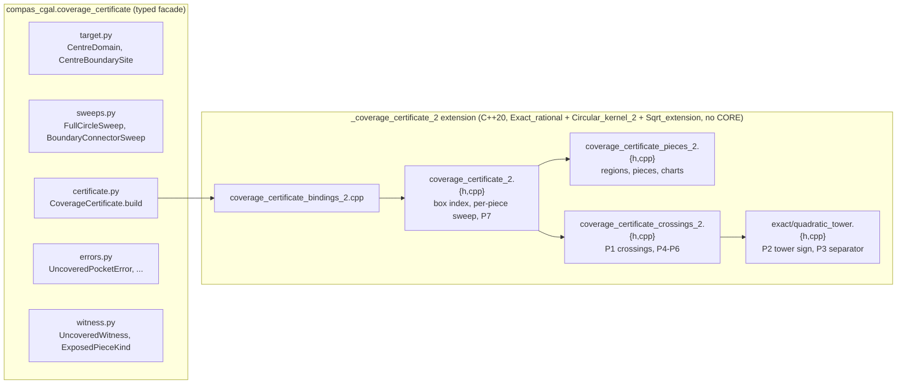

# Held coverage certificate

!!! note "The certificate decides both ways, on the polygonal target and on the exact target T(Ω\*)"
    Cut circles, connector capsules and the target are all cut into the
    arrangement (CORE-free extension `_coverage_certificate_2`, typed facade
    `compas_cgal.coverage_certificate`). `CoverageCertificate.build` returns a
    certificate when T is covered and raises `UncoveredPocketError` with exact
    witnesses otherwise.

    - **Polygonal target.** On the generated Held paths, Figure 5, crossed skis
      and upper boundary are certified covered. Monstera is proven uncovered at
      two slivers, and its certified repair is certified covered
      ([Acceptance on the generated paths](#acceptance-on-the-generated-paths)).
    - **Exact target T = Ω\* ⊕ D_r** (`exact_target=`). Its declared boundary
      and its one-root vertex circles cut every swept piece, so
      `UnmodelledCertificatePieceError` is never raised for it. The current
      Monstera path is proven uncovered against T(Ω\*) at 119 clusters. Besides A
      and B these are convex-arc chord slivers and sub-ulp hairlines along the
      walls, which no binary64 path can avoid. The run takes 8.4 s at load 25, over
      the 5 s budget ([The exact target Ω\*](#the-exact-target)).
    - **Still open.** Exact connectors along ∂Ω\* (arc connectors). A connector
      lying exactly on a declared boundary support or a vertex circle raises the
      named `CoincidentTargetSupportError`; it is not modelled yet.

!!! note "Review findings C1 and I1 are fixed (2026-10-21): every exact search loop fails loud"
    - **C1.** The start-witness search is bounded by its theorem bound,
      1 + 2·(2·|counted| + |target circles| + |vertex circles| + |lines|).
      A breach raises `StartWitnessSearchError`.
    - **I1a.** Every exact sign rule (one-root, tower, tower-plus,
      rational two-radical, K-root) is checked against its certified interval
      enclosure whenever that enclosure excludes 0. A wrong rule raises
      `SignRuleContractError` at its first well-separated comparison. The
      phase-2 injection (dominant-magnitude branch swapped) failed the suite in
      2.8–4.9 s, where it used to stall to the 300 s timeout.
    - **I1b.** The 2^16 step limits are gone. P3 chart bisection, cross-base
      separation, line-event separation and the circle witness search are each
      bounded by a root-separation bound computed from their operands' bit
      sizes ([Contract bounds](#contract-bounds)). A breach raises
      `SeparationBoundExceededError`.

The certificate decides exactly whether the union of a toolpath's swept regions
covers its machinable target. It does this with no global boolean and no growing
residual. It checks every boundary piece of every swept region, and every piece
of the target boundary, against the few regions that can touch it. The theorem
below shows that coverage holds exactly when no checked piece is exposed. The
work is near-linear in path size, and every decision is an exact predicate. A
failure raises `UncoveredPocketError`. The error carries exact rational witness
points inside each uncovered region.

Why it is needed: the generated Monstera path leaves two real interior slivers
uncut, A and B; their positions and areas are in the
[diagnostic raster](#the-monstera-evidence). Nothing on the critical path
noticed. The only exact check is the
full-motion replay of [Held motion coverage](held_motion_coverage.md), and it was
set aside on 2026-09-08 because it does not finish at real size.

## The decision being made

Notation:

- Tool radius: r > 0, a binary64 value injected exactly as a rational.
- Centre domain Ω: the polygon (with holes) the tool centre is declared to stay
  in. For the Held lane this is `figure7_inward_offset(case).components`, the
  same loop the connectors follow. Its vertices are binary64, so they are
  exact rationals.
- **Machinable target**: T = Ω ⊕ D_r, the material that a radius-r disk centred
  in Ω can reach. This is Held and Pfeiffer's machinable pocket (§2.1) for
  the declared centre domain. Pocket tips that no such disk can reach are not
  in T by definition. This is why the raster's boundary-touching crumbs at
  lobe tips are not failures.
- Swept regions S_1 … S_n, all compact and regular-closed:
    - A **full-circle cut** with path radius R about centre c sweeps the annulus
      `max(R − r, 0) ≤ |x − c| ≤ R + r`. When R ≤ r this is a solid disk.
    - A **connector** is a CCW interval of ∂Ω between two exact boundary sites.
      It sweeps (polyline) ⊕ D_r, which is one capsule per straight piece:
      `dist(x, [p, q]) ≤ r`.

The certificate decides **T ⊆ U, where U = S_1 ∪ … ∪ S_n**.

## Theorem

Write T as a finite union of simple members: T = Ω ∪ ⋃_k Cap(e_k), where Cap(e_k)
is the capsule of polygon edge e_k (hole edges included). Every member and every
S_i is regular-closed, and its boundary is a finite union of circle arcs and
segments. Let 𝒜 be the arrangement of all these boundary curves. Cut each
boundary curve at every point where it meets another boundary curve, including
tangencies. The resulting open pieces are the **edges**. An edge e on ∂X has X
on exactly one side (regular closedness), called its *inner side*. The other
side is its *outer side*.

For a region family 𝒴 and edge e, say **𝒴 covers side σ of e** when some Y ∈ 𝒴
satisfies either

1. e ⊂ int Y, or
2. e ⊂ ∂Y and Y lies on side σ of e (a coincident support).

Because e is an arrangement edge, membership in Y is constant along e. So
"e ⊂ int Y, e ⊂ ∂Y, or e ⊂ ext Y" is a clean trichotomy, decided at one
witness point.

**Theorem.** T ⊆ U if and only if no edge is *exposed*. An edge is exposed in
either of two cases:

- **(sweep edge)** e ⊂ ∂S_i, the targets {Ω, Cap(e_k)} cover the outer side of e,
  and the sweeps {S_j : j ≠ i} do not.
- **(target edge)** e ⊂ ∂X for a target member X, no other target member covers
  the outer side of e (so e is on ∂T), and no sweep covers the inner side of e.

*Proof sketch.* Faces of 𝒜 are open and have constant membership in every
region, so a face lies in T if and only if it lies in int T. Let W be the
union of the faces in T that no sweep contains. If T ⊄ U, then T \ U is
non-empty. Because T = cl int T and U is closed, (int T) \ U is then a
non-empty open set, so it contains a face, and W ≠ ∅. W is bounded because T
is compact. The boundary of a non-empty bounded open set is uncountable, and 𝒜
has finitely many vertices, so ∂W contains an edge e. On one side of e is a face
f ⊆ W. On the other side is a face f′ ⊄ W. There are two cases.

- **f′ ⊄ T.** Then e ⊂ ∂T, so e lies on the boundary of a target member X
  that contains f. No other target member covers the f′ side, and no sweep
  covers the f side because f ⊆ W. So e is an exposed target edge.
- **f′ ⊆ T, so f′ ⊆ U.** Some sweep contains f′ but not f, so e lies on its
  boundary ∂S_i, and its outer side is towards f. The target member containing f
  covers that side. No sweep covers it, because f ⊆ W. So e is an exposed sweep
  edge.

Conversely, an exposed edge has, on its exposed side, a face that lies in T and
in no sweep. So T ⊄ U. ∎

Consequences that the design relies on:

- **Holes are not special.** Hole edges of Ω are edges like any other, and their
  capsules are target members. The inner hole of an annulus is bounded by an
  inner circle whose outer side points towards the centre, and that side must be
  covered by neighbours. A pocket with holes and an annulus with a hole go
  through the same code path.
- **The pocket boundary is not special.** ∂T edges are checked by the
  target-edge rule. A gap that touches the pocket boundary is reported as an
  exposed `TARGET_BOUNDARY` edge (test (c)).
- **No single-point test is needed.** A separate point test is usually needed
  for a region with no sweep boundary inside it. Here ∂T is never empty, so even
  when T lies inside one large sweep, its target edges are checked against that
  sweep. If T lay entirely outside U, the target edges would be exposed.
- **∂T is never constructed.** A target edge is on ∂T exactly when no other
  target member covers its outer side, and that is the same local predicate
  again. There is no offset construction and no union of capsules. Narrow necks
  where far-apart edge capsules overlap are handled by locality.
- **Isolated points do not matter.** Tangencies and three-circle points are
  arrangement vertices, not edges. An uncovered set is open, so it always
  borders an edge of positive length.

## Exactness: what the pieces are and how they are compared

Every input double enters exact-land once, through `compas_cgal::exact::from_binary64`.
A sum such as R + r is formed exactly from the injected rationals. It is never
rounded in doubles.

### Piece types and their charts

Each boundary piece is parameterised by its own chart. A chart is chosen so that
**witness points can be rational** and **crossing parameters are in a small
quadratic tower**.

| piece | from | support | chart | witness points |
|---|---|---|---|---|
| `ANNULUS_OUTER`, `ANNULUS_INNER`, `DISK` | full-circle cut | circle, rational centre, rational radius R ± r | stereographic s ∈ ℚ ∪ {∞}: `x = c + ρ((1−s²), 2s)/(1+s²)` | rational: every rational s gives a rational point |
| `CAPSULE_CAP` | connector piece [p, q] | circle (p, r), restricted to the half-plane `(q−p)·(x−p) ≤ 0` | stereographic, restricted to one interval | rational |
| `CAPSULE_FLANK` | connector piece [p, q] | line `(q−p)^⊥·(x−p) = ±r·√L`, L = \|q−p\|² | t ∈ [0, 1]: `x = p + t(q−p) ± r(q−p)^⊥/√L` | in ℚ(√L)², a one-root point (`OneRoot`) |
| `TARGET_*` (polygon edge, edge cap, edge flank) | Ω and Cap(e_k) | same three shapes | same charts | same |

A flank line has an irrational offset, r·√L. This is why it cannot be a
`Gps_circle_segment_traits_2` segment, whose supporting line needs rational
coefficients. It is also the root of the 16 ms tangent-rectangle identity in the
replay. The certificate never builds the rectangle. A capsule is **one region**,
`dist(x, [p, q]) ≤ r`. Its flank is a chart whose points carry one root, √L.
Connectors are exact sub-intervals of Ω's edges, because sites are
`(segment, Fraction parameter)` points. A connector flank and the target flank
of the same edge are therefore **the same line exactly**. Coincidence is decided
by the exact `sign_mixed_radical` (the ratio of the two √L is a rational
square), and side analysis does the rest. The replay needed a tangency
certificate over a square root here. The certificate needs an equality.

### Predicate list

All of these are exact. Each is filtered first: `Interval_nt` evaluates it on the
exact double inputs, and the exact path runs only when the interval contains
zero. This is CGAL's filtered-predicate idiom. It is not a tolerance, because the
interval is a certified enclosure.

1. **P1 (crossing parameters).** These are the parameters on piece e where ∂Y
   meets e, as exact algebraic numbers with multiplicity.
    - Circle–circle: a quadratic in s with rational coefficients, so s ∈ ℚ(√Δ),
      a `OneRoot`.
    - Circle–flank, and flank–circle on the flank chart: substitution gives a
      quadratic whose coefficients lie in ℚ(√L). The parameter is in ℚ(√L)(√D),
      with D ∈ ℚ(√L), a depth-2 tower.
    - Flank–flank: a linear system with entries in ℚ(√L₁, √L₂), so t is
      biquadratic.
    - Tangency (Δ = 0 or D = 0) is detected exactly and produces a double root.
      It cuts the piece but toggles no membership.
2. **P2 (order).** Compares two crossing parameters on one piece:
   `sign(a − b)` with a and b in (possibly different) towers. Both are lifted
   into the compositum tower, and the sign is decided with the documented
   mixed-radical rule. `u + w√δ` is decided as sign(u), sign(w), compare(u², δw²),
   recursively, at most three levels deep. Depth 1 is the existing
   `exact::sign_mixed_radical`. Deeper levels apply the same rule to
   `Sqrt_extension` coefficients. Cross-root arithmetic is never formed (see
   `CrossRootExtensionError`): only squares of radicands, which are lower-level
   elements, appear.
3. **P3 (rational separator).** Finds a rational strictly between two
   *strictly* ordered algebraic parameters (strictness decided by P2). It
   refines the interval enclosures and checks each candidate with P2. This
   terminates because the gap is positive. No epsilon is involved: the candidate
   is accepted by an exact comparison.
4. **P4 (membership).** Decides whether the witness w is in int Y, on ∂Y, or in
   ext Y.
    - Annulus or disk: compare |w−c|² with (R−r)² and (R+r)². This is rational
      for circle witnesses and a `OneRoot` sign for flank witnesses.
    - Capsule: the projection parameter is clamped by exact compares, then
      |w−foot|² is compared with r².
    - Ω: orientation tests against the polygon edges (winding number).
5. **P5 (coincident support).** When P4 returns "on ∂Y", P1 guarantees that e
   and that piece of ∂Y share a support. This is checked exactly, never assumed.
    - Circles coincide when centre and radius² are equal (rational).
    - Flanks coincide when the normals are parallel (rational cross product = 0)
      and the offsets are equal (`sign_mixed_radical` = 0).
6. **P6 (side).** For a coincident support, decides which side of e region Y
   lies on. For a circle it is the inside for an outer boundary or disk and the
   outside for an inner boundary. For a flank it is the half-plane towards the
   capsule axis. Comparing that side with e's outer side is a sign comparison of
   normal orientations, which is rational.
7. **P7 (uncovered point).** On an exposed edge with rational witness w and
   rational outward normal n, it searches h = 2⁻ᵏ until `w + h·n` is
   exactly in T and exactly outside every neighbour sweep (P4). This terminates
   because the uncovered face is open and touches e. Flank witnesses are first
   replaced by a rational point on the outer side, found with P3 on each
   coordinate. The point is an exact `Fraction` pair, so tests re-check it
   independently.

### Per-piece algorithm

For each boundary piece e of each region X:

1. Find candidate neighbours: every region whose bounding box overlaps e's
   bounding box. Boxes are rounded outward (`to_interval` of the exact extents),
   so the candidate set is a superset. This is a filter, not a decision. Use
   `CGAL::box_intersection_d` over all regions once.
2. For each neighbour Y, compute its crossing parameters on e (P1). Each Y
   contributes ≤ 4 of them for a circle or ≤ 8 for a capsule. Between Y's own
   consecutive crossings, find Y's membership at one witness (P3 + P4). This
   turns Y into a sorted list of intervals of e on which "Y covers the outer side"
   (or "covers the inner side") holds, with P5/P6 for coincident pieces.
3. Merge all neighbours' interval endpoints in one sort (P2) and sweep with a
   cover counter. A target-member counter and a sweep counter are kept
   separately, because the two exposure rules need both.
4. Wherever the counters satisfy an exposure rule on an open sub-interval, take
   a witness (P3), confirm it directly with P4 against all neighbours (the
   counters are bookkeeping; the confirmation is the decision), and record an
   `UncoveredWitness` (P7).

The certificate passes when every piece reports nothing. Otherwise it raises one
`UncoveredPocketError` listing every exposed edge.

## Cost model

Let N be the number of regions and k the number of bounding-box neighbours of
a piece.

- Per piece: O(k) crossings, O(k) witness memberships and one sort of O(k)
  endpoints, so O(k log k).
- Total: O(N k log k), embarrassingly parallel over pieces. There is no shared
  mutable state and no residual.
- Measured inputs for Monstera (reporting only). Generator:
  `tools/coverage_certificate_cost_model.py`; regenerate with
  `pixi run coverage-certificate-cost-model`.

--8<-- "benchmarks/results/coverage_certificate_cost_model.md"

- **Estimate (to be measured, not a claim).** Each pair costs a few P1 crossings
  and P2 compares on the interval filter, around 1–5 µs, so roughly 1–6 s on
  one core and under 1 s in parallel. The exact fallback runs only where the
  filter cannot decide: shared supports, tangencies and fan circles through one
  contact. Its cost has to be measured, because it is the term that the
  replay's CORE path made dominant.
- **The replay, for comparison** ([measured](held_motion_coverage.md)): Figure 5
  draft, 2,013 circles and 2,202 connector segments. 400 circles took 5.4 s and
  800 took 10.0 s. 1,200 were not done after 4 min, and the whole draft was not
  done after 18 min. The connector tangent-rectangle identity alone costs 16 ms
  per capsule, so over a minute for the connector pieces in the table above
  before any union work.
  The replay's cost is quadratic in path length: each sweep is differenced
  against a residual that grows. The certificate's cost is linear in path length
  times local density.

Proposed gate at design time, recorded with `generation_s` in the toolpath
benchmark: the Monstera certificate takes ≤ 30 s on one core. The 2026-10-17
ruling tightened it to ≤ 5 s (see [Implementation status](#implementation-status)).

## Where it lives

The exact core is C++, and Python only orchestrates it.



- **Number types.** The certificate uses `compas_cgal::exact::Rational` (Epeck FT)
  and `OneRoot`, plus a new `exact/quadratic_tower.h` for depth ≥ 2, which is a
  generalisation of the existing `sign_mixed_radical`. It does **not** use
  `ReachKernel` (`Epeck_with_sqrt`, CORE). Every quantity is built from
  rational inputs and an explicit radical, so CORE's expression DAG is never
  needed. Avoiding it is the point. CORE stalls on identically-zero decisions,
  and coincident flanks are exactly such a decision. Here they are decided by
  exact rational coefficient comparisons, never by DAG evaluation.
- **Why `_coverage_certificate_2` (user ruling 2026-10-17).** The certificate
  lives in its own extension so that it never links CORE: the CMake target
  links no exact-core library and does not define `CGAL_USE_CORE`. Its number
  types are `CGAL::Exact_rational` (boost `cpp_rational` under the project's
  no-GMP build), `Circular_kernel_2` over it for circle-circle events, and
  `Sqrt_extension` for one-root values. The files are under
  `src/coverage_certificate_2/` (see [Implementation status](#implementation-status)).
- **One responsibility per file.** Pieces/charts, crossings and predicates, the
  tower number type, and the driver are separate files. The Python facade holds
  no geometry. It validates types, builds the native request once and maps
  native exceptions to the named Python ones.

## API

```python
from fractions import Fraction
from compas_cgal.coverage_certificate.certificate import CoverageCertificate
from compas_cgal.coverage_certificate.errors import UncoveredPocketError
from compas_cgal.coverage_certificate.sweeps import BoundaryConnectorSweep, FullCircleSweep
from compas_cgal.coverage_certificate.target import CentreBoundarySite, CentreDomain
from compas_cgal.coverage_certificate.witness import ExposedPieceKind
from compas_cgal.units import GuideRadius, Point2, ToolRadius, WorldXY

domain = CentreDomain.build(outer: Sequence[Point2[WorldXY]], holes: Sequence[Sequence[Point2[WorldXY]]] = ())
cut = FullCircleSweep.build(centre: Point2[WorldXY], path_radius: GuideRadius)
site = CentreBoundarySite.build(loop: int, segment: int, parameter: Fraction)
connector = BoundaryConnectorSweep.build(domain, start: CentreBoundarySite, end: CentreBoundarySite)  # CCW along the loop
certificate = CoverageCertificate.build(domain, tool_radius: ToolRadius, full_circles, connectors)
```

- `CentreDomain.build` checks the polygon invariants (simple loops, outer CCW,
  holes CW, holes strictly inside, no zero-length edges). These are exact
  orientation and intersection predicates. Failures raise
  `InvalidCentreDomainError`.
- `CentreBoundarySite.build` checks `0 ≤ parameter < 1` and that the indices
  exist (`InvalidCentreBoundarySiteError`). The site is exact: vertex
  `v_s + parameter·(v_{s+1} − v_s)` is rational.
- `BoundaryConnectorSweep.build` rejects zero CCW progress
  (`DegenerateConnectorError`). The caller drops stationary fan connectors,
  because they sweep only disk(q, r), which lies inside the cut that starts at q.
  Dropping a region can only make the certificate stricter, never falsely pass.
- `CoverageCertificate.build` returns a `CoverageCertificate` and never returns
  partial success. Its reporting fields are `region_count`, `piece_count`,
  `edge_count`, `exposed_edge_count == 0`, `exact_fallback_count` and
  `elapsed_s`. Otherwise it raises `UncoveredPocketError(witnesses)`.
- `UncoveredWitness` has these fields:
    - `piece_kind: ExposedPieceKind`, one of `ANNULUS_OUTER`, `ANNULUS_INNER`,
      `DISK`, `CAPSULE_CAP`, `CAPSULE_FLANK` or `TARGET_BOUNDARY`.
    - `region_index: int`, which indexes `full_circles`, then `connectors`, then
      target members.
    - `uncovered_point: tuple[Fraction, Fraction]`, an exact point in T \ U,
      decided by P7.
    - `uncovered_point_mm: tuple[float, float]`, its rounding, for reporting only.
- Error model (one exception per failure mode):
    - `InvalidCentreDomainError`
    - `InvalidCentreBoundarySiteError`
    - `DegenerateConnectorError`
    - `UncoveredPocketError`
    - `CoverageCertificateNativeError` for an internal contract breach, such as a
      P5 coincidence that P1 did not predict. It is raised, never swallowed.

## Replacing the opt-in replay on the critical path

- `benchmarks/tools/held_reference_toolpaths.py` and
  `benchmarks/tools/held_toolpath_progress.py` build the certificate
  **unconditionally**, right after `transitions` are formed. They do it before
  any figure is written.
- On `UncoveredPocketError` the generator writes a diagnostic figure: the
  published axes, with the exposed edges and uncovered points overlaid. It then
  exits non-zero. No figure is published as if it were certified.
- The `--check-coverage` flag and `require_full_motion_coverage` stay as an
  opt-in second oracle. Two independent exact methods should agree on small
  fixtures: the L-shape and the synthetic triangle, where the replay finishes in
  seconds. A differential test there is the next contract test after the
  implementation is green. Removing the replay is a separate decision for the
  user.
- The toolpath benchmark (`held_toolpath_benchmark`) records
  `certificate_s`, `exposed_edge_count` and `exact_fallback_count` next to
  `generation_s`. Coverage then becomes a gate column, so it no longer has to be
  remembered.

## The Monstera evidence

A diagnostic raster of the generated Monstera path sizes what the certificate
proves uncovered. It is reporting only, not a certificate. The uncut area is a
few hundredths of a percent of the pocket. Exactly two components are interior
slivers: A and B, the two largest. Each is a curvilinear triangle between three
large circles (the bordering cuts column). Every other component is a crumb at a
pocket tip, which lies outside T = Ω ⊕ D_r. The method was first used in
`.superpowers/sdd/2026-10-13-product-pipeline/held-monstera-uncut-report.md`
(2026-10-17, not published). Generator: `tools/coverage_certificate_raster.py`;
regenerate with `pixi run coverage-certificate-raster`.

--8<-- "benchmarks/results/coverage_certificate_raster.md"

The slow acceptance test requires that the certificate rejects the published path
with witnesses within 0.5 mm of A and B.

## Contract tests

| test | fixture | expectation |
|---|---|---|
| `test_three_annulus_gap_raises_with_exact_witnesses_inside_the_gap` | triangle Ω (0,0),(8,0),(4,7), r = 1; reach-17/4 stacks at the vertices | `UncoveredPocketError`; every witness exactly in T and outside every cut, near the circumcentre (4, 33/14) |
| `test_fourth_cut_closes_the_gap_and_the_certificate_holds` | + cut R = 3/4 at (4, 19/8) | passes, `exposed_edge_count == 0` |
| `test_gap_on_the_target_boundary_is_reported_as_an_exposed_target_edge` | stack at (8,0) shrunk to reach 31/8 | `UncoveredPocketError` with a `TARGET_BOUNDARY` witness on flank y = −1, x ∈ (4.1307, 4.2563) |
| `test_boundary_connector_closes_the_target_edge_gap_on_a_coincident_flank` | + connector along edge 0, parameters 1/4 → 3/4 | passes; the connector flank coincides exactly with the target flank |
| `test_published_monstera_path_is_rejected_with_witnesses_at_both_slivers` (slow tier) | regenerated Monstera path | witnesses within 0.5 mm of A and B |

The fixtures use only dyadic coordinates, so their expected outcomes are exact.
They were sanity-checked with a 0.004 mm raster
(`build/coverage_certificate_design/fixture_raster.py`, reporting only). The
uncovered components it found were one interior gap for (a), none for (b), one
flank-touching gap for (c) and none for the connector case.

## Implementation status

### Rulings this phase implements (2026-10-17)

- The certificate lives in the new CORE-free extension `_coverage_certificate_2`.
- The target is T = Ω\* ⊕ D_r, the erosion-based domain of
  [Held exact centre domain](held_exact_centre_domain.md). Its convex vertices are
  one-root points, so the target gains a **`VERTEX_DISK`** member, D_r(w) with w
  in ℚ(√δ)². It is in the data model from the start (`VertexDisk` in
  `target.py`, `VertexDisk` in `target_2.h`), and its membership is decided
  exactly (sign of A + B√δ, with δ = 0 and B = 0 folded away first).
- The budget is ≤ 5 s on one core for Monstera.
- There is no `AmbiguousBranchError`. The spike aborted when the two certified
  branch boxes of a near-tangent pair overlapped. Here the branch labels are
  always decided by an exact rational matcher: p₊ − p₋ = 2s·(−d_y, d_x) with
  s > 0. So when d_y ≠ 0, p₊ is the point with the smaller x iff d_y > 0. When
  d_y = 0, p₊ is the point with the larger y iff d_x > 0. One exact coordinate
  comparison and two rational signs decide it. The boxes are then only checked
  to contain their exact point. That check is a contract on the filter, and a
  breach raises.

### Phase 1: the circle-circle core

| file (`src/coverage_certificate_2/`) | responsibility |
|---|---|
| `kernel_2.{h,cpp}` | number types, the single binary64 door, rational wire text |
| `regions_2.{h,cpp}` | full-circle regions, boundary circles, P4 for cuts, stereographic chart |
| `target_2.{h,cpp}` | Ω validation, the target members (POLYGON, EDGE_CAPSULE, VERTEX_DISK), exact membership |
| `lazy_crossings_2.{h,cpp}` | box candidates, P1 behind the interval front, exact branch matcher, P2 comparisons |
| `circle_sweep_2.{h,cpp}` | CCW order, vertices, start state, cover counters, P5/P6 for coincident circles |
| `witness_2.{h,cpp}` | P3 witness (exact bisection when the double seed is rejected), P4 confirmation, P7 uncovered point, audit oracle |
| `certificate_2.{h,cpp}` | driver |
| `bindings_2.cpp` | nanobind module |

The Python facade in `src/compas_cgal/coverage_certificate/` follows the
[API](#api), with three additions:

- `circle_core.run_circle_core(..., filter_mode, audit)` exposes the core and
  its reporting counters.
- `VertexDisk` / `OneRootMillimetre` carry the one-root target members.
- `UnmodelledCertificatePieceError` is raised whenever the decision needs a
  piece that phase 2 adds.

What phase 1 decides:

- **Non-coverage, proven.** An exposed sweep edge has an exact uncovered point
  beside it (P7) that lies exactly outside every swept region. If that point is
  also exactly in T, then T ⊄ U is proven, and `UncoveredPocketError` carries the
  point. The error also reports `undecided_edge_count`.
- **Coverage, not yet.** An exposed edge whose uncovered point lies outside T
  can still cross ∂T. Only cutting the target pieces into the arrangement can
  certify it: polygon edges, capsule caps and flanks, vertex-disk circles, and
  the target-edge rule. So phase 1 never returns a `CoverageCertificate`.

Phase 2 extension points, named in the headers:

- `CircleRegionSet` gains capsule regions.
- `CrossingTable` gains circle–flank and flank–flank events on the quadratic tower.
- Each target member gains a piece list, swept by the same per-piece cover counter.

### Contract tests and results

| test | status | why |
|---|---|---|
| `test_three_annulus_gap_raises_with_exact_witnesses_inside_the_gap` | green | the gap arcs are interior to T, so their uncovered points prove the gap |
| `test_fourth_cut_closes_the_gap_and_the_certificate_holds` | green (phase 2) | certifying needs the target edges: the 3 envelope edges cross ∂T and cannot be decided without them |
| `test_gap_on_the_target_boundary_is_reported_as_an_exposed_target_edge` | green (phase 2) | the flank gap is bounded by two long arcs that leave T. Finding it needs the flank y = −1 cut into those arcs and a `TARGET_BOUNDARY` edge |
| `test_boundary_connector_closes_the_target_edge_gap_on_a_coincident_flank` | green (phase 2) | connector capsules are phase 2 |
| `tests/test_coverage_certificate_circle_core.py` (12 tests) | green | lazy front contract, oracles, VERTEX_DISK, validation |

The lazy-front contract (`tests/test_coverage_certificate_circle_core.py`):

- **Forced `EXACT_ONLY` mode is byte-identical to `LAZY`** on the spike's
  degenerate integer grid (default tier). On the 4367 Monstera circles
  (`benchmarks/acceptance/test_coverage_certificate_monstera_exact_slow.py`) and
  on the full Monstera path, connectors and target included
  (`benchmarks/acceptance/test_coverage_certificate_monstera_path_slow.py`), the
  identity is checked in the slow tier (`pixi run coverage-certificate-gate`).
  The default tier keeps the LAZY spike counts
  (`test_monstera_circles_match_the_spike_counts`). Byte-identical covers every
  exposed edge, its vertices and its exact witnesses. On the grid that includes
  330 tangencies, coincident circles and start-witness retries.
  Witness proposals are seeded from the exact endpoints, never from the filter
  boxes, so the output cannot depend on the mode.
- **Audit oracle.** `audit=True` re-witnesses every edge the counters call
  covered, by pure exact membership, independently of the counters.
    - Grid, generic doubles and near-tangent fixtures: in the test suite.
    - Monstera: every sub-arc agrees with the counters (the audit row of
      [Monstera, circles only](#monstera-circles-only); one generator run, not a
      test).
- **Generic doubles.** 80 random circles: every witness is re-checked with
  `Fraction` arithmetic in the test, and the filter decides every pair.
- **Near-tangent pair.** Two unit disks at height 2⁴⁰, with centres 2 − 2⁻²⁶
  apart. The interval discriminant certifies two crossings, but the branch boxes
  overlap. The exact matcher labels them (`exact_branch_matches ≥ 1`).
- **Defect injection.** Dropping the start-state rollback turns the grid test
  red.

### Monstera, circles only

The circle-circle core alone on the spike's frozen 4367 Monstera circles. The
sub-arc and exposed-edge counts are the spike's independent counts, pinned by
`test_monstera_circles_match_the_spike_counts`. Of the proven uncovered points
in T, the ones farther than r from ∂Ω lie at slivers A and B; the others lie
within r of ∂Ω, where connectors cut and this core does not model them.
Generator: `tools/coverage_certificate_circle_core.py`; regenerate with
`pixi run coverage-certificate-circle-core`.

--8<-- "benchmarks/results/coverage_certificate_circle_core.md"

The target phase is phase-1 scaffolding: a linear scan over the Ω edges. In
phase 2 the target pieces enter the box index like every other piece, and the
scan goes away. Times for the full certificate are in the
[acceptance table](#acceptance-on-the-generated-paths).

### Phase 2: capsules and target pieces

**Decomposition.** A capsule dist(x, [p, q]) <= r enters as three regions: the
end disks D_r(p), D_r(q) (ordinary circle regions, `CAPSULE_CAP`) and the
rectangle {0 <= tau <= 1, |n.(x - p)| <= r sqrt(L)}, the intersection of four
closed half-planes. The theorem holds for any finite family of regular-closed
regions, so nothing else changes. A rectangle's membership along a piece is the
conjunction of four side bits that flip exactly at transversal crossings of the
UNRESTRICTED lines, so flank/cap junctions need no conventions. The target is
T = Omega u (edge rectangles) u (vertex disks D_r(v)).

**Exact union of connectors.** Every connector piece lies on a domain edge. The
union of capsules on one edge whose parameter intervals overlap or abut is the
capsule of the union interval, exactly, so connector pieces merge per edge into
maximal intervals (per-workload counts: the `connectors` and `connector regions`
columns of the [acceptance table](#acceptance-on-the-generated-paths)). U is
unchanged; a witness on a merged piece reports the lowest contributing connector.

**Shared supports.** All flanks along one edge, connector and target, are the
same line object (`LineTable`), so a connector flank coinciding with the target
flank is recognised by identity; `line_coincidence` decides the remaining cases
exactly. A coincident rectangle line counts as satisfied when the rectangle lies
on the piece's checked side, and excludes the rectangle otherwise (P5/P6).

**Pieces checked.** Swept circles (cuts, caps) and connector flanks are exposed
when no other sweep covers their outer side and that side is in T. They are cut
at the target supports (target flank lines, vertex circles), so T-membership is
constant along each edge and is decided at the edge witness
(`target_decision_2`). Target flanks and vertex circles are exposed when no
sweep covers their member side. Such an exposure is a genuine uncovered point
even off dT, so no target-target arrangement is needed, and every dT piece is
among them. Rectangle end segments are never exposed: away from their corners
they lie in the interior of an end disk.

**Exactness.** Flank lines are n.x = k0 + k1 sqrt(L), folded to rational when L
is a rational square. Circle-flank crossings are towers m +/- n sqrt(d) over
Q(sqrt(L)); flank-flank crossings add sqrt(L'). Every comparison on one piece is
sign(t + u sqrt(e)) with t a tower, decided by the mixed-radical rule with
same-root `Sqrt_extension` calls (`tower_2`). Circle-circle crossings use the
rational-base tower c_A + (q/2D)d +/- (sqrt(disc)/2D)perp(d), compared over the
integers after one positive common scaling: no Circular_kernel_2 construction
and no rational normalisation on the hot path. Two line events over two
different irrational bases on one circle are compared by provenance (is X1 on
line 2, and on its branch) and separated by exact rational bisection.

**Cost.** Measured per workload in the
[acceptance table](#acceptance-on-the-generated-paths). Held fans make many
annuli near-tangent to one cap at one point, so a large share of comparisons
falls to the exact back end. They are legitimate near-degeneracies, made cheap
rather than avoided.

### Acceptance on the generated paths

Figure 5, crossed skis and upper boundary are certified covered. The Monstera
path is proven uncovered: its exact witnesses form two clusters, sliver A and
sliver B, and nothing else. Select-certify-repair re-inserts the dropped source
circles, and the repaired Monstera path is certified covered. Every path is
regenerated by `benchmarks.held_toolpath_benchmark.generate`, closing seam
connector included, so the open-seam witnesses of the earlier npz dumps are
gone. No edge is left undecided.

"Covered" is relative to T = Ω ⊕ D_r for the current polygonal-projection Ω,
not the exact Ω\*; it says nothing about gouges (see
[Held qualification](held_qualification.md)).

Generator: `tools/coverage_certificate_acceptance.py`. Regenerate with:

```bash
pixi run coverage-certificate-acceptance
```

The times are wall clock under the recorded load average and do not transfer
between machines or loads. The slow tier
(`benchmarks/acceptance/test_coverage_certificate_monstera_path_slow.py`, run by
`pixi run coverage-certificate-gate`) pins the same verdicts: Monstera witnesses
only within 0.5 mm of A or B, and the repaired path covered.

--8<-- "benchmarks/results/coverage_certificate_acceptance.md"

### The exact target Ω\* { #the-exact-target }

`CoverageCertificate.build(path_domain, r, cuts, connectors, exact_target=T)`
certifies T = Ω\* ⊕ D_r of [Held exact centre domain](held_exact_centre_domain.md).
The polygon `path_domain` then only carries the connectors' sites. The adapter
`benchmarks.held_coverage_target.exact_coverage_target(boundary, omega)`
reads T off Ω\* without rounding.

**Members** (`exact_target_2.h`). T = Ω\* ∪ (band of every ∂Ω\* piece) ∪
(D_r(w) at every convex vertex w):

- The band of a piece is its normal segments of length r toward the primitive
  it offsets. For an offset line this is a rectangle with rational sides and
  one-root ends. For a circle piece it is an annular sector between R and ρ
  (ρ = 0 for a junction r-circle).
- Why the union is all of T: a point of T outside Ω\* has its nearest Ω\* point
  either inside a piece, so it lies in that piece's band, or at a vertex. A
  vertex has a non-trivial normal cone only when it is convex, and then the
  point lies in D_r(w).
- Closed membership of a point in Q(√L)² is exact. Every member test is a sign
  in Q(√L)(√δ), with δ the radicand of the member's one vertex: one tower sign
  over Q(√L). Ω\* membership is p ∈ P and dist(p, ∂P) ≥ r, against the rational
  declared primitives, with arcs split y-monotone for the crossing number.

**Theorem used** (`exact_certificate_2.h`).

- ∂T lies on the declared boundary supports and on the vertex circles
  |x − w| = r. Every swept piece is cut at all of them.
- Then **T ⊆ U ⟺ no swept edge is exposed, and one interior point p of T is
  covered**.
- Why: Ω\* is one component (a splitting neck is a hard error upstream), so
  int T is connected. An uncovered face therefore borders a swept boundary
  (an exposed edge), or the uncovered set is all of int T, and then p is
  uncovered.
- No target piece is swept. The target side of an exposed edge is decided at
  its exact witness by closed membership. The witness lies on no cut support,
  so it is not on ∂T.
- p is a rational point strictly inside a line band. If p is uncovered it is
  reported as `TARGET_INTERIOR`.

**Vertex circles** (`vertex_events_2.h`). The centre w ∈ Q(√δ)² is folded
(exactness checklist q17: a zero or rational-square radicand becomes a rational
centre, an ordinary target circle).

- **On a rational circle**, the crossings are towers m ± n√disc over Q(√δ). They
  use the same shapes and rules as the circle-line events.
- **On a flank** x(t) = b₀ + b₁√L + t·d, the roots t = (μ ± √disc)/|d|² have
  μ ∈ Q(√δ) and disc ∈ K = Q(√L)(√δ). They are never formed as a tower.
  - Against a rational q, the sign is sign(M ± √disc) with M ∈ Q(√δ).
  - Against a tower event, the sign is sign(A ± √disc + C√d) with A, C, d ∈ K.
  - Either way it is the mixed-radical rule with a constant number of signs in
    K, each one tower sign over Q(√L), with no bisection.
- **Coincidences** with a line or another vertex circle are decided by
  provenance: |X − w|² − r² = P + Q√δ for tower points X (`sign_tower_root`).

**Filter policy** (never a decision). A lazy root enclosure wider than 2^-40
relative is replaced at once by the enclosure of its exact parts, using the
conjugate form (a² − b²r)/(a − b√r) where the two terms cancel. Near-tangent
roots otherwise keep wide double enclosures and force exact comparisons on
2000-bit vertex numbers.

**Not modelled.** A swept piece lying exactly on a target cut support raises
`CoincidentTargetSupportError`. Exact connectors along ∂Ω\* hit this case by
design (their flanks are the declared lines, their caps are the vertex circles).
They need arc connectors and coincident-support rules against the bands, which
are the next stage.

**Contract tests** (`tests/benchmarks/test_coverage_certificate_exact_target.py`):

- Membership is checked against the native Ω\* distance oracle on five pockets:
  square, convex arc, concave arc, L-shape (junction r-circle) and a tight
  convex arc. The checks use random points plus dense lattices at every kink.
- Dense grids are certified covered.
- A missing cut is proven, with witnesses re-checked in T by the Ω\* distance
  oracle and outside every sweep in `Fraction`s.
- Cusp material outside T is never reported.
- A hole that meets T only inside a one-root vertex disk is found. This is a
  raster-search find that a certificate dropping vertex disks misses.
- Connector flanks cross one-root vertex circles.
- The interior anchor and the coincident-support error are both pinned.
- Every fixture runs LAZY ≡ EXACT_ONLY, with the audit on.

Defect injection results:

| injected defect | outcome |
|---|---|
| vertex disks dropped from T | caught by 1 test |
| Ω\* distance to declared lines skipped | caught by 2 tests |
| band wedge `∧` → `∨` | caught by 2 tests |
| band level off by r/2 | caught by 6 tests |
| crossing-number side flipped | caught by 1 test |
| vertex circles not cut | no test fails |

The last injection changes the exposed-edge counts but flipped no verdict in
520 random cusp configurations. A raster search found no false pass either.

**Monstera.** The current generator's path is certified against T(Ω\*) by
`tools/coverage_certificate_omega_star.py`. Every cluster's first witness is
re-checked by the same two independent oracles. Regenerate with:

```bash
pixi run coverage-certificate-omega-star
```

--8<-- "benchmarks/results/coverage_certificate_omega_star.md"

Reading it:

- **A and B** are the known interior slivers.
- **Convex-arc clusters** are the chord slivers of the polygonal Ω, 2·10⁻⁴ to
  5·10⁻² mm deep.
- **Line and kink clusters** are hairlines at most 3.4·10⁻¹³ mm from the
  declared walls. They are binary64 rounding of the projected contacts. The
  certificate decides them correctly as uncovered: only the exact path, with
  connectors on ∂Ω\*, can close them
  ([Coverage target and the exact path](held_exact_centre_domain.md#coverage-target-and-the-exact-path)).
- **Cost.** About 2× the polygonal target on the same path. Two things drive it:
  - The witness phase scales with the 4078 witnesses.
  - Exact decisions on 2000-bit vertex numbers occur where connector caps sit
    within ulps of vertex circles: the polygon vertices are projected contacts
    on ∂Ω\*.
  - On the exact path both causes vanish.

### Contract bounds { #contract-bounds }

Each exact search loop terminates because the two algebraic numbers it
separates are distinct. Its step limit is the theorem bound on how close two
distinct numbers of the given sizes can be (`separation_2.h`).

- Write the value as ξ = U/L. U and L are algebraic integers built from integer
  leaves by + − × and square roots. Every conjugate of U is bounded by u, and
  every conjugate of L by l.
- The rules: rational p/q gives u = |p|, l = q. x ± y gives u = u_x·l_y + l_x·u_y.
  x·y gives u = u_x·u_y. x/y gives u = u_x·l_y, l = l_x·u_y. √x gives
  u = √(u_x·l_x), l = l_x.
- U lies in a field of degree D ≤ 2^k, with k the number of distinct radicals.
  So a nonzero U has a nonzero integer norm, and |U| ≥ u^(1−D).
- Hence ξ ≠ 0 ⟹ |ξ| ≥ 2^−((D−1)·log₂u + log₂l).

A halving loop from a bracket of width W therefore ends within
⌈log₂W⌉ + ⌈bits⌉ + 64 steps.

- The measures are evaluated in doubles from exact integer bit lengths. This is
  an analytic bound that drives refinement. Its safe failure direction is more
  steps, and the 64-step slack is an integer.
- The bound is computed only after 256 free steps, so correct runs never pay
  for it.
