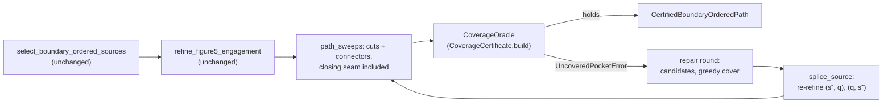

# Held coverage-preserving selection

!!! note "Implemented (2026-10-21); the Monstera diagnostics below are reporting only"
    Select, certify, repair is implemented in `benchmarks/held_coverage_repair*.py`
    against the [coverage certificate](held_coverage_certificate.md). The
    contract tests and the Monstera slow test are listed under
    [Tests](#tests). Tables marked as numpy diagnostics were computed on
    existing dumps before the implementation. They are **reporting only, not a
    certificate**; the measured Monstera outcome is in
    [Monstera: measured](#monstera-measured).

**Rule: select, certify, then repair.** Boundary-order selection runs
unchanged. The always-on coverage certificate then runs on the emitted path,
closing seam included. If it raises `UncoveredPocketError`, the repair stage
re-inserts dropped source circles that contain the exact witness points. Each
re-inserted circle goes back into its own boundary-order slot, and only the
two source intervals it splits are re-refined under the engagement cap. Then a
**fresh full certificate** runs on the whole repaired path (user ruling: the
post-repair gate is a full certificate, never a windowed re-certification).
The loop stops when the certificate holds. It raises a named error when no
dropped circle covers a witness, or when every candidate for a witness is
refused. On Monstera, one round re-inserts **two** sources (#744 for island B,
#1273 for island A), adds 2 circles (4366 → 4368) and takes 0.12 s of repair
work, inside the ≤ 0.5 s budget on top of the certificate's own gate. The
alternative, where every drop is guarded by its own certificate query, is
estimated at 170–850 s. It is rejected.

## The current rule and why it dropped the covering circles

`select_boundary_ordered_sources` (`benchmarks/held_boundary_order_spacing.py:51-65`)
walks the initial circles in boundary order with one predecessor, the last
kept circle. The cap is decided exactly (see [Exactness](#exactness)); this
page first quoted the earlier binary64 rule `float(angle) > float(cap.theta)`.
The exact rule left crossed skis bit-identical and removed 3 refinement
midpoints on Figure 5 (2013 → 2010): two internally tangent shared-contact
transitions the float model reported as 180° are about 2·10⁻⁶° exactly. The
selection logic below is unchanged:

```python
for index in range(1, len(circles) - 1):
    remaining.subtract(circle_sources[index])
    required = any(run not in represented and remaining[run] == 0 for run in circle_sources[index])
    if not required:
        try:
            engagement = exact_predecessor_engagement(_paper_candidate(circles[selected[-1]]), _paper_candidate(circles[index + 1]), tool_radius)
        except StandardPlacementFragmentationError:
            required = True
        else:
            required = not engagement.within(cap)
    if required:
        selected.append(index)
```

What it optimises: the **number of kept sources**. It drops a circle whenever
it is allowed to, so it is a greedy farthest jump. Circle i is kept only in
three cases:

- i is the first or last circle;
- i is the last remaining representative of a guide run not yet represented;
- jumping from the last kept circle straight to circle i + 1 would exceed the
  engagement cap, or would leave the standard model's overlap domain
  (`StandardPlacementFragmentationError`).

The refinement that follows (`refine_figure5_engagement`,
`benchmarks/held_figure5_engagement_refinement.py:237-254`) only *adds*
midpoint circles, and only where a transition is over the cap:

```python
engagement = exact_predecessor_engagement(_paper_candidate(predecessor), _paper_candidate(target), tool_radius)
if engagement.within(cap):
    ...
    emitted.append(target)
    continue
...
midpoint = _midpoint(predecessor, target, boundary, corner_approaches=corner_approaches)
```

**Coverage does not appear anywhere in either function.** The predecessor
engagement measures how much new material the next circle cuts near the
previous cleared disk. It does not see what a skipped circle's *far* ring
reached. On Monstera every circle that covers an island is a local peak of
reach inside its selection interval. Its selected neighbours are smaller, so
the engagement from the predecessor to the next, smaller circle stays under
the cap, and the peak is skipped. Signed gap from the island centroid to the
outer swept ring, d = |p − c| − (R + r), where negative means covered
(`build/held-selection-design/far_ring_diag.py`, float, reporting only):

| island | kept predecessor | dropped cover | kept successor |
|---|---|---|---|
| A | #1272 R 6.856, d +0.094 | #1273 R 7.079, d −0.338 | #1285 R 6.390, d +1.219 |
| A | #4034 R 6.913, d +0.078 | #4038 R 7.063, d −0.223 | #4040 R 6.588, d +0.655 |
| A | #6123 R 6.597, d +0.074 | #6127 R 6.966, d −0.664 | #6141 R 5.400, d +2.506 |
| B | #743 R 4.196, d +0.088 | #744 R 4.447, d −0.268 | #748 R 3.326, d +2.502 |
| B | #6158 R 3.568, d +0.846 | #6159 R 4.403, d −0.565 | #6160 R 3.476, d +0.969 |

The kept predecessors miss the islands by 0.07–0.09 mm. That matches the
0.065–0.096 mm gaps that the
[uncut-area diagnostic](held_coverage_certificate.md#the-monstera-evidence)
measured to the bordering circles of the final path.

## The new rule

### Pipeline



Every stage is typed and fails loudly. The certificate is an injected
dependency (`CoverageOracle`), so the contract tests run the real one. The
repair is split by responsibility:

| module | responsibility |
|---|---|
| `held_coverage_repair.py` | the driver: `path_sweeps`, `repair_coverage` (certify, repair, re-certify in full), and the entry points `certify_boundary_ordered_selection` and `refine_boundary_ordered_path_certified` |
| `held_coverage_repair_cover.py` | one round: exact witness membership (`contains_exactly`), the outward-rounded box filter, the greedy set cover and its refusals |
| `held_coverage_repair_splice.py` | exact cyclic slot check (`cyclically_between`) and the two-interval splice (`splice_source`) |
| `held_coverage_repair_types.py` | value types: settings, emission, splice, refusal, insertion, ledger, certified path, the oracle protocol |
| `held_coverage_repair_errors.py` | one named exception per failure mode |
| `held_coverage_repair_invariant_errors.py` | the base `CoverageRepairError`, `CoverageRepairInvariantError` and one named error per value-type invariant; below `types.py` so `types.py` can raise them without an import cycle |

The existing `refine_boundary_ordered_path` stays as it is.
`refine_boundary_ordered_path_certified` is added beside it and returns the
path, the certificate and a `CoverageRepairLedger`. It checks the reached-run
ledger on the selection, before refinement, as the original does, so a ledger
mismatch fails before any certificate runs. The generators switch to it only
after the tests below are green. Removing the old path is a separate decision
for the user.

### Precondition

The repair can only re-insert circles that the initial path already had. It
therefore needs the initial path to cover the target:

> T ⊆ ⋃ (initial circles) ∪ C, where C is the connector chain.

The diagnostic shows that the initial order is cyclically monotone along ∂Ω.
There is exactly one descent, at index 504, and it is the wrap through the
arclength origin (−840.84 mm, one perimeter). There are also 155 zero steps,
which are fans (`repair_cover_diag.py`). So any subsequence that keeps the
first and last circle produces connectors whose union is the same chain C,
from the first contact CCW to the last contact. **Selection changes only the
circle set, never C.** A precondition violation is discovered lazily: it is a
witness that no dropped circle contains, and it raises
`CoverageNotRepairableBySelectionError` (see below). It is never repaired by
something other than a dropped source.

### One repair round

Input: the selected indices, the dropped candidates in emitted form (each
candidate passed through the same `circle_on_side` that the refinement will
apply, so membership is decided on the geometry that will be cut), and the
certificate's witnesses `w_1 … w_m` (exact `Fraction` points in T \ U).

1. **Candidates per witness.** A numpy filter over boxes of the dropped
   candidates' swept disks (radius R + r), then an exact decision. Each box
   side is the correctly rounded binary64 result stepped once outward with
   `nextafter` (reach, then c ± reach), so it contains the exact disk; the
   witness coordinates, exact `Fraction`s, are bracketed the same way
   (`witness_bracket`). The filter is a closed-interval overlap, a superset,
   never a decision. Membership is then decided exactly: w ∈ S_q ⟺
   max(R−r, 0)² ≤ |w − c|² ≤ (R+r)² in `Fraction` arithmetic on exactly
   injected doubles, on the circle exactly as the refinement emits it
   (`contains_exactly`). Witnesses with no candidate raise
   `CoverageNotRepairableBySelectionError(witnesses)`.
2. **Choice.** This is a greedy set cover over the witnesses, with
   lexicographic keys that are all integers:
    1. the most witnesses contained;
    2. the fewest circles added by the splice (step 3, run per candidate);
    3. the smallest boundary-order index.
3. **Placement and splice.** Candidate q goes into the selected subsequence at
   its initial index, between the kept circles s⁻ < q < s⁺. Its boundary site
   must satisfy site(s⁻) ≤ site(q) ≤ site(s⁺) in cyclic CCW order. This is
   compared exactly on `(segment id, Fraction parameter)`. A violation raises
   `RepairOrderViolationError`. The source intervals (s⁻, q) and (q, s⁺) are
   re-refined with the unchanged refinement loop, including corner bridges.
   Every other interval is untouched. This splice is exactly a full
   re-refinement of the augmented selection, because the loop's state across
   an interval boundary is only `emitted[-1]`, which is the interval's target
   source. A contract test checks that equality. The run ledger is unaffected,
   because q's runs are already reached.
4. **Refusal.** The splice either emits transitions that pass the
   refinement's cap test, or it raises `Figure5EngagementResolutionError`:
   the depth or the circle budget is exhausted, or (user ruling 2026-10-21)
   the exact engagement model fails on a transition. The refinement wraps
   `StandardPlacementFragmentationError` as `Figure5EngagementFragmentationError`
   and `ExactEngagementCosineRangeError` as `Figure5EngagementCosineRangeError`,
   both subclasses, so they are refusals of that candidate and never escape
   the repair. A refusal is recorded once per (candidate, kept interval) and
   round, with the error class and message, and the next candidate in step
   2's order is tried. Within a round a refused (candidate, interval) is not
   re-spliced: insertions only add circles, so the same local refinement
   under a smaller remaining budget is refused again. If every candidate of
   an open witness is refused, the repair raises
   `CoverageRepairRefusedError(witness, refusals)`, chained from a refusal of
   a candidate of that witness. Nothing is skipped silently, and a refused
   candidate is never emitted with an over-cap transition.
5. **Fresh full certificate.** After the round's insertions, the whole
   repaired emission is certified again: `path_sweeps` over every emitted
   circle and connector, the closing seam included, and one full
   `CoverageOracle` call. There is no windowed or local re-certification
   (user ruling). A splice can drop an interval's old midpoints and replace
   its connectors, so U can lose regions there as well as gain them; a full
   run decides that without a window argument. On Monstera the second run
   costs about 2.5 s. A failure returns new witnesses for the next round.

**Termination.** Every round inserts at least one dropped source or raises
(orphan witnesses, every candidate refused). There are finitely many dropped
sources (4051 on Monstera). A `CoverageOracle` that raises
`UncoveredPocketError` without witnesses would make no progress; the repair
raises `UncoveredPocketWithoutWitnessesError` instead of looping. When the
loop ends without an error, the last full certificate holds.

### Error model

| error | failure mode |
|---|---|
| `CoverageNotRepairableBySelectionError` | a witness lies in no dropped source: placement or the connector chain is at fault, not selection |
| `CoverageRepairRefusedError` | every candidate for a witness is refused: depth, circle budget, or a wrapped placement-model failure |
| `RepairOrderViolationError` | a candidate's exact boundary site is not between its kept neighbours |
| `UncoveredPocketWithoutWitnessesError` | the oracle raised `UncoveredPocketError` with no witness; no round can progress |
| `InvalidCoverageRepairInputError` | the emission does not index its selection, or the candidate is already selected (caller contract) |
| `UncoveredPocketError` | (certificate) raised to the caller only by the entry point without repair |

Refusals (recorded, not raised): `Figure5EngagementResolutionError` and its
subclasses `Figure5EngagementFragmentationError` and
`Figure5EngagementCosineRangeError`.

`CoverageRepairLedger` records the following. They are reporting fields:

- `insertions` (source, witness, round), with `inserted_sources` in insertion order;
- `refusals` (candidate, interval, round, `"ErrorClass: message"`);
- `rounds`, `certificate_runs` (always `rounds + 1`);
- `emitted_before`, `emitted_after`;
- `repair_s` (candidate search, set cover, splices) and `certificate_s`
  (every certificate run, the final one included).

### Value-type invariants

Every repair value type has a `build` factory that checks its invariants; the
raw constructors stay unvalidated. Inside the repair every value is built
through `build`. Each violated invariant raises its own subclass of
`CoverageRepairInvariantError` (itself a `CoverageRepairError`), defined in
`held_coverage_repair_invariant_errors.py`.

| type | invariant | error |
|---|---|---|
| settings | `max_depth >= 0` | `NegativeRefinementDepthError` |
| settings | `max_circles >= 1` | `NonPositiveCircleBudgetError` |
| emission, insertion, refusal | source indices `>= 0` | `NegativeSourceIndexError` |
| emission | `selected` is strictly increasing | `UnorderedSelectionError` |
| emission | `len(original_indices) == len(selected)` | `EmissionIndexCountError` |
| emission | `original_indices` is strictly increasing within `[0, len(circles))` | `EmissionIndexOrderError` |
| splice | `interval[0], candidate, interval[1]` are consecutive in the spliced selection | `SpliceSlotError` |
| insertion, refusal | round `>= 1` | `NonPositiveRepairRoundError` |
| ledger | `rounds >= 0` and `certificate_runs == rounds + 1` | `CertificateRunCountError` |
| ledger | insertion rounds are ordered and cover exactly `1..rounds`; refusal rounds are ordered and in `1..rounds` | `LedgerRoundError` |
| ledger | no source is inserted twice | `DuplicateInsertionError` |
| ledger | emitted counts are `>= 0`; with 0 rounds the count is unchanged | `EmittedCountError` |
| ledger | timings are finite and `>= 0` | `InvalidRepairTimingError` |
| certified path | `selected` lies in `range(len(sources))` | `CertifiedSelectionRangeError` |
| certified path | `emitted_after == len(circles)`; inserted sources are a subset of `selected` | `CertifiedLedgerMismatchError` |
| certified path | `certificate.exposed_edge_count == 0` | `UncertifiedPathError` |

An unordered selection from a caller therefore fails loud with
`UnorderedSelectionError` instead of passing silently.

## Exactness

- The certificate decides coverage with exact, filtered predicates (see its
  page). The repair adds no geometric decision of its own beyond these:
    - witness membership, which is P4 on exactly injected doubles, with
      rational squared distances compared to (R ± r)²;
    - cyclic site order, which compares `(segment, Fraction)` keys.
- The candidate boxes are outward-rounded supersets (one `nextafter` step
  after each correctly rounded operation). They are filters, never decisions;
  a property test checks them against the exact disk in `Fraction`s.
- The greedy choice compares integer counts and indices.
- There is no epsilon, no tolerance and no proximity threshold.
- **Resolved (2026-10-17):** selection and refinement decide the cap with `exact_predecessor_engagement(...).within(cap)` on the exact `EngagementCap.chord_ratio` surrogate (`benchmarks/held_standard_placement.py`), and `maximum_predecessor_engagement` reports through it; the `acos` angle is reporting only.

### The exact bisection band (Section 2.4)

The Figure 5 standard placement (`_bisect_next_candidate` in
`benchmarks/held_standard_placement.py`) bisects ordered candidates and stops
once `cap − 0.001 ≤ θ ≤ cap` (`PAPER_BISECTION_ANGLE_TOLERANCE = 0.001` rad).
Both ends are exact decisions on the engagement cosine; `acos` only reports.

- **Cap end:** `cosine.within(cap)`, i.e. cos θ ≥ 1 − chord_ratio/2 on the
  cap's `EngagementCap` surrogate 4 sin²(cap/2).
- **Floor end:** `_BisectionStopBand`. The floor is the declared binary64
  `fl(cap.theta − 0.001)`, one IEEE subtraction of the two declared
  parameters, taken as its own `EngagementCap` surrogate; the test is
  `cosine.reaches(floor)` (cos θ ≤ 1 − chord_ratio/2). A non-positive floor
  means every probe stops.
- **Surrogate semantics:** the band is `[floor surrogate, cap surrogate]` in
  chord-ratio space. The sub-ulp gap between each surrogate and the
  transcendental band edge is the API semantic documented at
  `PAPER_BISECTION_ANGLE_TOLERANCE`, never an in-core correction. Example:
  the binary64 π/2 cap's surrogate is `0x1.ffffffffffffep+0` (< 2), so a pair
  whose float `acos` reported exactly π/2 is over the exact cap.
- **Output:** no change on Figure 5 or crossed skis (initial and refined
  digests identical; 0 cap and 0 band disagreements over 9,722 and 10,447
  exact evaluations), per `held-suite-green-report.md` in the plan folder and
  re-verified by the review-fix round.
- **Oracles:** the decision is pinned against an independent exact reference
  (`tests/benchmarks/held_engagement_reference_oracle.py`, Q(√D) field
  arithmetic with the Fig. 4(d) chord built from the explicit swept-circle
  intersection), on every Hypothesis draw with no filter.

## Cost

| term | count on Monstera | cost each | total |
|---|---|---|---|
| full certificate on the selected path (always-on gate; not a repair cost) | 1 | ≤ 5 s (user-approved gate, [performance](performance.md)) | ≤ 5 s |
| witness → candidates (numpy box filter + exact membership) | 8 witnesses (measured: 4 at A, 4 at B) | µs | < 1 ms |
| splice trials (re-refine 2 intervals per candidate) | candidates containing a witness | ms | measured repair total 0.12 s |
| fresh full certificate after repair | 1 per round (1 round on Monstera) | ≈ 2.5 s (measured) | ≈ 2.5 s |
| **repair work (`repair_s`, budget ≤ 0.5 s)** | | | **0.12 s measured** |

Neighbour counts come from the certificate's design table
(`build/coverage_certificate_design/neighbour_stats.py`): 8673 regions, median
119 bounding-box neighbours. The witness count and the timings are the
2026-10-21 Monstera measurements (`monstera-acceptance-report.md`).

**Rejected: guarding every drop with a local certificate query.** Here the
greedy scan tombstones circle i in a static `box_intersection_d` neighbour
graph. It drops i only if the target T ∩ S_i is still covered by i's live
neighbours. The guard is exact, but it costs one sequential query per drop.
That is 4051 drops on Monstera (`build/held-gaps/dump_monstera_pre.log`:
6747 initial, 2696 selected). Each query covers the pieces of about 119
neighbours (≈ 3 pieces each) clipped to S_i, each against up to 119 regions.
That is ≈ 42k pair operations at 1–5 µs, so 0.04–0.2 s per query and
**170–850 s** in total. The total is serial, because each verdict depends on
the earlier tombstones. That is 34–170× over the certificate's 5 s gate, to
fix two islands. Repair spends its work only where the certificate found a
hole.

## What selection needs from Ω*

Ω is being redesigned as the exact disk erosion Ω* of the true boundary, with
the target T = Ω* ⊕ D_r. The repair runs unchanged against today's float Ω,
where T = Ω ⊕ D_r. The Monstera islands lie 15.27 mm and 6.90 mm from the
outline, so their acceptance does not wait for Ω*. Once T moves to Ω*,
selection needs the following:

1. **Placement and connectors on ∂Ω\*.** Today's chord-based Ω loses up to
   0.048 mm of reach at convex arcs. That is 1.68 mm² of analytic sliver on
   Monstera (`build/omega-audit/audit.py` and `chord_area.py`, reporting
   only; summarised under "Inexact substrate" in [Performance](performance.md)).
   No dropped circle covers
   those slivers. Against T = Ω* ⊕ D_r they would surface as witnesses that
   no dropped circle contains, raising `CoverageNotRepairableBySelectionError`
   correctly, because the fix belongs to placement. The connector chain C
   must follow ∂Ω*, arcs included. The certificate then needs an arc-connector
   region (an annular sector with end caps) and the matching target members.
2. **Exact boundary sites on Ω\*:** (loop, primitive, exact parameter). The
   cyclic order check and the invariance of C under selection both depend on
   it.
3. **Rational arc radii.** An Ω* arc has radius ρ − r, where today
   ρ = |start − centre| has only a rational square. The certificate's
   stereographic chart needs a rational radius. Either the case loader
   injects ρ as a declared binary64 (an API boundary), or the certificate
   extends its charts to one-root radii. This is an open question.
4. **The precondition on the initial set.** The precondition has to be
   re-established on Ω* before selection can rely on it.

## Prerequisite found by this design: the open seam

The Held path is open. The transitions are `zip(circles, circles[1:])`, and
the slow certificate test builds no closing connector. On Monstera the last
initial contact sits 0.0438 mm before the first one, in CCW order. On the
target's outer flank along that seam, 199 of 199 samples are covered by no
initial circle and by neither end cap (`build/held-selection-design/seam_diag.py`,
float, reporting only). The certificate will report a `TARGET_BOUNDARY`
witness there. Selection keeps both endpoints, so no dropped circle can cover
it, and the repair raises `CoverageNotRepairableBySelectionError`.

**Resolved.** `Figure5BoundaryConnectors` declares the seam
(`Figure5SeamClosure.CONNECTOR`: a CCW connector from the last contact to the
first is real motion; `COINCIDENT`: the contacts coincide). `path_sweeps`
adds the seam connector to every certificate run; `close_seam=False`
reproduces the open path, whose failure stays a tested contract.

## Monstera diagnostic: what the repair would re-insert

`build/held-selection-design/repair_cover_diag.py`. It uses numpy on
`build/held-gaps/monstera_pre.npz` and the island labels in
`build/task12/monstera/raster_0.01.npz`, with the annulus model
`abs(|p − c| − R) ≤ r` at pixel centres. **Reporting only.**

| | A (355 px) | B (292 px) |
|---|---|---|
| dropped circles touching the island | 12: #1273–1277, 4035–4038, 4046, 6127, 6128 | 5: #738, 744, 746, 6159, 6161 |
| selected circles touching the island | 0 | 0 |
| full single covers | #1273, 4038, 6127, 6128 | #744, 746, 6159, 6161 |
| minimal re-insertion | **1** (any of the four) | **1** (any of the four) |

Together that is **2 re-inserted sources** (the two candidate sets are
disjoint). The brief's list of 15 is these 17 minus the two weakest partial
covers, #1277 (53 %) and #738 (12 %).

Where the covers sit in boundary order (s = CCW arclength of the contact on Ω,
in mm; the gaps are centre distances to the kept neighbours):

| cover | kept s⁻ → s⁺ | dropped in that interval | s⁻ ≤ s ≤ s⁺ | centre gap to s⁻ / s⁺ (mm) |
|---|---|---|---|---|
| A #1273 | #1272 → #1285 (s 115.06 → 115.75) | 12 | yes | 0.22 / 0.96 |
| A #4038 | #4034 → #4040 (s 466.88 → 467.01) | 5 | yes | 0.15 / 0.48 |
| A #6127 | #6123 → #6141 (s 719.63 → 720.44) | 17 | yes | 0.38 / 1.73 |
| A #6128 | #6123 → #6141 | 17 | yes | 0.28 / 1.62 |
| B #744 | #743 → #748 (s 34.60 → 34.76) | 4 | yes | 0.26 / 1.67 |
| B #746 | #743 → #748 | 4 | yes | 0.36 / 1.73 |
| B #6159 | #6158 → #6160 (s 721.40 → 721.45) | 1 | yes | 0.84 / 0.93 |
| B #6161 | #6160 → #6165 (s 721.45 → 722.17) | 4 | yes | 0.91 / 1.38 |

Kept-neighbour centre gaps across the whole selection are 0.39 mm at the
median and 0.74 mm at p90 (same script). A short splice is most likely for
#4038 on A (0.15 / 0.48 mm) and for #6159 on B (0.84 / 0.93 mm). Whether each
splice needs midpoints is decided by the engagement predicate in the
acceptance test, not here.

### Monstera: measured

Measured 2026-10-21 (`test_held_coverage_repair_monstera_slow.py`): the
certificate on the selected path finds 8 witnesses, all `ANNULUS_OUTER`, 4 at
A and 4 at B. One round re-inserts #744 (B) then #1273 (A), with no refusal
and no midpoint (m = 0): 4366 → 4368 emitted circles, 4088 connectors. Two
certificate runs (the failing one and the fresh full one, ≈ 2.5 s each);
`repair_s` 0.12 s. Every emitted transition, the closing seam included, is
within the cap.

## Tests

Contract tier, `tests/benchmarks/test_held_coverage_repair.py`
(`pixi run affected`, or the editable-skip `pytest` on this file). Every
certificate is the real `CoverageCertificate.build` except where a test is
named a fake-oracle unit test of the greedy cover.

- **Square fixture.** Ω = square (0,0)–(6,6), r = 1. A fan of three circles at
  contact (3,0) on segment 0 (parameter 1/2): R = 1, 2, 3 with centres (3,1),
  (3,2), (3,3). One circle at contact (3,6) on segment 2 (parameter 1/2): R = 1,
  centre (3,5). Connectors run CCW, and the seam connector closes the loop.
  All values are dyadic. The connector band covers {dist(x, ∂Ω) ≤ 1}; the fan
  covers disk((3,3), 4). Without R = 2, (4.5, 3) and (1.5, 3) are uncovered.
  R = 3 is the only member of run 1. Under a 180° cap selection drops R = 2.
- **Side fixture.** The 10 × 10 square of `test_held_boundary_order_spacing.py`,
  cap 80°, side circles on side 0. Kept selections are given by hand and
  `repair_coverage` runs directly with a scripted oracle; witness membership
  and each candidate's `added` are asserted as preconditions.

| test | expectation |
|---|---|
| `test_boundary_selection_drops_the_closing_fan_circle_and_repair_reinserts_it` | selection returns (0, 2, 3) (the defect); the repair inserts 1 at slot 1, 1 round, 2 certificate runs |
| `test_repair_witness_lies_in_the_reinserted_circle_exactly` | the witness is in T \ U(0, 2, 3) and in circle 1's annulus, re-checked in `Fraction`s |
| `test_repair_raises_when_the_circle_budget_refuses_the_only_closing_circle` | budget = the selected path's 3 circles: `CoverageRepairRefusedError` naming candidate 1 (the cap variant is incoherent here: every fan engagement is 180°) |
| `test_repair_raises_when_no_dropped_circle_covers_the_witness` | without circle 1: `CoverageNotRepairableBySelectionError` with a witness near (4.5, 3) or (1.5, 3) |
| `test_repair_rejects_a_candidate_outside_its_boundary_slot` | `RepairOrderViolationError` |
| `test_open_seam_is_not_repairable_by_selection` | `close_seam=False`: `CoverageNotRepairableBySelectionError` with a `TARGET_BOUNDARY` witness |
| `test_post_repair_gate_is_a_fresh_full_certificate` | the last oracle call sees every emitted circle and connector; `certificate_runs == rounds + 1` |
| `test_splice_equals_full_rerefinement` (Hypothesis) | the splice equals `refine_figure5_engagement` on the augmented selection, or both refuse |
| `test_unit_fake_oracle_set_cover_prefers_most_witnesses_over_lowest_index` | fake oracle: count beats index |
| `test_more_witnesses_beat_fewer_added_circles` | count beats `added` (kills key order `(added, -count, index)`) |
| `test_tie_on_count_inserts_the_candidate_with_fewest_added_circles_over_a_lower_index` | `added` beats index (kills dropping `added`) |
| `test_tie_on_count_and_added_inserts_the_lowest_source_index` | lower index wins (kills highest index) |
| `test_budget_refusal_of_the_first_candidate_inserts_the_second` | first candidate refused by the budget is recorded; the second is inserted (kills stop-at-first-refusal) |
| `test_refinement_wraps_placement_errors_as_named_resolution_errors` | injected fragmentation / cosine-range errors leave the refinement as the named subclasses, chained |
| `test_placement_error_refuses_the_candidate_and_the_next_is_inserted` | each wrapped error is a recorded refusal; the next candidate is inserted |
| `test_placement_error_on_every_candidate_raises_refused_with_the_wrapped_cause` | all refused: `CoverageRepairRefusedError` from the wrapped error |
| `test_a_refused_candidate_is_recorded_once_per_interval_and_round` | two greedy steps, one refusal record |
| `test_refused_error_chains_a_refusal_of_the_named_witness` | the cause is a refusal of the named witness's candidates |
| `test_an_uncovered_pocket_without_witnesses_is_a_named_error_not_a_livelock` | `UncoveredPocketWithoutWitnessesError` |
| `test_run_ledger_is_checked_before_certification` | ledger mismatch raises before any oracle call |
| `test_cyclically_between_matches_a_linearised_loop` (Hypothesis), `test_cyclically_between_wraps_through_the_seam` | the wrap branch against (m − f) mod n ≤ (l − f) mod n |
| `test_outward_box_contains_the_exact_swept_disk` (Hypothesis), `test_witness_bracket_contains_the_exact_coordinate` (Hypothesis), `test_a_witness_exactly_on_the_outer_rim_is_a_candidate` | the filter is a superset, checked in `Fraction`s |

The fragmentation and cosine-range fixtures inject the error from the exact
engagement in the refinement module only: no natural pair was found in
800,000 random quarter-unit circle pairs. Each greedy, refusal, guard and
filter defect named above was injected and fails at least one test.

Slow tier, `benchmarks/acceptance/test_held_coverage_repair_monstera_slow.py`
(not collected by pytest; about 30–75 s, path generation dominates):

| test | expectation |
|---|---|
| `test_monstera_repaired_path_passes_an_independent_fresh_certificate` | a certificate run in the test on the final emission's sweeps: 4368 cuts, 4088 connectors, 0 exposed edges; `certificate_runs == rounds + 1 == 2` |
| `test_monstera_repair_reinserts_the_pinned_island_candidates` | `inserted_sources == (744, 1273)` (B, A), 1 round, 0 refusals, 4366 → 4368 |
| `test_monstera_repair_respects_the_engagement_cap_including_the_seam` | every consecutive transition and the seam (last → first) is within the cap |
| `test_monstera_repair_reports_circle_count_and_time` | writes `build/coverage-repair/monstera_repair.json`; `repair_s ≤ 0.5` |

## Related pages

- [Held Coverage Certificate](held_coverage_certificate.md): the oracle.
- [Performance](performance.md): lever 4 and the budget policy.
