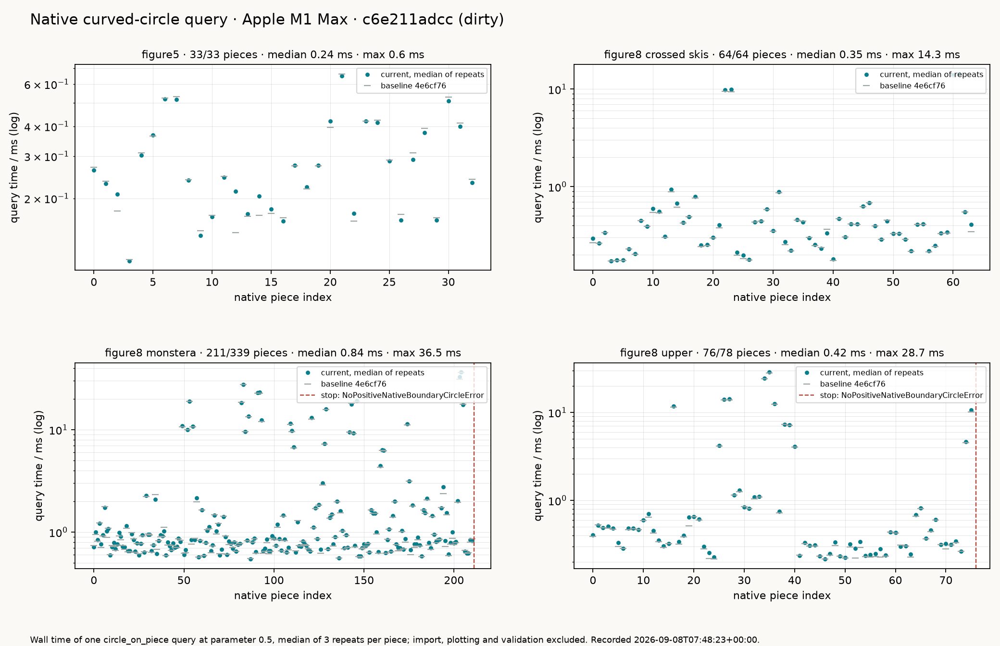

# Held Performance

The toolpath generators are the product, so they are what the regression gate
measures. Five concrete workloads, each the exact pipeline behind a gallery
panel, run stage by stage and record their toolpath's counts and lengths with
the time. The recorded baseline below was taken on a quiet Apple M1 Max at
commit `fa1f53a3` and is committed as
`benchmarks/results/held_toolpath_baseline.json`. In every workload the
initial placement is the cost; guide, offset, refinement and connectors
together stay under three seconds even on Monstera.

| workload | generation | initial placement | circles | connectors | planar length | max engagement | containment rejections |
| --- | ---: | ---: | ---: | ---: | ---: | ---: | ---: |
| Figure 5, corner-aware refinement | 21.0 s | 20.6 s | 2,013 | 2,012 | 26,436.6 mm | 79.992° | 1,010 |
| Figure 8 upper, lane spacing | 90.9 s | 90.0 s | 4,183 | 4,182 | 44,186.9 mm | 79.993° | 2,118 |
| Figure 8 upper, boundary spacing | 92.9 s | 92.0 s | 1,684 | 1,683 | 18,236.8 mm | 79.993° | 847 |
| Figure 8 crossed skis, boundary spacing | 36.6 s | 36.0 s | 1,616 | 1,615 | 7,835.6 mm | 79.996° | 830 |
| Figure 8 Monstera, boundary spacing, qualified contacts, corner approaches | 449.8 s | 446.5 s | 4,367 | 4,366 | 46,719.9 mm | 79.998° | 2,168 |

Generation excludes import, plotting and any coverage replay. Planar length
is the sum of full-circle circumferences and connector polylines; maximum
engagement is the paper's standard-model predecessor engagement over
consecutive circles; containment rejections are exact rejections of circles
against the polygon, kept visible as in the figure tools.

## What counts as a regression

The gate compares a fresh run of each workload with the baseline and fails on
any of the following, with the offending numbers in the message:

| check | bound | rationale |
| --- | --- | --- |
| circles, connectors, containment rejections, unresolved engagements | must be identical | exact arithmetic, deterministic order |
| planar length, maximum engagement | within 1e-6 mm and 1e-9 degrees | reporting doubles of exact quantities, never geometry |
| generation time, same hardware | within 3× the baseline | run-to-run spread measured under 1.5× on a quiet machine |
| generation time, other hardware | within 10× the baseline | only order of magnitude is comparable across machines |
| generation time, any hardware | under the workload's absolute ceiling, three times its recorded time | catches the hundredfold regressions this lane has produced |

Two tiers keep the default suite honest without a ten-minute job on every
run. `tests/benchmarks/test_held_toolpath_performance.py` gates Figure 5 and
crossed skis, about a minute together, on every `pixi run pytest` and on CI.
`pixi run held-toolpath-gate` runs the upper and Monstera workloads from
`benchmarks/acceptance`, which pytest does not collect. Both read the same
baseline; `pixi run held-toolpath-baseline` re-records it, deliberately, when
a change to the generators is meant to change these numbers.

```bash
pixi run held-toolpath-benchmark   # fresh record into build/, no gate
pixi run held-toolpath-gate        # slow tier against the baseline
pixi run held-toolpath-figures     # rebuild every gallery toolpath
```

## The curved-circle query, a component

The native curved-circle construction query that the coverage page describes
has its own record, `benchmarks/results/held_curved_circle_baseline.json`,
and its own gate in `tests/benchmarks/test_held_curved_circle_performance.py`,
with the same policy shape: unchanged stop events, absolute ceilings of
0.25 s per query and 20 ms per case median, 3× and 5× on the same hardware,
10× elsewhere. It is a component measurement, not a toolpath: Figure 5's
median query is 0.25 ms, upper's 0.41 ms, crossed skis' 0.35 ms and
Monstera's 0.82 ms.



## Not measured here

The exact full-motion coverage replay is off the critical path since
September 8, 2026, because it does not finish on drafts of this size; the
[coverage page](held_motion_coverage.md) states the measurements and the
decision. Held's published timings remain an external reference, not a
same-machine claim; nothing on this page is a speed-up ratio against them.
