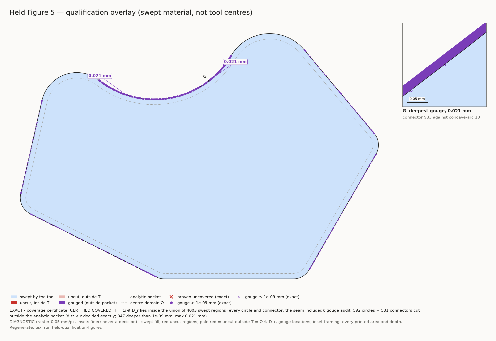
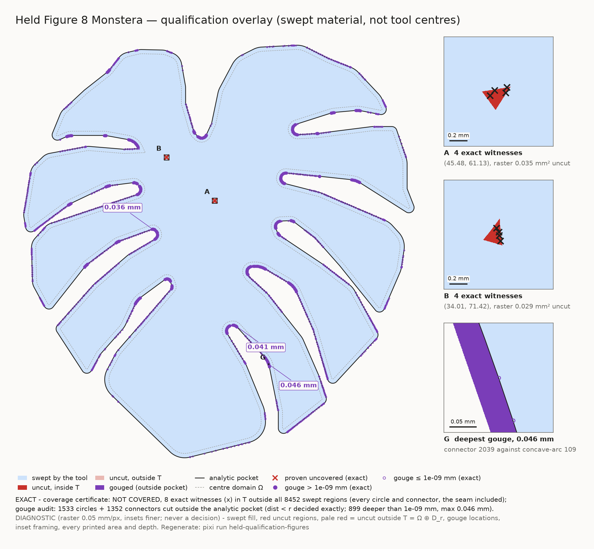

# Held qualification

!!! danger "Under repair: no published Held path is machining-qualified"
    The Held toolpaths in the [gallery](held_toolpath_gallery.md) and on the
    [performance](performance.md) and [Held performance](held_performance.md)
    pages are drafts. They are not fit to cut. Treat every length, circle count
    and generation time quoted for them as a draft measurement, not a result
    for a qualified path.

**Conclusion.** No published Held path is machining-qualified: the five
published paths are generated in the polygonal centre domain and all five
gouge. The Ω\* paths, generated in the exact centre domain, meet all three exit
gates: zero gouges, coverage of T(Ω\*) certified, and zero connector-gate
refusals after the Ω\* connector repair, on all five workloads (see
[Exit gates on the Ω\* paths](#exit-gates-on-the-omega-paths), generated
tables). They replace the published paths once the gallery is re-rendered
from them.

The published (polygonal-Ω) paths:

- **They gouge.** On all five published workloads, the tool disk leaves the
  analytic pocket. The deep gouges sit at concave arcs. This is decided
  exactly, path element by path element, in the
  [gouge audit](#exact-gouge-audit) below.
- **Monstera leaves uncut islands.** The generated Monstera path leaves two
  interior slivers of material uncut. The coverage certificate proves them with
  exact witnesses in two clusters. Select-certify-repair re-inserts the dropped
  source circles, and the repaired path is certified covered.

## Exit gates on the Ω\* paths {#exit-gates-on-the-omega-paths}

A path is machining-qualified when its exact gouge audit has no gouging
element, `CoverageCertificate.build` certifies coverage of the exact target
T(Ω\*) = Ω\* ⊕ D_r, and the exact connector gate certifies every connector.
Status on the Ω\* paths of all five workloads (`figure5_refined`,
`figure8_upper_lane`, `figure8_upper_boundary`,
`figure8_crossed_skis_boundary`, `figure8_monstera_boundary_qualified_corners`):

| exit gate | status | generated evidence |
| --- | --- | --- |
| Exact gouge audit against the declared boundary (`benchmarks/held_omega_gouge_audit.py`) | **met on all five**: no gouging circle, no gouging connector, before and after the connector repair | "gouge before / after" column of the [connector repair table](#omega-connector-repair-table) |
| Coverage of T(Ω\*), connectors as exact ∂Ω\* pieces | **met on all five**: COVERED, no witness | [coverage table](#omega-coverage-table) |
| Ω\* connector gate (tiers 1 / 1b, seam and junction lines included) | **met on all five after the Ω\* connector repair**: no refusal | [connector repair table](#omega-connector-repair-table) ("refused before → after") and the [gate table](#omega-connector-gate-table) of the emitted path |

Each table's header line records the commit and tree state it was measured
on; its pixi task regenerates it. A gouge-audit table of its own for the Ω\*
paths, like the polygonal one [below](#exact-gouge-audit), has no generator
yet.

### Coverage of T(Ω\*) { #omega-coverage-table }

Generator: `tools/held_omega_coverage_results.py`. Regenerate with
`pixi run held-omega-coverage`. Region accounting:
[Held coverage certificate](held_coverage_certificate.md).

--8<-- "benchmarks/results/held_omega_coverage.md"

### Ω\* connector repair { #omega-connector-repair-table }

Generator: `tools/held_omega_connector_repair_results.py`. Regenerate with
`pixi run held-omega-connector-repair`. Method:
[Ω\* connector repair](held_connector_engagement.md#omega-connector-repair).

--8<-- "benchmarks/results/held_omega_connector_repair.md"

### Ω\* connector gate on the emitted path { #omega-connector-gate-table }

Generator: `tools/held_omega_connector_gate_results.py`. Regenerate with
`pixi run held-omega-connector-gate`.

--8<-- "benchmarks/results/held_omega_connector_gate.md"

## Qualification overlays

Each overlay puts both verdicts on one generated path. The first caption line
is exact: the `CoverageCertificate.build` verdict on every circle and connector,
closing seam included, and the gouge-audit counts. Figure 5 is CERTIFIED
COVERED and gouges (deepest 0.021 mm, at a concave arc). Monstera is NOT
COVERED, with 8 exact witnesses at two slivers, A (45.48, 61.13) and
B (34.01, 71.42), and gouges (deepest 0.046 mm). The second caption line is
diagnostic: the swept fill, the uncut and gouged shading, the inset framing and
the inset areas are a raster at 0.05 mm per pixel. Insets frame the exact
witness clusters (ranked by witness count) and the deepest gouge.





Generator: `benchmarks/tools/held_qualification_overlay.py`. Regenerate with:

```bash
pixi run held-qualification-figures
```

The task generates both paths live (Monstera takes minutes), then runs the
certificate and the gouge audit before drawing.

## Coverage certificate

`CoverageCertificate.build` runs on the generated paths, closing seam connector
included. It decides coverage of T = Ω ⊕ D_r for the current
polygonal-projection Ω. A certified-covered row is therefore not a
machining qualification: the same paths gouge (next section). Method, theorem
and open review findings: [Held coverage certificate](held_coverage_certificate.md).

Generator: `tools/coverage_certificate_acceptance.py`. Regenerate with:

```bash
pixi run coverage-certificate-acceptance
```

--8<-- "benchmarks/results/coverage_certificate_acceptance.md"

## Why the paths gouge

The centre domain Ω the generators place circles in is an inward offset of the
polygonal projection of the pocket, not the exact erosion of the analytic
pocket. At a concave arc, each chord of the projection lies in material. A
circle tangent to such a chord therefore cuts into the wall by up to the chord
sagitta. [Held exact centre domain](held_exact_centre_domain.md#evidence-the-old-domain)
shows that the maximum gouge equals the maximum concave chord sagitta. The
gouges against straight lines are exact sub-ulp offsets of Ω's straight edges,
not geometric defects. The audit counts them and splits them out.

## Exact gouge audit

A path element gouges when `dist(element, ∂P) < r`. A touch, `dist == r`, is
allowed. The gouge/touch counts and the split by primitive are exact decisions.
Depths, and the split column above 10⁻⁹ mm, are reporting values in doubles.

Generator: `benchmarks/held_gouge_audit_table.py`. Regenerate with:

```bash
pixi run held-gouge-audit
```

The slow-tier test `benchmarks/acceptance/test_held_gouge_audit_figure5_slow.py`
pins the Figure 5 row. It records the defect: once Ω is the exact erosion, it
must fail and be replaced by `require_gouge_free` passing.

--8<-- "benchmarks/results/held_gouge_audit.md"

## What is certified and what is diagnostic

| claim | kind | evidence |
| --- | --- | --- |
| The listed elements gouge or touch | certified, exact predicate | gouge audit above |
| The Monstera path leaves uncut material | certified, exact witnesses | [coverage certificate](#coverage-certificate) above; slow test `benchmarks/acceptance/test_coverage_certificate_monstera_path_slow.py` |
| Figure 5, crossed skis, upper boundary and repaired Monstera cover T = Ω ⊕ D_r (polygonal Ω) | certified, `CoverageCertificate.build` returns a certificate | [coverage certificate](#coverage-certificate) above; repaired Monstera pinned by the same slow test |
| The Ω\* paths cover T(Ω\*) | certified, connectors as exact ∂Ω\* pieces | [Exit gates on the Ω\* paths](#exit-gates-on-the-omega-paths), [Held coverage certificate](held_coverage_certificate.md) |
| The Ω\* paths do not gouge, and every Ω\* connector is certified | certified, exact predicates | [Exit gates on the Ω\* paths](#exit-gates-on-the-omega-paths) |
| Gouge depths in mm | diagnostic, doubles | gouge audit above |
| Island areas and centroids | diagnostic, raster | [The Monstera evidence](held_coverage_certificate.md#the-monstera-evidence) |
| Engagement strips in the gallery | diagnostic, predecessor-circle model only | [gallery](held_toolpath_gallery.md) |
| Path lengths and generation times | draft measurements of unqualified paths | [Held performance](held_performance.md), [performance](performance.md) |

## The repair

Three designs close the gap. Each has a failing test to write before any code:

1. **Exact centre domain Ω\* (built, not yet published).** It replaces the
   polygonal-projection offset with the exact erosion of the analytic pocket.
   The Ω\* paths have no gouging element on all five workloads
   ([exit gates](#exit-gates-on-the-omega-paths)). See
   [Held exact centre domain](held_exact_centre_domain.md).
2. **Coverage-preserving selection.** Boundary-order selection may drop a circle
   only if the certificate still holds. This restores the circles that covered
   the Monstera islands. See
   [Held coverage-preserving selection](held_coverage_preserving_selection.md).
3. **Coverage certificate, phase 2 (done) and T(Ω\*).** Connector capsules
   and target pieces are in; coverage is certified, not only refuted, on the
   polygonal Ω, and against T(Ω\*) with the connectors as exact ∂Ω\* pieces
   ([exit gates](#exit-gates-on-the-omega-paths)). Open findings:
   [Held coverage certificate](held_coverage_certificate.md).

The time budgets for these steps are on the [performance](performance.md) page.
A Held path counts as machining-qualified only when its gouge audit row has zero
gouging elements and `CoverageCertificate.build` returns a certificate for it.
