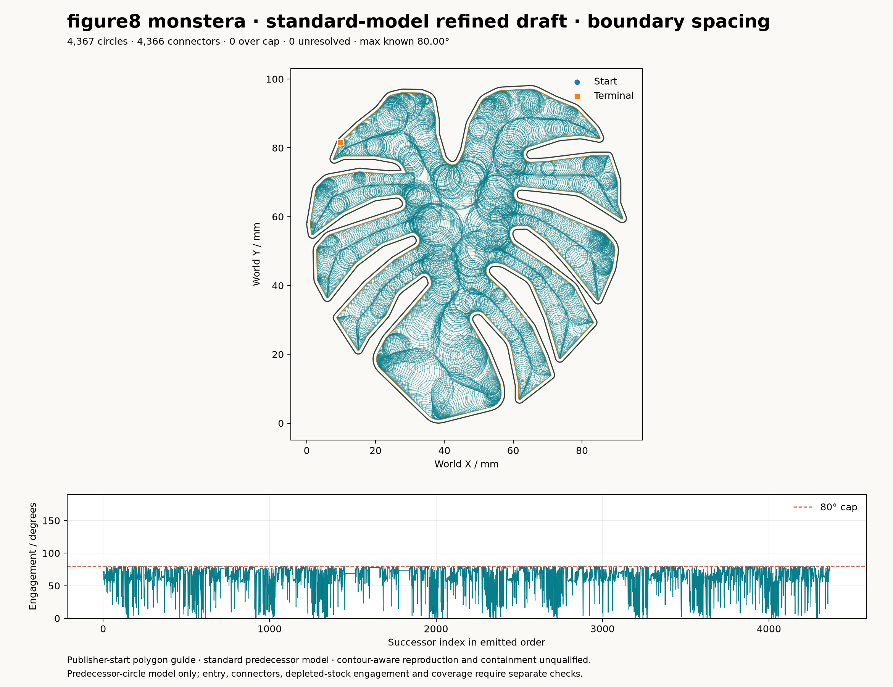

# Held Toolpath Gallery

Every panel below is a generated toolpath, circles and connectors emitted by
the repository's engagement-controlled generators from the prepared publisher
inputs, shown beside the publisher's own figure. Construction diagnostics
never appear here. A panel the generators cannot produce yet is stated as
blocked with the missing capability, not filled with a placeholder. Rebuild
all of them with one command; the numbers on each panel come from the
[performance record](held_performance.md), which also gates them in pytest.

```bash
pixi run held-toolpath-figures
```

## Figure 5 · standard model

| publisher | generated |
| --- | --- |
|  |  |

`pixi run held-figure5-toolpath-progress --refine`: the publisher-start
polygon proposal with corner-aware engagement refinement, every motion drawn,
final-order engagement per successor in the lower strip, exact full-motion
coverage checked after rendering. Panels (b) contour-aware, (c) intermediate
machined contour and (d) MATHSM are blocked: the contour-aware
maximum-over-candidate placement and the constant-spacing MATHSM sweep on this
pocket are open items of the reproduction plan.

## Figure 8 · upper pocket

| publisher | generated, boundary-order spacing |
| --- | --- |
|  |  |

`pixi run held-reference-toolpaths --case figure8_upper --spacing boundary`.
The lane-spaced draft, `held_figure8_upper_standard_refined.png`, is the
earlier variant with 4,183 circles and is kept as the comparison the spacing
work was measured against. The publisher panel is contour-aware; the
generated one is the standard predecessor model, and the gallery says so
rather than relabelling it.

## Figure 8 · crossed skis

| publisher | generated, boundary-order spacing |
| --- | --- |
|  |  |

`pixi run held-reference-toolpaths --case figure8_crossed_skis --spacing boundary`.

## Figure 8 · Monstera

| publisher | generated, boundary spacing, qualified contacts, corner approaches |
| --- | --- |
|  |  |

`pixi run held-reference-toolpaths --case figure8_monstera --spacing boundary --qualify-contacts --corner-approaches`:
bounded contact hypotheses with rejected alternatives recorded, and concave
corners partitioned into approach, shared-contact rotation and departure.

## Figure 6 · path length against engagement cap

| publisher | generated |
| --- | --- |
|  |  |

`pixi run held-figure6-same-axes`: repository path lengths at requested caps
of 80, 120 and 160 degrees from the controlled generator, on the publisher's
axes, cap compliance unaudited and the publisher ordinate and repository
millimetres without an established common scale. The contour-aware and
constant-spacing curves are blocked with the same items as Figure 5.

## Figure 7 · engagement maps

Blocked. No generator renders the per-position engagement maps of the three
algorithms; it needs the standard, contour-aware and MATHSM motions on the
Figure 5 pocket under one engagement measurement, which is the open Task 6
protocol of the reproduction plan.
