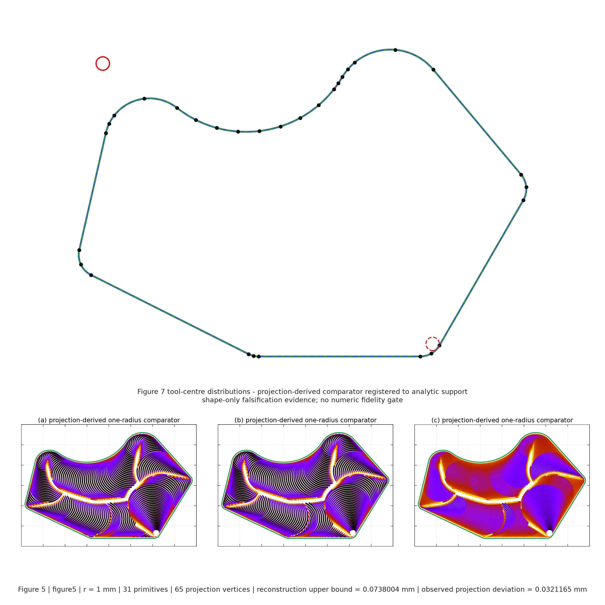
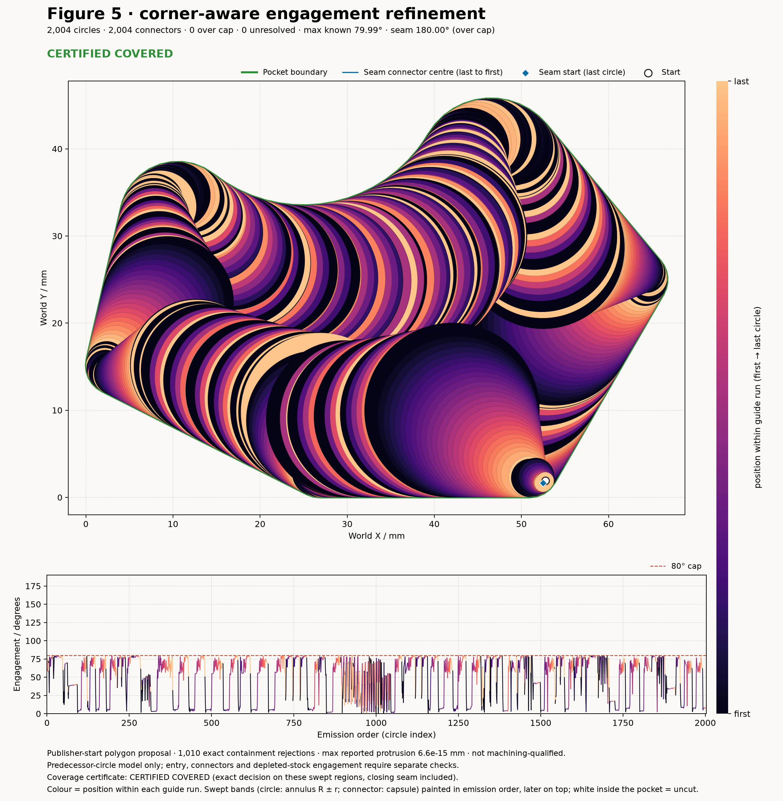
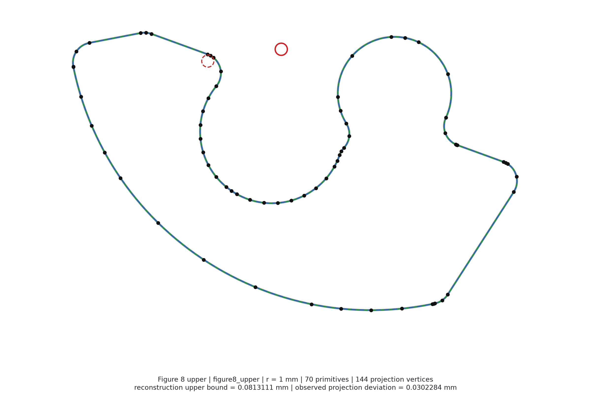
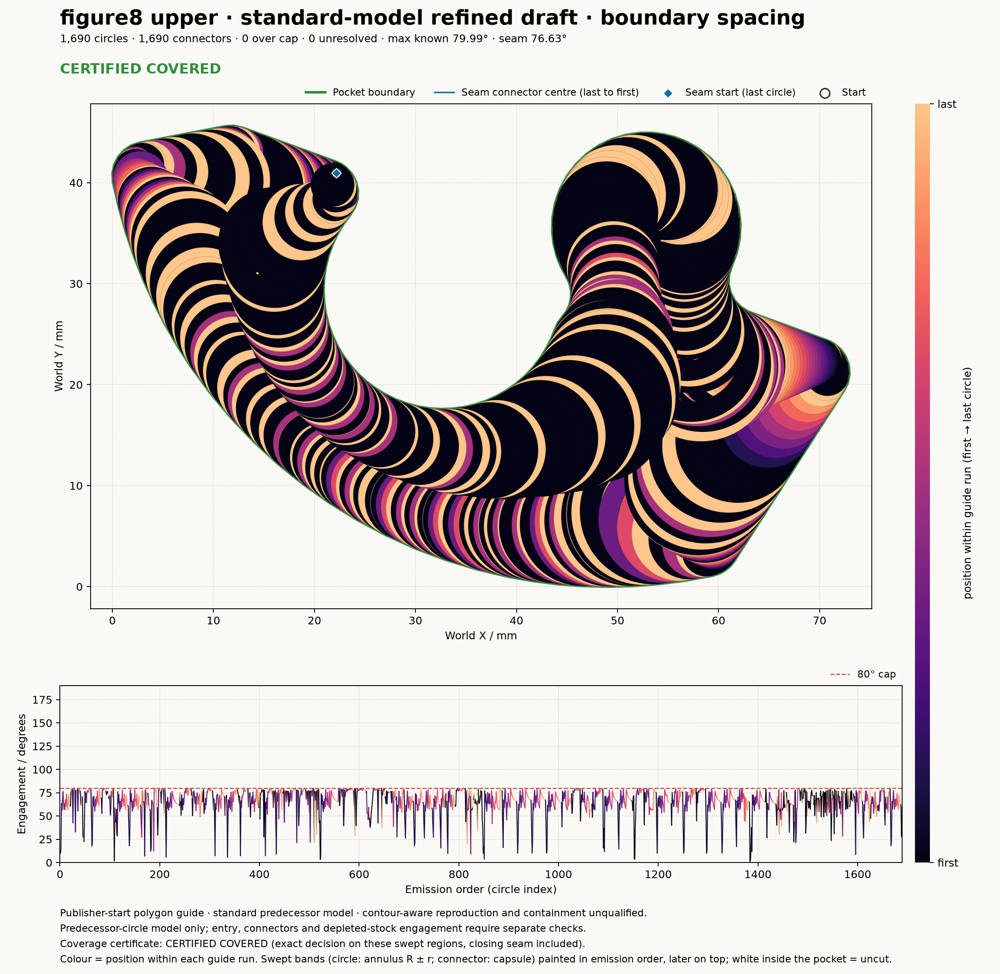
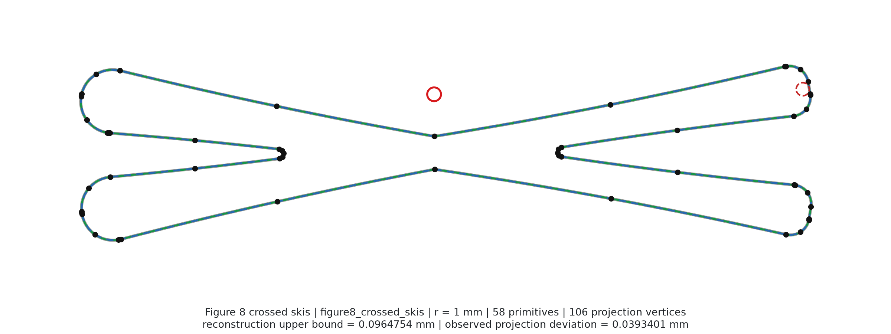
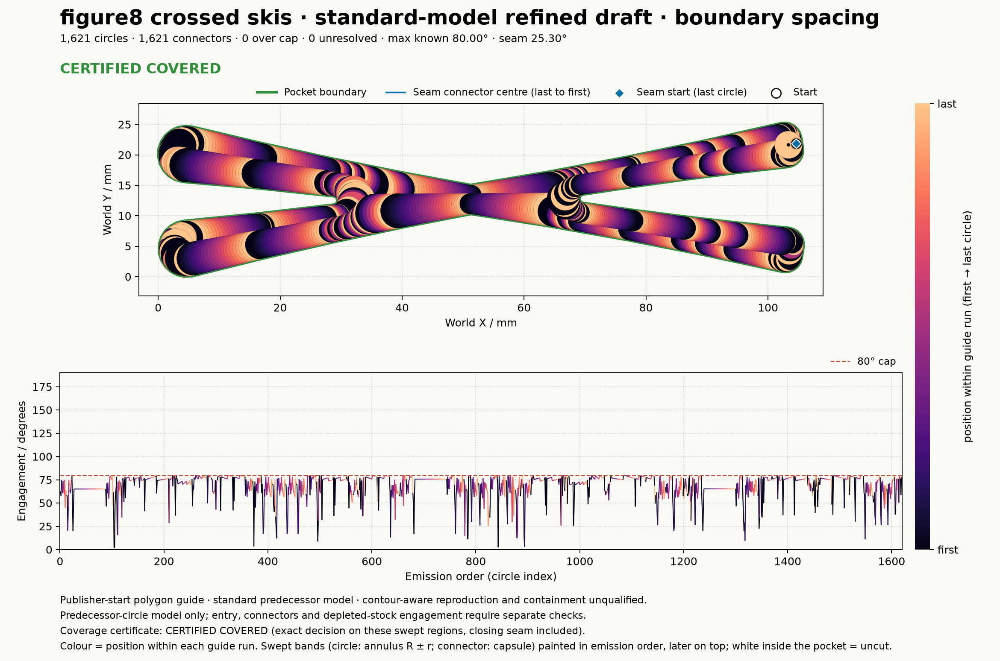
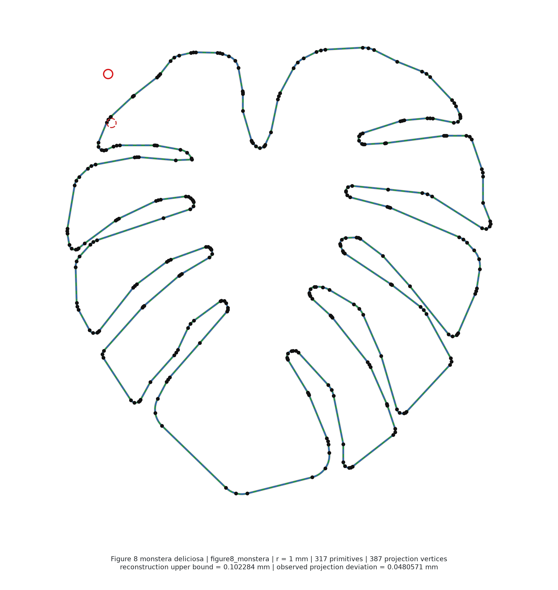
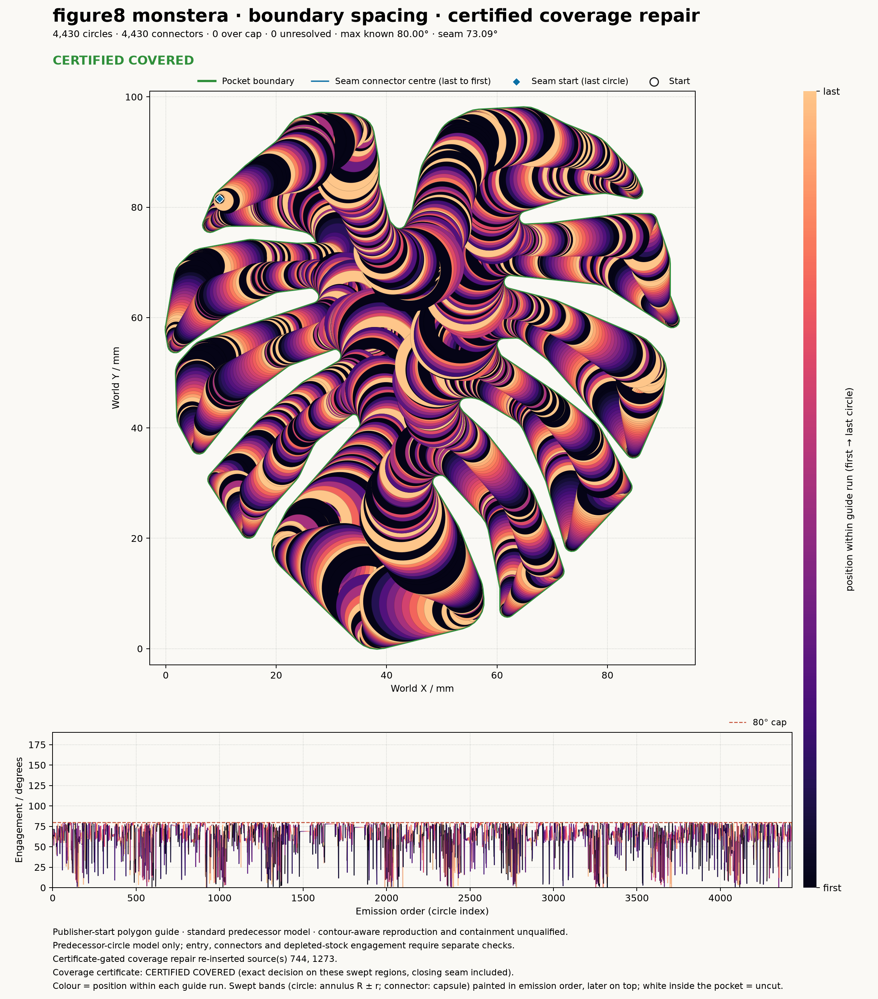
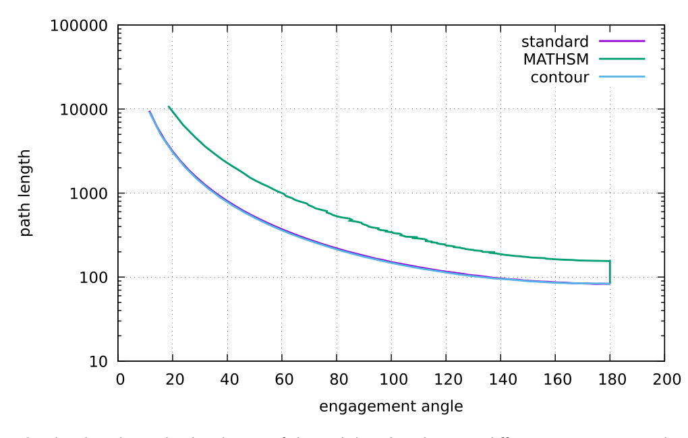
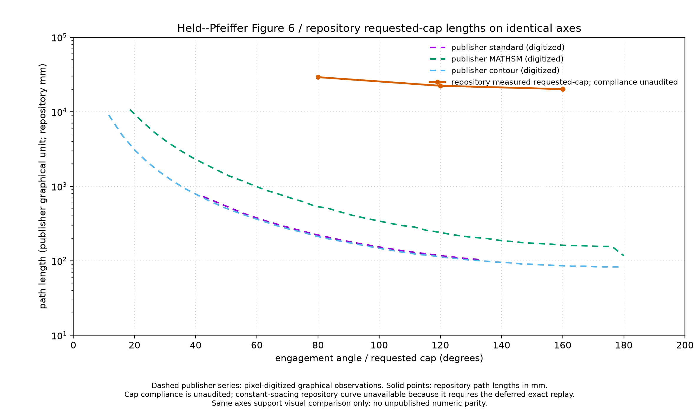

# Held Toolpath Gallery

!!! danger "Unqualified drafts: every path gouges"
    No panel below is a machining-qualified toolpath, because every pocket
    path gouges: an exact audit finds gouges on every pocket panel (Figures 5
    and 8), deepest at concave arcs; the Figure 6 paths are unaudited. See
    [Held qualification](held_qualification.md) for the evidence and the
    repair. The exact coverage certificate on the drawn swept regions decides
    each pocket panel: Figure 5 <!-- gv:fig5_refined.verdict -->CERTIFIED COVERED<!-- /gv -->; Figure 8 upper,
    boundary spacing <!-- gv:upper_boundary.verdict -->CERTIFIED COVERED<!-- /gv --> and lane spacing
    <!-- gv:upper_lane.verdict -->CERTIFIED COVERED<!-- /gv -->; crossed skis <!-- gv:skis.verdict -->CERTIFIED COVERED<!-- /gv -->; Monstera,
    after the certificate-gated coverage repair, <!-- gv:monstera_repaired.verdict -->CERTIFIED COVERED<!-- /gv -->.
    A covered path that gouges is still not machining-qualified.

Every panel below is a generated toolpath, circles and connectors emitted by
the repository's engagement-controlled generators from the prepared publisher
inputs, shown beside the publisher's own figure. Construction diagnostics
never appear here.

Each generated panel paints the swept band of every motion in emission order,
later motions on top: a circle of centre radius R sweeps the annulus R ± r
(r the tool radius; the full disk when R ≤ r), a connector or the closing seam
sweeps its centre polyline thickened by r. Colour ramps from first to last
circle within each guide run, and the engagement strip below uses the same
ramp. White inside the pocket is material the motion does not cut: nothing is
painted outside a band (each band's darker edge lies inside it, and the pocket
outline is clipped to the outside of the wall), up to one pixel of antialiasing
and the turn polygon's chord sagitta, under 0.005 mm on every pocket here
(`benchmarks/tools/held_sequence_plot.py`, pinned by its tests). Each figure
states the verdict of the exact coverage certificate on those same swept
regions, closing seam included. A panel the generators cannot produce yet is stated as
blocked with the missing capability, not filled with a placeholder. Rebuild
all of them with one command; every number printed on a panel is written by
that generator run. Each panel is the path of the benchmark generator
(`benchmarks/held_toolpath_benchmark.py`: refinement with the closing seam,
then the connector engagement post-gate), not a re-derivation. The numbers in
the captions below are filled from the JSON each figure run writes beside its
PNG (`benchmarks/tools/held_sequence_gallery_values.py`), never typed by hand.
The [performance record](held_performance.md) gates the counts in pytest
against its own recorded baseline (`pixi run held-toolpath-baseline`).

```bash
pixi run held-toolpath-figures
pixi run held-gallery-values
```

## Figure 5 · standard model

| publisher | generated |
| --- | --- |
|  |  |

`pixi run held-figure5-toolpath-progress --refine`: the publisher-start
polygon proposal with corner-aware engagement refinement, final-order
engagement per successor in the lower strip: <!-- gv:fig5_refined.circles -->2,004<!-- /gv --> circles,
<!-- gv:fig5_refined.connectors -->2,004<!-- /gv --> connectors (closing seam included), maximum
successor engagement <!-- gv:fig5_refined.max_deg -->79.99<!-- /gv -->° (a binary64 report of the
predecessor model, not the exact engagement gate). The coverage certificate
verdict is <!-- gv:fig5_refined.verdict -->CERTIFIED COVERED<!-- /gv -->; the path still gouges the concave arcs
([Held qualification](held_qualification.md)). The 2026-09-08 exact replay
remains set aside ([Held motion coverage](held_motion_coverage.md)); the
verdict comes from the coverage certificate, not from that replay. The
subtitle reports the closing seam pair (last circle to first) at <!-- gv:fig5_refined.seam_deg -->180.00<!-- /gv -->°, a
full-slot engagement the successor strip does not show. Per the user ruling
of 2026-10-21 that pair is report-only and circles[0] is not re-cut; the seam
connector's own engagement is certified separately
([Held connector engagement](held_connector_engagement.md)). Panels (b) contour-aware, (c) intermediate
machined contour and (d) MATHSM are blocked: the contour-aware
maximum-over-candidate placement and the constant-spacing MATHSM sweep on this
pocket are open items of the reproduction plan.

## Figure 8 · upper pocket

| publisher | generated, boundary-order spacing |
| --- | --- |
|  |  |

`pixi run held-reference-toolpaths --case figure8_upper --spacing boundary`.
<!-- gv:upper_boundary.circles -->1,690<!-- /gv --> circles. Coverage certificate:
<!-- gv:upper_boundary.verdict -->CERTIFIED COVERED<!-- /gv -->; the lane-spaced draft: <!-- gv:upper_lane.verdict -->CERTIFIED COVERED<!-- /gv -->.
The lane-spaced draft, `held_figure8_upper_standard_refined.png`, is the
earlier variant with <!-- gv:upper_lane.circles -->4,160<!-- /gv --> circles (generator
`pixi run held-reference-toolpaths --case figure8_upper`) and is kept as the comparison the spacing
work was measured against. The publisher panel is contour-aware; the
generated one is the standard predecessor model, and the gallery says so
rather than relabelling it.

## Figure 8 · crossed skis

| publisher | generated, boundary-order spacing |
| --- | --- |
|  |  |

`pixi run held-reference-toolpaths --case figure8_crossed_skis --spacing boundary`.
<!-- gv:skis.circles -->1,621<!-- /gv --> circles. Coverage certificate: <!-- gv:skis.verdict -->CERTIFIED COVERED<!-- /gv -->.

## Figure 8 · Monstera

| publisher | generated, boundary spacing, qualified contacts, corner approaches, certified coverage repair |
| --- | --- |
|  |  |

`pixi run held-reference-toolpaths --case figure8_monstera --spacing boundary --qualify-contacts --corner-approaches --certified-repair`:
bounded contact hypotheses with rejected alternatives recorded, concave
corners partitioned into approach, shared-contact rotation and departure, then
the certificate-gated coverage repair (`refine_boundary_ordered_path_certified`):
the full coverage certificate runs on the emitted path and, where it finds
uncut material, re-inserts the dropped boundary-order sources that cover it
and certifies again. It re-inserted <!-- gv:monstera_repaired.inserted_count -->2<!-- /gv -->
source(s), <!-- gv:monstera_repaired.inserted_sources -->744 and 1273<!-- /gv -->, for
<!-- gv:monstera_repaired.circles -->4,430<!-- /gv --> emitted circles. Coverage certificate:
<!-- gv:monstera_repaired.verdict -->CERTIFIED COVERED<!-- /gv -->. The unrepaired path
(<!-- gv:monstera.circles -->4,428<!-- /gv --> circles, <!-- gv:monstera.verdict -->NOT COVERED<!-- /gv --> with
<!-- gv:monstera.witnesses -->8<!-- /gv --> exact witnesses at <!-- gv:monstera.sites -->2<!-- /gv --> sites) is
the counterexample on the [Held qualification](held_qualification.md) page.

## Figure 6 · path length against engagement cap

| publisher | generated |
| --- | --- |
|  |  |

`pixi run held-figure6-same-axes`: repository path lengths at requested caps
of 80, 120 and 160 degrees from the controlled generator, on the publisher's
axes, cap compliance unaudited and the publisher ordinate and repository
millimetres without an established common scale. The contour-aware and
constant-spacing curves are blocked with the same items as Figure 5.

## Figure 7 · engagement maps

Blocked. No generator renders the per-position engagement maps of the three
algorithms; it needs the standard, contour-aware and MATHSM motions on the
Figure 5 pocket under one engagement measurement, which is the open Task 6
protocol of the reproduction plan.
