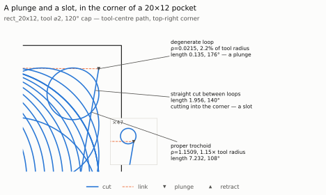
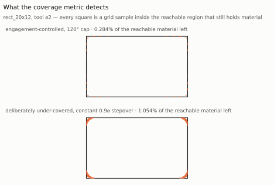
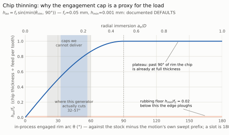
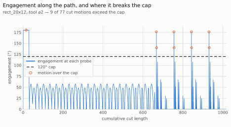
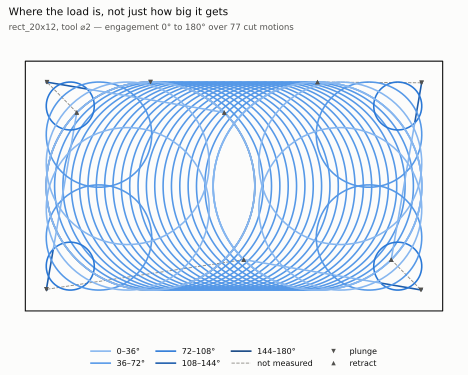
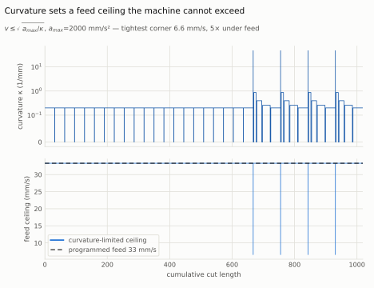
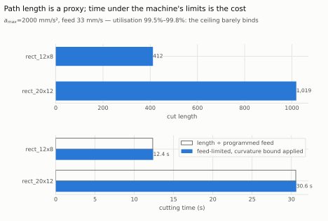
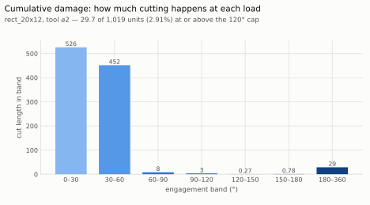
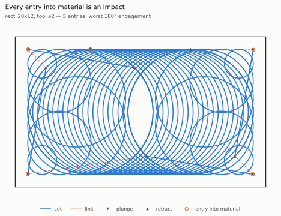

# Machining Quality

**Both of this project's headline claims rest on proxies, and neither proxy is the
quantity that matters.** The engagement cap is a proxy for tool load — the load
that breaks an edge is the maximum undeformed chip thickness `h_ex`, and below a
material-dependent floor `h_min` the edge *rubs* instead of cutting, which wears
it faster than a heavier cut does. Path length is a proxy for cycle time — feed
through a curve is bounded by `v ≤ sqrt(a_max / κ)`, so a shorter path with
sharper curvature can be *slower*. This page measures both proxies and both
quantities, separates what we computed from what we assumed, and reports that
neither generator currently produces a toolpath worth running.

The gate in `tests/benchmarks/test_quality.py` is **red on purpose**: twelve
cells, crossing three pockets and two generators at the default 120° cap and
the attribution 40° cap (40° is the one cap in the approved 40–100° sweep at
which every pocket's generator pair diverged). Every cell fails several
criteria; which ones, and by how much, is read from the pinned vectors in
[Measured](#measured), never typed here. The gate is a specification of the
target, not a description of the code: the current generators leave residue,
emit cuts that remove nothing, plunge into solid stock once per chain, and
exceed the cap on their entry cuts.

## How engagement is measured: in process

Engagement at a station inside a motion is read against the stock the motion
started from **minus that motion's own swept prefix** up to the station, not
against the static stock. The static reading was physically wrong in the most
basic case: a straight slot into solid stock read 360° (the whole rim sits in
the material the motion is about to cut), while the cutter physically engages
the leading half, 180°. The gate (`benchmarks/survey.py`) now asks
`_stock_2.engagement_line_prefixes` / `engagement_arc_prefixes` once per motion
and threshold:

- **Lines.** The prefix capsule covers exactly the closed rear half of the
  station's rim, so a straight slot reads 180° at every station after the first
  (`verify_direction.py`: `[0.0, 180.0, 180.0] ... [180.0, 180.0, 180.0]`, was
  `[0.0, 192.8, 205.7] ... [360.0, 360.0, 360.0]`). The cap and slotting
  verdicts stay exact: at a 180° cap the slot is within, at 179° it exceeds.
- **Arcs and circles.** The prefix is the start disk plus the annular sector
  swept so far. A full circle is an arc prefix from 0 to 2π; its seam is
  sampled once, at prefix 0, which is the static reading.
- **Travel order.** Stations follow the operation's turn direction. The gate
  streams cut clockwise, and the earlier sampler walked them counter-clockwise;
  the prefix model depends on the order, and so do the engagement gradient and
  the maximum engagement step.
- **Non-mutating.** The query reads the motion's starting stock and never
  depletes it; the replay still owns depletion.

The generators' own probe rings (`_station_is_admissible` in
`engagement_toolpath.py` and its importers) **still decide against the static
stock** until Task 1.1. The gate therefore measures physics that the generators
do not yet regulate. The figures on this page are redrawn by
`benchmarks/qualityfigures.py` under the same in-process instrument (rules 0.3);
the tool paths they show are unchanged, only the engagement read off them is.
Every gate number on this page is read from `benchmarks/results/gate_vectors.json`.

## The four groups

`benchmarks/quality.py` splits the question four ways, because a validity defect
and a tool-life cost should never be averaged together.

**Geometry-derived** (marked ▣) is computable from the toolpath plus the exact
stock: ours, reproducible from this repository. **Model-derived** (marked ◈)
depends on a workpiece material or a machine's dynamics and is only as good as
its calibration. A model-derived metric takes its model as an argument and raises
a named error when it is absent — `MissingMaterialModelError`,
`MissingMachineModelError` — so a guessed coefficient is never substituted.

| Group | Metric | Captures | Source |
| :--- | :--- | :--- | :--- |
| **elementary** | `uncut_fraction` | residue in the tool-**reachable** region | ▣ |
| | `gouge_free`, `gouging_motions` | cutter centre outside the legal domain | ▣ |
| | `rapid_safety`, `unsafe_rapids` | a rapid travelling in XY on the cutting plane | ▣ |
| | `continuity_breaks` | one cut not ending where the next begins | ▣ |
| | `zero_length_motions` | operations of no length | ▣ |
| | `degenerate_loops` | `ρ ≤ r`: a disk sweep, not a trochoid — **reported, not gated** (rule d) | ▣ |
| | `marginal_loops` | `r < ρ ≤ 1.5 r`: a hole too small to use | ▣ |
| | `redundant_operations` | **CUT** motions whose exact removal verdict is `NOTHING` (rule a; a `LINK` or lead that removes nothing is a stay-down transit, reported as `air_at_depth_length`) — even a certified region containing the true sweep misses the stock; `WITHIN_BAND` counts as removing and is reported as `PathSurvey.within_band_motions` ([bracket](exactness.md#deciding-on-a-model-that-is-only-a-bound-bracket-it)) | ▣ |
| | `material_plunges` | plunges whose disk meets the stock's interior, gated at ≤ the centre domain's component count (rule b) | ▣ |
| | `misplaced_plunges` | plunges whose foot is not bit-equal to the next motion's start (rule e) | ▣ |
| | `recut_fraction` | swept area meeting no fresh material | ▣ |
| **quality** | `max_engagement_deg`, `engagement_p95_deg`, `engagement_variance_deg2` | load level and steadiness | ▣ |
| | `cap_exceedances` | motions the exact cap predicate fired on | ▣ |
| | `max_chip_thickness_ratio`, `low_chip_thickness_ratio` | `h_ex / f_z` at the heavy and light ends | ▣ |
| | `max_engagement_gradient_deg_per_length` | load **shock** within a motion | ▣ |
| | `max_engagement_step_deg` | load shock **at** a junction: the next motion's first station with a non-empty prefix against the previous motion's last (rule f) | ▣ |
| | `slotting_motions` | straight motions over the cap — the same cap as a loop (rule c) | ▣ |
| | `immersion_steady_fraction`, `immersion_at_design_fraction`, `immersion_excursions` | whether the cut holds its commissioned bite | ▣ |
| | `mean_radial_depth`, `radial_depth_variance` | removal rate per unit travel | ▣ |
| | `wall_scallop_height` | deepest residue against a wall | ▣ |
| | `loop_radius_cv`, `max_loop_radius_step` | smoothness of the machining-circle centre locus | ▣ |
| | `max_chip_thickness_mm`, `low_chip_thickness_mm` | the same chip, as a length | ◈ material |
| | `rubbing_length`, `rubbing_fraction` | cut spent under `h_min`, ploughing | ◈ material |
| **speed** | `cutting_length`, `air_length`, `air_fraction` | where the path spends itself | ▣ |
| | `max_curvature` | where the feed ceiling is tightest | ▣ |
| | `tangent_breaks`, `curvature_breaks` | G1 and G2 discontinuities | ▣ |
| | `direction_reversals` | the tool turning back on itself | ▣ |
| | `retract_count`, `reentry_count` | clearance moves and plunges (reported) | ▣ |
| | `air_at_depth_length` | stay-down transits through cleared stock (reported) | ▣ |
| | `cutting_seconds`, `air_seconds`, `total_seconds` | feed-limited cycle time | ◈ machine |
| | `mean_cutting_feed_mm_per_s`, `feed_utilisation` | feed actually achieved against programmed | ◈ machine |
| **longevity** | `material_entries` | first contacts after a plunge, reported; superseded as a gate by `material_plunges` | ▣ |
| | `engagement_length_histogram` | cumulative damage, not just the peak | ▣ |
| | `cut_air_alternations`, `alternations_per_length` | thermal cycling | ▣ |
| | `cutting_speed_m_per_min`, `taylor_life_minutes`, `life_fraction_consumed` | Taylor life `V·Tⁿ = C` | ◈ both |

!!! warning "Two rim arcs and one textbook angle"

    The kernel reports the **engaged arc of the cutter rim**. What that arc means
    depends on which stock it is read against, and the cut and material metrics
    convert it differently for each reading:

    - **Static** (`_stock_2.engagement_at`, the generators' probe rings): read
      against the stock the motion is about to cut. A slot reads a full turn
      (360°). On a half-plane at tool radius 1, radial depths of 0, 0.5, 1.0, 1.5
      and 2.0 read 0, 120, 180, 240 and 360°, so `a_e = r(1 − cos(θ_rim/2))` and
      `θ_textbook = θ_rim / 2` (`textbook_engagement_deg`, pinned by
      `test_the_kernel_anchors_the_rim_arc_to_radial_depth_relation`).
    - **In process** (`benchmarks/survey.py`, the gate, since Task 0.1): read
      against the stock minus the motion's own swept prefix, which covers the
      rim's rear half. A slot reads a half turn (180°). The same depths read 0,
      60, 90, 120 and 180°, so `a_e = r(1 − cos θ_rim)` and
      `θ_textbook = θ_rim` (`in_process_textbook_engagement_deg`, pinned by
      `test_the_in_process_rim_arc_of_a_side_cut_is_the_textbook_angle`).

    Every immersion, chip-thickness and rubbing number on this page is computed
    from the survey, so it uses the in-process conversion
    (`in_process_radial_immersion`, `chip_thickness_ratio_from_in_process_rim`).
    Feeding an in-process reading through the static conversion would report a
    90° side cut (`a_e = r`) at immersion 0.146 instead of 0.5.

    **The cap number means two things until Task 1.1.** The generators still
    decide on the static reading: a station is admissible when its static rim
    arc is within `tea_cap`. The gate tests the in-process reading against the
    same `tea_cap` number. For a straight-wall side cut the static arc is twice
    the in-process one, so a generator held at a 120° cap cuts at about 60° in
    process, and the gate's cap is about twice as lenient as the generators'
    regulation for side cuts. `design_immersion` is the generators' commissioned
    load: the static conversion of the cap, `a_e = r(1 − cos(cap/2))`, which is
    the same `a_e/D` the in-process measurements report.

## Measured

!!! abstract "Stage 0 exit"

    Stage 0 changed the instrument, not the generators. It delivered in-process
    engagement (Task 0.1: a slot reads a half turn, not a full one), exact
    idempotent sweeps in the replay (Task 0.2), and gate rules 0.3 with the
    ratchet (Task 0.3, [below](#the-gate-rules-task-03)). Both generators remain
    red on every one of the twelve cases. `gouging_motions`, `unsafe_rapids`,
    `continuity_breaks`, `zero_length_motions`, `misplaced_plunges` and
    `max_loop_radius_step` hold on all of them; `uncut_fraction`,
    `redundant_operations`, `material_plunges`, `cap_exceedances` and
    `tangent_breaks` fail on all of them; `slotting_motions` and
    `max_engagement_step_deg` split by pocket and cap. At the 120° cap the worst
    junction step is 140.00° on rect_20x12 (52.01° on rect_12x8, 30.39° on
    L_shape), and every case peaks at 180.00°. From here on every gate commit
    must improve a gated cell in the table below and may worsen none. The
    figures before and after Stage 0 are juxtaposed on
    [Stage 0: the gate measures physics](refactor/stage0.md).

Every number in this section is generated: `tools/gate_table.py` renders
`benchmarks/results/gate_vectors.json` into the table below, which this page
includes; `tests/tools/test_gate_table.py` holds the two byte-for-byte. Gated
criteria are bold; their `required` column is the gate's threshold. At the
120° cap the two generators return identical motion streams, so their columns
are identical in pairs. Regenerate with `pixi run gate-vectors`.

--8<-- "benchmarks/results/gate_vectors.md"

!!! note "The two-cap gate separates saturation from attribution"

    At 120°, `radius_regulated_toolpath` and `engagement_controlled_toolpath`
    emit structurally identical complete operation streams on all three pockets;
    the radius ladder never leaves its top rung. At 40°, the complete streams
    diverge on all three. The executable witness preserves defining Line/Circle
    binary64 geometry, operation metadata, tangents, order, and duplicates.
    This establishes attribution at the tighter cap; it does not make either
    generator's quality cells green.

## The gate rules (Task 0.3)

The gate decides thirteen criteria (`benchmarks.quality_observations.CRITERION_NAMES`).
Six rules changed what four of them mean and added two, each pinned by a
synthetic path in `tests/benchmarks/test_gate_rules.py`:

- **(a) Redundant is a CUT that removes nothing.** The operation's label decides
  (Ruling 0.3-C11): a `CUT` owns removal, so a `CUT` whose exact verdict is
  `NOTHING` is waste. A `LINK`, `LEAD_IN` or `LEAD_OUT` at the cut plane that
  removes nothing is a legal stay-down transit; its length is reported as
  `air_at_depth_length` and it is still judged by the cap like every motion. The
  frozen generators emit no `LINK` at depth, so this rule moves none of their
  cells: every zero-removal motion they emit is a labelled `CUT`.
- **(b) Plunges into material are bounded by the centre domain.** At each plunge,
  before its disk is subtracted, the replay asks the exact regularized
  interior-intersection predicate whether the tool disk meets the stock
  (`Stock.circle_sweep_removal` with a guide radius of zero, non-mutating). A
  connected cutter-centre domain admits one plunge into material; every further
  one could have been reached by a stay-down transit or a ramped entry. The
  threshold is the domain's component count, read by the coverage pass from the
  same `ReachableMaterialPredicate2` its grid queries
  (`center_component_count`, one on every gate pocket), so a reduction builds
  one predicate. The frozen generators plunge into material once per chain, so this
  criterion now fails on every case. Retracts stay reported.
- **(c) Slotting is a straight motion over the cap.** The same cap as a loop; the
  half-cap threshold (`SLOT_ENGAGEMENT_FRACTION`, an engineering judgement with
  no literature behind it) is gone, and with it the second engagement query per
  line. Slotting is the straight-motion subset of the cap exceedances: it names
  the defect, it does not add a threshold.
- **(d) Degenerate loops are reported, not gated.** A `ρ ≤ r` circle in cleared
  stock is legitimate cleanup; whether it loads the tool is the cap's question.
  `degenerate_loops` stays in the report and in the attribution.
- **(e) A plunge must land on the next motion's start.** Exact binary64 equality
  of the plunge's foot and the next motion's start: the replay injects both as
  themselves, so equal doubles are the same exact point. A plunge no cut motion
  follows is misplaced. No frozen-generator case misplaces a plunge; the rule
  guards the pipeline.
- **(f) The engagement step is read at the junction.** The step between two
  motions run back to back is the next motion's first station with a non-empty
  swept prefix (station 1; station 0 reads 0° by construction, the tool sitting
  in its own start disk) against the previous motion's last station (Ruling
  0.3-f-station). The old reading — the difference of the two motions' peaks —
  compared loads the edge never felt back to back. The step stays a reported
  sampled diagnostic (Ruling 0.3-C6); the cap verdicts at those stations stay
  exact. A closed loop samples its seam once, at the start, so its last
  per-motion station sits a station spacing before it ends; its junction is
  read at one extra station instead, the seam with the full turn as prefix
  (`MotionQuality.exit_sample`, Ruling 0.3-f-loop). That station serves the
  junction only and enters no other statistic.

## The ratchet

`benchmarks/results/gate_vectors.json` is the single results file for the gate
(schema `gate-vectors/1`, `tools/gate_vectors.py`). Each (case, criterion) cell
is a decimal string at the gate's report precision. `tools/gate_ratchet.py`
compares the file at each commit with the file at its parent:

- a commit **worsens** when any gated cell of a shared case rises or a case is
  dropped; that fails on every commit, whatever it touches;
- a commit that changes a gate path (`GATE_PATHS`: the Python gate modules and
  `src/compas_cgal/pipeline/`; C++ kernels are out, Ruling 0.3-C3) must
  **improve** at least one gated cell;
- a new generator column improves iff it beats the per-(cap, pocket) minimum of
  the existing generators on some cell and exceeds it on none (Ruling 0.3-C2,
  option i);
- a `rules_version` change is accepted only with a recorded approval
  (`rebaseline: {from, approval, criteria, retired}`, the approval citing a
  ledger ruling id; `pixi run gate-vectors` keeps an existing record), never
  silently. It re-baselines only the gated criteria listed in `criteria` (each
  a gated criterion of the new vectors; a newly gated criterion must be
  listed). Every criterion the old vectors gated that the new ones do not
  (removed, or demoted to reported) must be listed in `retired`, which may name
  only such criteria. The two lists may not both be empty. Every unchanged
  criterion is still checked for worsening and dropped cases on the bump
  commit (Ruling 0.3-bump-worsens); the recorded bump itself counts as the gate
  commit's improvement. Under one rules version the gated criteria cannot
  change at all. Re-measure a bump with
  `python -m tools.gate_measure --rebaseline-approval '<ruling line>' --rebaseline-criteria NAME ... --rebaseline-retired NAME ...`.

`pixi run gate-ratchet` checks `GATE_BASE..HEAD` (default `HEAD^..HEAD`) and then
re-measures the working tree for freshness: every gated cell and every reported
integer must match exactly. Reported floats and wall-clock cells are stored for
the reader and never compared (Ruling 0.3-CI-fresh: their last digit is not
guaranteed to agree across platforms).
`tests/tools/test_gate_ratchet.py` holds the semantics, including a synthetic
regression the ratchet must refuse and a contract test that every repository
module the gate imports is a gate path or listed with a reason. A stage exits
when `pixi run red-manifest` and `pixi run gate-ratchet` pass and its exit-gate
test passes (`tests/benchmarks/test_stage_exit.py`, rows in
`benchmarks/stage_acceptance.py`).

## Elementary

<figure markdown>
  
  <figcaption><strong>Rules 0.3, in-process engagement; labels measured at draw time, not gate cells.</strong> The defect a machinist sees first. Between two ordinary trochoids
  the generator emits a loop a few percent of the tool radius across, engaged
  about a half turn (radius, length and engagement are on the figure). That is
  a plunge, not a trochoid: below ρ = r the swept region is a filled disk with no
  uncut core, so the cutter never disengages. The straight cut leaving it runs
  into the corner over the cap, which is a slot. Contrary to the first report of
  this defect, the degenerate loops are not idle: removing them raised residue
  above the <code>uncut_fraction</code> cell (measured at commit 70049dd9), so
  they cut, badly. Whether a loop removes nothing is the exact
  <code>redundant_operations</code> verdict in the table.</figcaption>
</figure>

<figure markdown>
  
  <figcaption><strong>Rules 0.3, in-process engagement; labels measured at draw time, not gate cells.</strong> Residue is measured against the tool-<em>reachable</em> region, never
  the pocket: a sharp corner a round cutter can never enter is not residue, and
  counting it would put a floor under every path. The deliberately under-covered
  path beside it shows what the metric detects when a stepover is genuinely too
  coarse.</figcaption>
</figure>

## Quality

<figure markdown>
  
  <figcaption><strong>Rules 0.3, in-process engagement; labels measured at draw time, not gate cells.</strong> Why the cap is a proxy. The chip is <code>h(φ) = f_z sin φ</code>,
  so, in the gate's in-process rim arc, <code>h_ex/f_z = sin(min(θ_rim, 90°))</code> — it rises as a sine and then
  <em>plateaus</em>, never falling. Two consequences. Below the plateau the same
  feed produces a thinner and thinner chip, so holding a tighter cap without
  compensating <code>f_z</code> silently reduces the load until the edge stops
  cutting and starts rubbing; this is why a <em>lower</em> bound on engagement
  matters and why nothing else in this suite expressed one. Above it, engagement
  can be tightened with no effect on the load at all. Read in process, this
  generator operates entirely on the rising limb — the band the figure marks,
  below the 95th-percentile <code>engagement_p95_deg</code> of 57.58° on
  rect_20x12 — so chip thinning bites across its whole working range, and the
  shaded caps we cannot yet deliver overlap it. The rubbing floor uses documented <em>defaults</em>,
  stated on the figure, not a measurement of any real material.</figcaption>
</figure>

<figure markdown>
  
  <figcaption><strong>Rules 0.3, in-process engagement; labels measured at draw time, not gate cells.</strong> The cap is honoured almost everywhere and violated in the same
  places every time: the chain-entry slot at the start and the corner cuts
  (<code>cap_exceedances</code> 9 on rect_20x12 at 120°). What the peak alone
  hides is the gradient: engagement changes by up to 58,576.8° per unit of
  travel within a single motion
  (<code>max_engagement_gradient_deg_per_length</code>), and load shock damages
  an edge more than a high steady load does.</figcaption>
</figure>

<figure markdown>
  
  <figcaption><strong>Rules 0.3, in-process engagement; labels measured at draw time, not gate cells.</strong> The same measurement placed back on the pocket, so a peak can be
  attributed to a location rather than to an operation index. Read in process,
  the heaviest motions are the corner loops and the cuts into the corners, not
  the long trochoids along the spine.</figcaption>
</figure>

## Speed

<figure markdown>
  
  <figcaption><strong>Rules 0.3, in-process engagement; labels measured at draw time, not gate cells.</strong> Curvature along the path, and the feed it permits under
  <code>v ≤ sqrt(a_max/κ)</code>. The tightest corner drops the achievable feed
  well below the programmed feed. Honestly, though: integrated over the whole
  path the ceiling costs little of the cycle time at this machine model, because
  the sharp features are short. The thesis that length is a proxy for time is
  correct in principle and small in magnitude here.</figcaption>
</figure>

<figure markdown>
  
  <figcaption><strong>Rules 0.3, in-process engagement; labels measured at draw time, not gate cells.</strong> Length and time side by side under a stated machine model. Time is
  a lower bound: it holds each motion to its curvature ceiling but charges
  nothing for the acceleration ramps or for the tangent breaks the same paths
  carry (<code>tangent_breaks</code> 24 on rect_12x8 and 32 on rect_20x12 at
  120°).</figcaption>
</figure>

## Longevity

<figure markdown>
  
  <figcaption><strong>Rules 0.3, in-process engagement; labels measured at draw time, not gate cells.</strong> Cumulative damage, which a peak cannot describe. Read in process,
  almost all of the cut length sits below 60° (525.960 in the 0–30° band and
  451.970 in the 30–60° band on rect_20x12 at 120°), the light end where chip
  thinning applies; 28.612 units sit in the top band, which is the chain-entry
  slots.</figcaption>
</figure>

<figure markdown>
  
  <figcaption><strong>Rules 0.3, in-process engagement; labels measured at draw time, not gate cells.</strong> Every entry is an impact, and impacts chip edges. Five on the
  rectangles, eight on the L — one per skeleton chain, because the generator has
  no entry strategy other than plunging.</figcaption>
</figure>

## Where the thresholds come from

Cited concepts, and — separately — the places where a number is our judgement.

| Threshold | Basis |
| :--- | :--- |
| `degenerate_loops`: `ρ ≤ r` | **Physics, reported, not gated.** The swept annulus is `[ρ−r, ρ+r]`; at `ρ ≤ r` it has no hole, the tool passes over its own loop centre, and there is no trochoidal relief. A qualitative boundary, tested exactly; the cap decides whether such a loop loads the tool. |
| `material_plunges` ≤ components | **Derived.** One plunge into material reaches every point of a connected centre domain; a second bores solid stock a stay-down transit could have reached. Decided by an exact interior-intersection predicate. |
| `misplaced_plunges` = 0 | **Exact.** Bit-equality of two injected doubles is equality of the exact points; there is no tolerance to choose. |
| `max_loop_radius_step` ≤ 2 r | **Derived.** Clearance along a skeleton chain is 1-Lipschitz, so the radius change between consecutive stations cannot exceed the advance, which is capped at 1 tool diameter. A larger step did not come from advancing. |
| chip thinning, `h_min` | **Literature.** `h_ex = f_z sin φ`; `h_min` is commonly cited at 5–30% of the cutting-edge radius, and a sharp carbide edge at ~5 µm gives `h_min` ≈ 1–2 µm. |
| Taylor life | **Literature.** `V·Tⁿ = C`, carbide `n ≈ 0.2–0.4`. |
| feed ceiling | **Literature.** Curvature- and jerk-limited feed scheduling, `v ≤ sqrt(a_max/κ)`. |
| `uncut_fraction` = 0 | **Judgement**, and a mild one: a roughing pass must clear what the tool can reach. Measured on a grid, so it demands that not one reachable sample survives. |
| `marginal_loops`: `ρ ≤ 1.5 r` | **Judgement.** At 1.5 r the uncut core is half a tool radius across. Deliberately a separate field from the physics boundary. |
| `slotting_motions` = 0 | **The cap itself.** A straight motion over the cap; the earlier half-cap judgement is retired. |
| `max_engagement_step_deg` ≤ cap | **Judgement.** The load may not swing by more than the entire commissioned load across a junction between two motions run back to back, read at the junction. |
| `tangent_breaks` = 0 | **Project goal**, not an external standard: this repository already treats tangent continuity as a design objective. |

Deliberately **not** gated: `air_fraction` (depends on the machine's rapid rate,
not on the path); `air_at_depth_length` (a legal transit's cost in feed time);
`recut_fraction` (a trochoidal path scores ~0.9 by construction, since
consecutive loops are meant to overlap); `degenerate_loops` (rule d);
`material_entries` (superseded by the gated `material_plunges`, which asks the
exact question of whether the plunge bored material, instead of counting first
contacts); `curvature_breaks`; and `loop_radius_cv` — on a rectangle the medial
axis carries a spine of constant clearance and four branches on which clearance
falls to zero at the corners, so a coefficient of variation near 0.5 is
*intrinsic* to placing centres on the skeleton at all. The number that would make
a threshold defensible is the one a middle-curve implementation produces, and it
does not exist yet.

!!! note "Two tool-diameter channels are machined as plunges (historical finding, commit 70049dd9)"

    Measured at commit 70049dd9 (2026-08-22, static engagement model); not a
    gate cell and not re-measured since. A loop centred on the spine of a channel of width `W` has radius at most
    `W/2 − r`, so a trochoid needs `W > 4r` — an arm strictly wider than two tool
    diameters. Asked to machine a channel of exactly two, both generators emit 68
    circles at radius 0.998 against a tool radius of 1.0: every one a disk sweep.
    The honest response to `W ≤ 4r` is to decline or to switch strategy, not to
    emit 68 plunges. Recorded as a finding; not gated, because the gate corpus
    deliberately avoids the degenerate width.

## Regenerating

Every gate number on this page is read from the pinned vectors, and every
figure is produced by committed code, never a one-off script:

```bash
pixi run gate-vectors      # re-measure the 12 gate cases; rewrite gate_vectors.{json,md}
pixi run gate-ratchet      # ratchet GATE_BASE..HEAD, then check the vectors are fresh
pixi run figures           # rebuild the extension, redraw every published figure (light theme)
```

`benchmarks/figures.py::regenerate_every_figure` redraws the tool-path comparison
and all nine quality figures, in both themes, byte-reproducibly.
