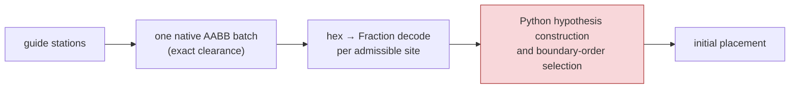
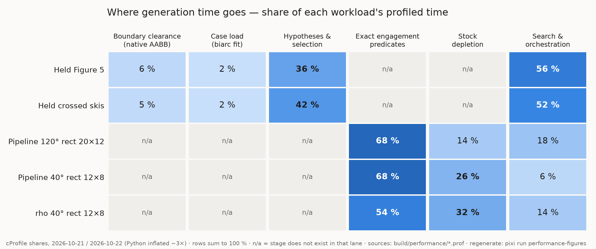
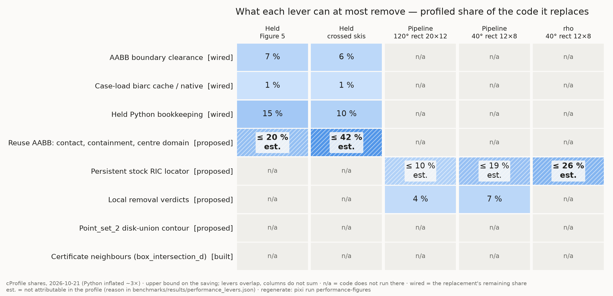

# Performance

The Held generators are still too slow, but the dominant defect is fixed:
the brute-force boundary clearance search is replaced by a native, indexed,
exact query, wired into the generator with byte-identical output. Figure 5
generation went from 20.9 s (committed baseline) to 3.23 s (one orchestrator
measurement on a loaded machine, 2026-10-21). That is still about 6.5× over
its proposed 0.5 s budget. The cost has moved to the Python hypothesis
construction and selection, which is now the [next lever](#next-lever). The
coverage certificate's circle core meets its budget. Its phase 2 does not
yet finish on Figure 5.

!!! danger "These are draft paths"
    No published Held path is machining-qualified: every one gouges concave
    arcs, and Monstera leaves uncut islands. See
    [Held Qualification](held_qualification.md). Every Held time on this page
    is the time to generate a draft path.

!!! warning "Status: under way (2026-10-21)"
    Wired: native clearance (lever 1), case-load cache (lever 2), Held
    bookkeeping (lever 3). Certificate: phase 1 done, phase 2 in progress and
    over budget. The committed baseline
    `benchmarks/results/held_toolpath_baseline.json` predates all of them. It
    is scheduled for one deliberate re-record (`pixi run held-toolpath-baseline`)
    on a quiet machine, after the pending Held units land. Until then, each
    "current" cell names its own measurement.

## Policy

Performance is part of a stage's definition of done, alongside correctness:

1. **Budget first.** Every new module or stage states its time budget in
   seconds on a named real workload before any code is written. Example: the
   coverage certificate must run in ≤ 5 s on Monstera, on one core.
2. **Profile in the first draft.** A first implementation ships with a
   profile of its real workload, not of a toy fixture.
3. **Slow is red.** A first measurement over budget is a failing finding with
   a root cause. It is never recorded as a baseline with headroom.
4. **Replace, never drop.** A check too slow to run gets a faster formulation
   that decides the same thing. Dropping one is how two uncut islands shipped
   on Monstera (see [Held Coverage Certificate](held_coverage_certificate.md)).
5. **Never buy speed with exactness.** No epsilons, coarser rungs, fewer
   samples or approximate certificates. Speed comes from indexing, native
   code, filtered exact predicates and locality, per
   [Exact-Kernel Discipline](exactness.md).
6. **Measure quietly.** Wall-clock numbers come from serial runs, one case at
   a time, in fresh processes, on a machine with no other suite running, and
   are compared only within one run.

## Budgets

| workload | budget | current | source of current | status |
| --- | ---: | ---: | --- | --- |
| Held Figure 5 generation | ≤ 0.5 s (proposed) | 3.23 s (initial stage 2.79 s), 2,010 circles | one run of `benchmarks.held_toolpath_benchmark` workload `figure5_refined` by the orchestrator, 2026-10-21, **machine loaded** (breaks policy 6) | ~6.5× over |
| Held Figure 8 crossed skis generation (1,616 circles) | ≤ 0.5 s (proposed) | 36.5 s, pre-wiring | `held_toolpath_baseline.json`, recorded 2026-09-08 (stale) | not re-measured since wiring |
| Held Figure 8 upper generation, boundary (1,684 circles) | ≤ 1 s (proposed) | 92.9 s, pre-wiring | same (stale) | not re-measured since wiring |
| Held Figure 8 upper generation, lane (4,183 circles) | ≤ 1 s (proposed) | 90.9 s, pre-wiring | same (stale) | not re-measured since wiring |
| Held Monstera generation (4,367 circles) | ≤ 5 s (proposed) | 449.8 s, pre-wiring | same (stale) | not re-measured since wiring |
| Held case load (biarc reconstruction), Figure 5 | ≤ 0.5 s (proposed) | warm 0.079 s, cold 7.95 s (medians of 3) | `python -m benchmarks.held_reference_case_load_timing` → `build/held-case-cache-timing/timing.json`, 2026-10-21, load average 47–79; no pixi task yet | met when warm |
| Held coverage certificate, Monstera | ≤ 5 s (user-approved) | phase 1 (circles only): 1.14 s, median of 3. Phase 2: did not finish on Figure 5 within 11 CPU-minutes | `CoverageCertificate.build`, timed by the phase-1 and overlay work, 2026-10-21, load average ~24 and ~70; no pixi task yet | phase 1 within; **phase 2 over** |
| Actual-stock engine, Monstera: full replay (circle + connector sweeps) and one 45-station decision per circle | ≤ 5 s CPU, one core; ≤ 0.25 ms per sweep, ≤ 0.6 ms per query (user-approved) | stopped at the budget after about 1.5 % of the sweeps; prefix means 60× (sweep) and 82× (query) over the split | `pixi run actual-stock-engine-budget` (median of 3 fresh-process runs) and the generated table in [Held Actual-Stock Engine](held_actual_stock_engine.md#2-where-the-time-goes-today), 2026-10-21, load average 16–29 | **over** |
| Actual-stock engine, Figure 5: same replay and decisions | ≤ 2.5 s CPU, one core (user-approved) | stopped at the budget after about 3 % of the sweeps | same | **over** |

The circle counts in the stale rows are those of the 2026-09-08 baseline.
Figure 5 now emits 2,010 circles instead of 2,013, because the exact
engagement-cap decision no longer subdivides three internally tangent pairs
that the float model misread; the re-record will carry that. The proposed
generation budgets are about one hundredth of the recorded times. They stay
"proposed" until the user approves them. The 3× ceilings in
[Held Performance](held_performance.md) protect the defect and are to be
replaced by these budgets. Changing a gate needs the user's go.

## Where the time goes

In the committed baseline (pre-wiring), the initial placement was 98–99 % of
every Held generation (`stage_seconds.initial` against `generation_seconds`
in `held_toolpath_baseline.json`). Wiring the native clearance shrinks that
stage on Figure 5 from 20.6 s to 2.79 s of 3.23 s (the orchestrator run in
the budget table). The placement is still the bulk; what dominates inside it
has changed.

A cProfile of the Figure 5 workload, regenerated against the wired path,
shows what the placement does now. The profiler inflates wall time, so read
the shares, not the seconds:

--8<-- "benchmarks/results/performance_fig5_callpaths.md"

## Next lever

**Hypotheses and selection.** In the current profiles, Python hypothesis
construction and boundary-order selection is the largest Held bucket:
`shares_percent.hypotheses_selection` in
`benchmarks/results/performance_time_buckets.json` is 57.11 % for Figure 5
and 68.42 % for crossed skis (profiles dated 2026-10-21, written by
`tools.performance_heatmap`; regenerate with `pixi run performance-figures`).
Two levers in the [lever heatmap](#lever-detail) cut into it, and neither is
started:

- reuse the boundary `AABB_tree` for contact projection, containment and
  `CutterCentreDomain2` (an estimated cell; its reason is recorded in
  `benchmarks/results/performance_lever_shares.json`);
- the remaining Python bookkeeping.

Like every lever, it must leave the generated path byte-identical and land
with an old-against-new measurement.

## Levers

| # | lever | decides the same thing? | status | evidence |
| --- | --- | --- | --- | --- |
| 1 | Native, spatially indexed, exact nearest-boundary query (`AABB_tree`) in place of `_station_records` / `_project_exact` | yes: generation digests identical before and after on Figure 5, crossed skis and upper; equivalence test on every Figure 5 station plus a Hypothesis property on random rings | **wired** (native code `7ef897b7`; wiring uncommitted). The Fraction path stays beside it as the equivalence oracle until the user approves its removal | Figure 5 generation 20.9 → 3.23 s (budget table); residual cost is `boundary_clearance` in `performance_time_buckets.json` |
| 2 | Case load: exact biarc reconstruction cached under a content-addressed `ReconstructionBuildIdentity` (case bytes, deciding-source digest, interpreter, platform, cache format) | yes: a hit equals a fresh reconstruction bit for bit, signed zeros included | **built and wired** into `load_held_reference_case` (uncommitted) | warm Figure 5 load in the budget table; `case_load` in `performance_time_buckets.json` |
| 3 | Held Python bookkeeping: hoisted boundary segments and arclength offsets, tuple-based owners, per-span placement validation | yes: path digests identical on all three workloads; Hypothesis properties against verbatim copies of the old code | **done** (uncommitted) | residual cell `held_bookkeeping` in `performance_lever_shares.json` |
| 4 | Exact coverage certificate, local per boundary arc, CORE-free, interval-filtered | replaces the dropped replay, deciding exact coverage of Ω ⊕ tool disk | **phase 1 done** (circle core, `_coverage_certificate_2`); **phase 2 in progress** (capsules, target pieces) and over budget | budget table |
| 5 | Coverage-preserving selection: boundary-order selection may drop a circle only if the certificate still holds | fixes the Monstera islands, whose covering circles were all dropped | blocked on lever 4 phase 2 | — |

`benchmarks/results/performance_levers.json`, the committed mapping behind
the lever heatmap, still labels levers 2 and 3 `proposed`. The table above is
the status. The heatmap's cells are unaffected, since they measure code that
still runs.

Each lever lands with its own measurement: old against new, serial, three
runs, median, on the named workload. Numbers go into the budget table with
their source.

## Spatial indexing

**The Held boundary clearance now runs on CGAL's `AABB_tree`. The stock already uses CGAL's spatial machinery, but it throws its point-location structure away after every edit.**

- **Held.** The brute-force nearest-boundary search is gone from the generation path. Its replacement's residual share is `boundary_clearance` in `performance_time_buckets.json`. What remains is not spatial: Python hypothesis construction and selection (the [next lever](#next-lever)) and the per-site `Fraction` decode of the native batch.
- **Stock.** The product pipeline and rho already answer engagement with `Arrangement_zone_2` seeded by a trapezoid-RIC locator. Warm queries grow only from 0.10 to 0.21 ms as the arrangement grows to 1,000 edges. The defect is that the locator is rebuilt from scratch, O(n log n), twice per sweep.
- **Not spatial.** Half of exact station classification time is memory allocation. No spatial index changes that.

The stock figures were measured 2026-10-17 on a loaded machine. Audit and profiles: `.superpowers/sdd/2026-10-13-product-pipeline/spatial-index-audit-report.md` and `build/spatial-audit/`.

How to read it:

- **Held lanes:** hypotheses and selection lead. Boundary clearance (native
  AABB) and case load are now minor columns.
- **Stock lanes (pipeline, rho):** the exact engagement predicates lead,
  followed by stock depletion.
- **What has an index lever:** part of the Held hypotheses column (reuse of
  the boundary `AABB_tree`) and part of the stock-depletion column (a
  persistent locator).
- **What doesn't:** the engagement-predicate column. About half of it is
  allocation churn in the exact number types.

Rows are disjoint buckets that sum to 100 %. The Held rows use profile
subtrees; the stock rows use self-time of the native-call wrappers. The
figure and its shares (`benchmarks/results/performance_time_buckets.json`)
come from `tools.performance_heatmap`, reading one cProfile per workload from
`tools.performance_profile`. Each workload entry in that file records its
profile's date, commit and whether the tree was dirty.

!!! note "Cache state and load move the Held shares"
    The case-load column depends on whether the reconstruction cache is
    warm; the committed profiles hit it. They also ran on a heavily loaded
    machine, which inflates the clearance share. The profiler does not yet
    record cache hit or miss.

Regenerate: `pixi run performance-figures`

### Lever detail

How to read it:

- **A cell** is the profiled share of that workload's time spent in the code the lever replaces: an upper bound on its saving there. For a wired lever it is the time its replacement still costs. Levers overlap, so a column does not sum.
- **n/a** means none of the lever's code runs in that workload; **est.** (hatched) means the profile cannot attribute it exactly, for the reason recorded in `benchmarks/results/performance_levers.json`.
- **The mapping** from each lever to the functions it replaces is that committed file; `tools.performance_lever_heatmap` fails on any function the source or the profile no longer has.

Regenerate: `pixi run performance-figures`

| hot spot | today | CGAL tool | expected effect | exactness note | status |
| --- | --- | --- | --- | --- | --- |
| Held station → admissible boundary sites (`held_figure5_raw_guide.py`, `_native_station_boundary`) | one native batch per guide; the residual cost is the hex → `Fraction` decode and site construction (call paths above) | `AABB_tree` of `Segment_2` | done: lever 1 | Epick with exact injection; the pruning box comes from a certified interval upper bound; decisions are `Filtered_predicate`s | wired |
| Held case load: biarc certification (`held_reference_geometry.py`) | cached by content; recursive `Fraction` subdivision only on a miss | none: a content-addressed cache | done: lever 2 | a cache hit is the same exact result; the key holds the deciding-source digest | wired |
| Stock point location (`stock_local_2.cpp:338`, `stock_2.cpp:265`) | `Arr_trapezoid_ric_point_location` rebuilt per sweep and again per query epoch, O(n log n) | one persistent RIC locator; it is an arrangement observer and updates incrementally | rho −20…35 %, pipeline cap-40 −10…20 %, cap-120 −5…8 % (estimated, spatial-index audit) | the locator holds no numbers, and every decision stays a traits predicate. Re-attach it per clone and never share it across copied `Gps` (see Copying a `Gps`, [Exact-Kernel Discipline](exactness.md)) | proposed |
| Removal verdicts (`circle_sweep_removal`, `line_sweep_removal`) | global `Gps::do_intersect` sweep, O(n log n); cell `local_removal_verdicts` above | zone of the region boundary through the stock with the persistent locator, plus an island check in the one face it falls in | most of that cell | same circle-segment traits predicates | proposed |
| Held contact projection, containment report, `CutterCentreDomain2` | O(n) edge scan per query × hypotheses or per circle; cell `aabb_reuse_contact_containment` above (est.) | reuse the boundary `AABB_tree` | part of the [next lever](#next-lever) | ties stay detectable, because the box contains every tied segment | proposed |
| Held disk-union contour (`held_disk_contour_2.cpp`, `held_contour_clearance_2.cpp`) | global `join` per appended disk plus a scan of every edge per query, O(n²) per lane | `Point_set_2` (Epeck) on centres, a range search to find candidates, then a local union of only the disks that meet the query ball | O(n²) → O(n·k log k) | `side_of_bounded_circle` with an exact rational squared radius; outward rounding gives a superset, never a decision | proposed; not in today's benchmark workloads |
| Coverage certificate neighbours, witness lookups, coverage-preserving selection | phase 1 uses `box_self_intersection_d` for circle candidate pairs; phase 2 and selection in progress | `box_intersection_d` over outward-rounded region boxes; `AABB_tree` or the pair list for witness points; tombstones for dropped circles | O(N k log k) total ([design](held_coverage_certificate.md)) | boxes from `to_interval` of exact extents are a filter, not a decision | phase 1 built |
| Ω* declared-boundary clearance oracle (`held_declared_clearance.py`) | Python: a numpy box scan per query, then interval and one-root arithmetic hand-rolled in `held_dyadic_interval.py`; connector touches re-proved by arithmetic although each ∂Ω* piece is the r-offset of its owner | native `AABB_tree` + the kernel's filtered predicates, like `held_boundary_clearance_2`; owner-by-construction TOUCH | the scan is under 1 % of the time; the hand-rolled arithmetic is most of the Ω* audit | the scan's skip is sound (monotone rounding); filtering belongs in CGAL's `Filtered_predicate`, not a Python copy of it | proposed (audit 2) |
| Ω* nearest site (`held_centre_domain_query_2.cpp`, `decide_nearest`) | O(pieces) lower-bound scan per contact in the batch projection | `AABB_tree` over piece boxes with interval-certified traversal | contacts × pieces → contacts × log pieces | interval lower bounds already filter-correct | proposed (audit 2) |
| Connector-engagement neighbours (`held_figure5_connector_gate.py`, `_ConnectorGate._nearby`, filter `tier_1b_kept` in `held_figure5_engagement_trace.py`) | numpy scan of every emitted centre per transition against reach `ρ + 2r`, each binary64 step rounded one ulp outward | outward-rounded region boxes into `box_intersection_d`, or `Point_set_2` for the append-only centres | O(n) per transition → O(log n + k) | the scan is already a provable superset (outward rounding, no slack); the lever is the O(n) scan only, and the early stop's trace must replay the same filter | proposed (audit 2) |
| Coverage-repair witnesses (`held_coverage_repair_cover.py`, `candidates_for`) | numpy box scan over dropped circles per witness | one `box_intersection_d` pass, witnesses × dropped-circle boxes | O(W·D) → O((W + D) log) | boxes from outward rounding | proposed (audit 2) |
| Engagement station queries, warm | zone + cached RIC, O(log n + k); the `exact_engagement_predicates` column above | none: already the right tool | — (about half of it is allocation churn in `Lazy_exact_nt` / one-root arithmetic) | — | not a spatial lever |

### Choosing the structure

The rule follows from the query:

- **Segments or arcs as keys, static set:** `AABB_tree`.
- **Points as keys, insertions and deletions interleaved with queries:** `Point_set_2` (a Delaunay triangulation). `Kd_tree` rebuilds after an insert and has no remove.
- **Points as keys, static set, nearest-first until a bound:** `Kd_tree` with `Incremental_neighbor_search`.
- **All overlapping pairs, once:** `box_intersection_d`.
- **A set that only shrinks** (selection drops about 60 % of circles): a static neighbour graph with tombstones; no dynamic structure is needed.
- **Variable radii:** query per-region boxes, not centres within `R_max + r`. A radius spread makes the centre query return far too many candidates.

### CGAL search structures: what is used

Of the eight packages in CGAL's spatial searching and sorting part, two are
used in the working tree (inventory of `src/`, 2026-10-21): `AABB_tree` since
`7ef897b7`, and `box_intersection_d` in the uncommitted certificate extension
`src/coverage_certificate_2/`.

| package | used | where it fits |
| --- | --- | --- |
| 2D and 3D Fast Intersection and Distance (`AABB_tree`) | Held boundary clearance, wired into generation | containment, contact projection, `CutterCentreDomain2`, clearance of an exact Ω |
| Intersecting Sequences of dD Iso-oriented Boxes (`box_intersection_d`) | coverage certificate candidate pairs (uncommitted) | also the selection neighbours and the engagement candidate pairs |
| Interval Skip List | no | stabbing queries along a curve: per-arc cover counting in the certificate, boundary-order ownership along Ω, connector intervals on ∂Ω |
| dD Range and Segment Trees | no | static window and stabbing queries over initial centres or contact windows |
| dD Spatial Searching (`Kd_tree`) | no | nearest guide station, incremental nearest-first search over circle centres |
| 2D Range and Neighbor Search (`Point_set_2`) | no | the disk-union contour, the one point set that grows while it is queried |
| Spatial Sorting (`hilbert_sort`, `spatial_sort`) | no | insertion order for incremental builds: segment Delaunay graph and medial axis, stock arrangement, Delaunay-based sets |
| Quadtrees, Octrees and Orthtrees | no | hierarchical localisation, e.g. narrowing an uncovered region to its exact witness; lowest priority |

### Exactness of a spatial filter

An index only prunes. The decisions after it are the existing exact predicates. A filter is acceptable only if its candidate set is exact or provably a superset, with no epsilon and no margin:

- **Allowed:** outward-rounded boxes from `to_interval` of exact extents, or exact `side_of_bounded_circle` / squared-distance predicates on exactly injected inputs.
- **Not allowed:** a `Fuzzy_sphere` whose double radius was rounded in Epick.

The radius must be an exact input, or its square an outward-rounded rational.

### Circular kernel and Minkowski sums

- **`Exact_circular_kernel_2`** fits circle–circle crossings in the coverage certificate. Its `Filtered_bbox_circular_kernel_2` bounding boxes feed `box_intersection_d`. It cannot represent a capsule flank: an offset by r has the irrational constant `c ± r·|n|`. Circle–flank crossings therefore keep their towers, as do the stock's line-sweep band.
- **`Minkowski_sum_2`** gives the exact disk offset only through conic traits, which means CORE and its stall risk. Use it only as a differential oracle on small fixtures (capsules, sweep regions, the Figure 7 inward offset), with a time cap. `approximated_offset_2` is epsilon-based and never decides here.

!!! warning "Inexact substrate under the coverage target"
    The centre domain Ω, the base of the coverage target T = Ω ⊕ tool disk, is
    today built by `figure7_inward_offset` from a float straight-skeleton
    `offset_polygon` (`benchmarks/held_reference_figures.py`). That is a
    polygonal, inexact offset, not the exact disk erosion, and it is why every
    published path gouges ([Held Qualification](held_qualification.md)).
    Before the certificate decides anything against T, Ω has to come from an
    exact source: [Held Exact Centre Domain](held_exact_centre_domain.md).

## Product pipeline timing

The narrow-regime pipeline's `generation_s` is a gate rule of its own (D6),
measured by `pixi run pipeline-timing`. See
[Product Pipeline: Narrow Regime](pipeline.md) and the Task 1.2 gate table in
`docs/refactor/stage1.md`. Its measurements follow policy 6: Task 1.2's
GT verdict waits on a timing run on a verified quiet machine.

## Related pages

- [Held Qualification](held_qualification.md): why no Held path is fit to
  cut yet, with the exact gouge audit.
- [Held Performance](held_performance.md): the recorded Held baseline and the
  current regression gate.
- [Continuous Engagement: the Cost Verdict](continuous_engagement_cost.md): a
  formulation that is ~116× too slow, and why tuning cannot fix it.
- [Held Coverage Certificate](held_coverage_certificate.md): the exact,
  budgeted replacement for the coverage replay.
