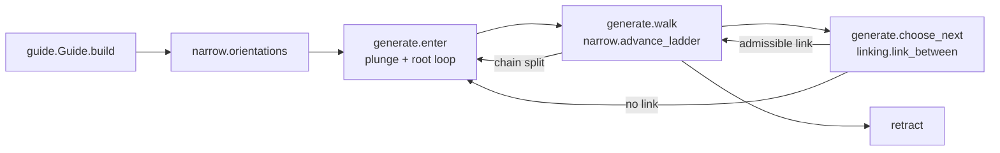
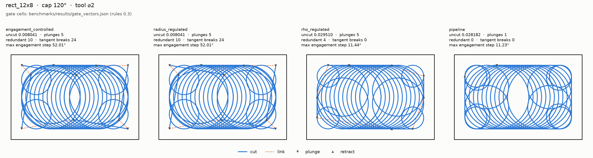
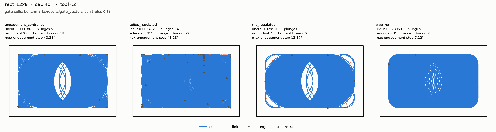
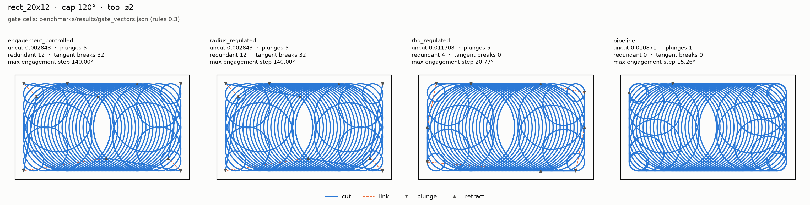
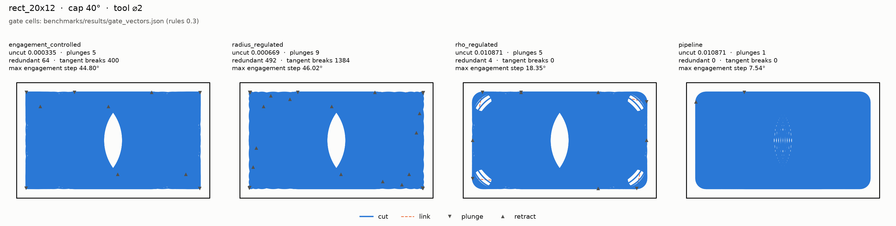
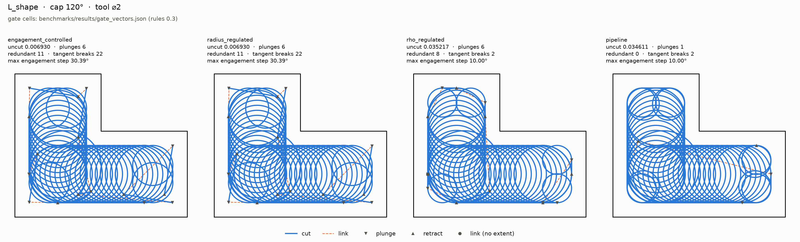
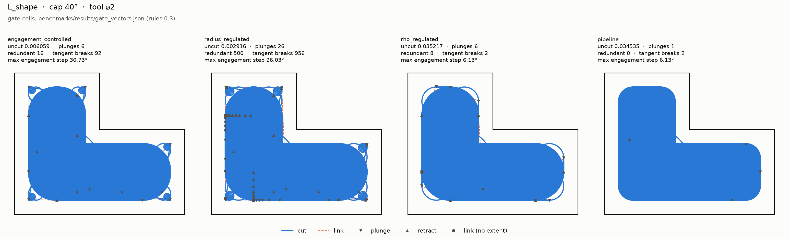

# The product pipeline: narrow regime (Stage 1)

`compas_cgal.pipeline` machines a pocket with **one plunge into material**. It
walks a straight-skeleton chain with the narrow ladder, then reaches the next
chain at cutting depth through stock the earlier chains already cleared, and
lifts only where no admissible link exists. Every such decision is recorded in
a ledger. Task 1.1 restores the stay-down chain ordering of the deleted
chain-ordered generator, as typed stages held to the gate's own model of the
stock. The pipeline imports nothing from `benchmarks` and no frozen generator.

The gate measures it as the `pipeline` column, beside the frozen columns and
the `rho_regulated` reference column. Admission ruling `0.3-C2-amend` admits
both new columns. The reference rule binds `pipeline` on every commit: no
gated cell may be worse than `rho_regulated`'s at the same cap and pocket.

## Stages



| stage | module | what it decides |
| --- | --- | --- |
| guide | `guide.py` | Ordered skeleton stations, read from the C++ guide. It raises `GuideTruncatedError` and never warns. |
| floor, entry normal | `narrow.py` | The floor ρ > r, decided on the exact station radius, then again on the authored `IncidentLoop` radius. The external-tangent entry direction. The exact slope guard. |
| ladder | `ladder.py`, `narrow.advance_ladder` | A furthest-first scan, never a bisection. The radius-step bound runs first and cannot be dropped. Then bridge, at-rest loop and in-process loop. |
| links | `linking.py` | The one link constructor: same-circle arc, in-chain chord, belt (overrun arc, external tangent, approach arc), or no link. Belt existence and exact touch at an entry are decided in `Fraction`. |
| admissibility | `admissibility.py` | Exact native cap verdicts, centre-domain containment, and the gate's removal bracket. It never mutates the stock. |
| emit | `emit.py` | Operations. Loops carry their exact entry in `ToolpathOperation.entry_xy`. |
| generate | `generate.py` | The stages above, plus the NOTHING-loop skip. Labels follow removal: a motion is a `LINK` only when its bracket is NOTHING. Each motion depletes the stock through the gate's replay dispatch. |

## The ladder conditions, and why there are two loop checks

A candidate station is taken when every condition passes. They are evaluated
in this order:

1. radius step, `|ρ' − ρ| ≤ 2r`, exact;
2. **rho's at-rest probe ring**: the loop entry plus `LOOP_PROBE_COUNT_AT_REST`
   positions, phased on the advance and read against the stock as it stands;
3. the bridge stays in the centre domain and under the cap, in process;
4. the full loop, in process: the stock minus the loop's own swept prefix.

Condition 2 is the frozen `rho_regulated` generator's own loop rule, ported.
Material at a probe only shrinks as the prefix is removed, so condition 2 is
never more permissive than condition 4 at the same position.

The ladder takes the conjunction, so the order decides nothing; it sets the
cost. The ring asks `LOOP_PROBE_COUNT_AT_REST` + 1 at-rest positions and stops
at its first refusal; the bridge asks `GATE_SAMPLES_PER_MOTION` + 1 in-process
stations, each an arrangement walk over the swept prefix. The ring refuses
most candidates at a tight cap, so it runs first. Because the verdict is a
conjunction of side-effect-free reads of one unchanged stock, reordering the
conditions cannot change an admitted station, the ops or the ledger.
`test_generate.py` pins the order (the ring short-circuits before the
in-process bridge) and the unchanged stock (every condition reads one stock
object, never mutated during the scan). Generation times are in
[Generation time](#generation-time).

**Decision cost.** Four changes, none of which moves a decision:

- *Decision-only native queries.* A cap decision reads only whether some
  station exceeds. `engagement_{line,arc,circle}_exceeded` classify the same
  stations with the same exact predicates as `engagement_*_prefixes`, probe the
  last station first (a refused bridge bites at its end), stop at the first
  exceedance and compute no reporting spans. Reports keep the prefix calls.
  The error path is narrower than the prefix calls'. A decision-only call
  computes no reporting spans, so the reporting invariant
  `RimSpanNormalizationError` never runs in it. The in-process clip runs only
  at a visited station whose static classification is CAP_EXCEEDED, and the
  scan stops at the first exceeding station, so the clip's invariant checks
  (`SweptPrefixRimCellError`, including a degenerate radial direction) never
  fire at a statically WITHIN_CAP station or at a station after the first
  exceedance (see the next item). Line stations are placed lazily, but
  `line_prefix_motion` has already validated every parameter and the distinct
  endpoints, so no placement error is reachable after it returns. The
  fail-loud checks are not lost: the gate survey runs the full prefix calls on
  every emitted motion, so every check runs on every station of the toolpath
  that is measured.
- *Clip monotonicity.* The in-process clip only drops pieces of the static
  engaged arcs, so every in-process run lies inside a static run and the cap
  test (span > cap) is monotone under inclusion: a static WITHIN_CAP is the
  in-process verdict, and only a static CAP_EXCEEDED pays for the clip. The
  lemma is stated at `swept_prefix_engagement_2.h` and pinned station by
  station against the full classification (`tests/test_swept_prefix_decision.py`).
  A static WITHIN_CAP station skips the clip, so the clip's invariant checks
  (`SweptPrefixRimCellError`) do not fire there in the decision call; the
  gate's prefix calls still run them.
- *Station 0 asked once.* The loop's station 0 (empty prefix) is exactly the
  ring's first probe, `engagement_at` at the entry on the same stock, so the
  ladder's loop condition skips it (`loop_admissible_past_entry`); the
  conjunction is unchanged. No cache: both conditions read the one stock of one
  scan, which nothing mutates.
- *Lazy next-chain choice.* `choose_next` minimises
  `(not linked, link length, position)`. Only `linked` needs the in-process
  checks, so links are checked in `(length, position)` order and the first
  admissible one is the minimum; links that cannot win are never checked
  (`tests/pipeline/test_choose_next.py` holds it against the eager rule).

What remains is one exact arrangement-zone walk per asked station, dominated
by the full in-process bridges and loops of the candidates that are admitted:
a winning candidate cannot stop early, because every one of its stations must
be read WITHIN_CAP.

**The one decision that is not in process, User ruling (2026-10-16).** Plan
R1(a) says engagement is measured in process in the gate and in every
generator decision. Condition 2, `Admissibility.loop_within_cap_at_rest`, is
the named exception: rho's at-rest probe ring, which reads each position
against the stock as it stands, without the loop's own swept prefix. It exists
because it closes the engagement-step gaps at the bridge→loop junction that
an in-process loop check alone leaves open (below). It is AND-ed
with the in-process checks, so it can only refuse more, never admit more. Every
other generator decision is in process. `test_generate.py` pins it: the ring
refuses a toy candidate whose bridge and loop pass in process, and a fresh
generation of each gate pocket keeps `max_engagement_step_deg` within rho's
committed cell.

**Insight: an in-process loop check alone over-advances.** Without condition
2, the spine advances well past rho's: the in-process loop discounts its own
swept prefix, so it admits longer bridges than the at-rest ring does. The gate
reads the engagement step at the bridge→loop junction, which grows with the
advance. That put the pipeline above the reference on
`max_engagement_step_deg` at both caps. Attribution with
`PathQualityAttribution` placed every one of those steps at an in-chain
bridge→loop junction or at a belt line entering material. Porting rho's rule as
a ladder condition closed them; `test_generate.py` holds each gate pocket's
`max_engagement_step_deg` within rho's committed cell. No tolerance or margin
is involved: the condition is rho's predicate on the same stock.

## The forced-decision ledger

`PipelineResult.ledger` is a `ForcedDecisionLedger`, the closed union of:

- `ForcedEntry(path_index, entry, reason, into_material)`, with reason
  `FIRST_CUT`, `NO_ADMISSIBLE_LINK` or `RADIUS_STEP_SPLIT`. `into_material` is
  the gate's own plunge predicate, `circle_sweep_removal(x, y, 0, r)`. The L's
  second plunge lands in cleared stock: it is a retract, not a plunge into
  material.
- `DeclinedRun(chain, first_station, last_station, cause)`. With cause `FLOOR`
  it covers stations at or below the floor; it matches rho's
  `declined_regions`. With cause `RADIUS_STEP` it is the gap of a chain split.
- `ForcedAdvance`, the minimum advance that keeps the bound when nothing else
  passes.

`ForcedDecisionLedger.build` is the one place that checks for exactly one
`FIRST_CUT`. Station indices are in guide emission order throughout.
`omitted` (loops that would remove nothing) and `links` are reported beside
the ledger.

**Chain split, never a broken bound.** When no floor-clearing station in the
window keeps the radius-step bound, rho takes `origin + 1` anyway and leaves an
uncut patch it never reports. The pipeline stops the walk instead, records the
gap as a `RADIUS_STEP` `DeclinedRun`, and re-enters the chain past it as a
`ForcedEntry`.

## Measured

Every column of the pinned vectors, rendered by `tools.gate_table` and never
typed by hand. The `rho_regulated` column is the reference, and `pipeline`
against it is the before/after of this stage:

--8<-- "benchmarks/results/gate_vectors.md"

The table's `generation_s` is wallclock under a contended parallel
measurement: `tools.gate_measure` runs the cases side by side, bounded by the
core count. It is not the time gate. The serial paired comparison below is.

## Generation time

Every gate generator on every gate case, measured serially, one case at a
time, each in a fresh process, by `tools.pipeline_timing` and never typed by
hand. The method and its caveats are stated in the table's header. Regenerate
it with

```bash
pixi run pipeline-timing
```

--8<-- "benchmarks/results/pipeline_timing.md"

## Figures

Each pocket at both caps, 120° and 40°: every gate generator in gate order,
`pipeline` beside the frozen generators and `rho_regulated`. Each panel is
captioned with its pinned gate cells. The figures are drawn from real
generated paths by `benchmarks/gate_figures.py`; regenerate them (both caps,
byte-stable) with

```bash
pixi run gate-figures
```

which re-measures every plotted case first and refuses a caption the current
code no longer reproduces (fix: `pixi run gate-vectors`). The 120° figures are
written under `assets/images/pipeline/120/`, the 40° figures beside
them under `assets/images/pipeline/40/`.













## Insights

- **Straight inter-chain links cost tangency at both ends.** A straight link
  from one chain's last loop to the next chain's first loop meets each circle
  at an angle. The non-G1 ports measured several tangent breaks per pocket; the
  belt (overrun arc, external common tangent, approach arc) measures rho's own.
  When the tangent touches a loop exactly at its authored entry (two loops
  tangent to the same wall offset, at an axis phase), that end needs no arc.
  This is decided exactly. A double construction there instead yields
  zero-length arcs a few ulps long.
- **`point_at(0)` is not the authored entry.** An `IncidentLoop`'s
  `Circle.point_at(0)` is a double rounding of its exact entry, and it differs
  on most loops re-authored from rho's stations. The survey therefore reads
  `ToolpathOperation.entry_xy` when present. Without it, a plunge onto the
  exact entry counts as misplaced under rule (e). Frozen circles carry no entry
  and are read as before.
- **An air arc is decided NOTHING first.** After a loop, an arc on its own
  circle is decided on the loop's authored annulus before the replay's surrogate
  chain. The surrogate can otherwise read REMOVES on an ulp sliver (Ruling
  1.1-C2, B-minimal). The frozen columns' cells did not move.
