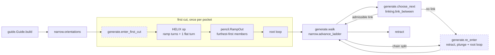

# The product pipeline: narrow regime (Stage 1)

`compas_cgal.pipeline` machines a pocket with **one entry into material**, and
since Task 1.2 that entry is a helix, not a plunge. The tool descends one
`HELIX` operation at the root loop's exact entry, closes the bore with one
flat turn, ramps out along the root's tangent pencil to the root loop, and
only then walks. It walks a straight-skeleton chain with the narrow ladder,
reaches the next chain at cutting depth through stock the earlier chains
already cleared, and lifts only where no admissible link exists. Every such
decision is recorded in a ledger. Task 1.1 restored the stay-down chain
ordering of the deleted chain-ordered generator, as typed stages held to the
gate's own model of the stock. The pipeline imports nothing from `benchmarks`
and no frozen generator.

!!! warning "Task 1.2 status: under verification"
    The helical entry, the pencil ramp-out and the gate's helix branches are
    built and reviewed, but not yet measured by a gate run. The `Measured`,
    `Generation time` and `Figures` sections below still show the Task 1.1
    pins until `pixi run gate-vectors`, `pixi run pipeline-timing` and
    `pixi run gate-figures` are re-run. The probe numbers quoted in
    [The helical entry](#the-helical-entry) are leads from scratch probes, not
    gate cells.

The gate measures it as the `pipeline` column, beside the frozen columns and
the `rho_regulated` reference column. Admission ruling `0.3-C2-amend` admits
both new columns. The reference rule binds `pipeline` on every commit: no
gated cell may be worse than `rho_regulated`'s at the same cap and pocket.

## Stages



Dashed stages write a `ForcedEntry` to the ledger. Inside the first-cut box,
the helix turn count and footprint radius are fixed by exact rules before any
stock is read; the pencil members are decided at run time against the live
stock.

| stage | module | what it decides |
| --- | --- | --- |
| guide | `guide.py` | Ordered skeleton stations, read from the C++ guide. It raises `GuideTruncatedError` and never warns. |
| first cut | `generate.enter_first_cut`, `compas_cgal.helix`, `pencil.py` | The only producer of `FIRST_CUT`. The helix footprint (`ρ_h ≤ r`, exact), the turn count (exact), the pencil members up to the root loop. Raises `FirstCutAfterEmissionError` if anything was emitted before it. |
| re-entry | `generate.re_enter` | Retract, rapid, plunge and root loop, for `NO_ADMISSIBLE_LINK` and `RADIUS_STEP_SPLIT` only. A `FIRST_CUT` reason raises `FirstCutReEntryError`. |
| floor, entry normal | `narrow.py` | The floor ρ > r, decided on the exact station radius, then again on the authored `IncidentLoop` radius. The external-tangent entry direction. The exact slope guard. |
| ladder | `ladder.py`, `narrow.advance_ladder` | A furthest-first scan, never a bisection. The radius-step bound runs first and cannot be dropped. Then bridge, at-rest loop and in-process loop. |
| links | `linking.py` | The one link constructor: same-circle arc, in-chain chord, belt (overrun arc, external tangent, approach arc), or no link. Belt existence and exact touch at an entry are decided in `Fraction`. |
| admissibility | `admissibility.py` | Exact native cap verdicts, centre-domain containment, and the gate's removal bracket. It never mutates the stock. |
| emit | `emit.py` | Operations. Loops and the helix carry their exact entry in `ToolpathOperation.entry_xy`; `emit.helix_operation` emits the helix as one operation, never relabelled. |
| generate | `generate.py` | The stages above, plus the NOTHING-loop skip. Labels follow removal: a motion is a `LINK` only when its bracket is NOTHING. Each motion depletes the stock through the gate's replay dispatch. |

## The ladder conditions, and why there are two loop checks

A candidate station is taken when every condition passes. They are evaluated
in this order:

1. radius step, `|ρ' − ρ| ≤ 2r`, exact;
2. **rho's at-rest probe ring**: the loop entry plus `LOOP_PROBE_COUNT_AT_REST`
   positions, phased on the advance and read against the stock as it stands;
3. the bridge stays in the centre domain and under the cap, in process;
4. the full loop, in process: the stock minus the loop's own swept prefix.

Condition 2 is the frozen `rho_regulated` generator's own loop rule, ported.
Material at a probe only shrinks as the prefix is removed, so condition 2 is
never more permissive than condition 4 at the same position.

The ladder takes the conjunction, so the order decides nothing; it sets the
cost. The ring asks `LOOP_PROBE_COUNT_AT_REST` + 1 at-rest positions and stops
at its first refusal; the bridge asks `GATE_SAMPLES_PER_MOTION` + 1 in-process
stations, each an arrangement walk over the swept prefix. The ring refuses
most candidates at a tight cap, so it runs first. Because the verdict is a
conjunction of side-effect-free reads of one unchanged stock, reordering the
conditions cannot change an admitted station, the ops or the ledger.
`test_generate.py` pins the order (the ring short-circuits before the
in-process bridge) and the unchanged stock (every condition reads one stock
object, never mutated during the scan). Generation times are in
[Generation time](#generation-time).

**Decision cost.** Four changes, none of which moves a decision:

- *Decision-only native queries.* A cap decision reads only whether some
  station exceeds. `engagement_{line,arc,circle}_exceeded` classify the same
  stations with the same exact predicates as `engagement_*_prefixes`, probe the
  last station first (a refused bridge bites at its end), stop at the first
  exceedance and compute no reporting spans. Reports keep the prefix calls.
  The error path is narrower than the prefix calls'. A decision-only call
  computes no reporting spans, so the reporting invariant
  `RimSpanNormalizationError` never runs in it. The in-process clip runs only
  at a visited station whose static classification is CAP_EXCEEDED, and the
  scan stops at the first exceeding station, so the clip's invariant checks
  (`SweptPrefixRimCellError`, including a degenerate radial direction) never
  fire at a statically WITHIN_CAP station or at a station after the first
  exceedance (see the next item). Line stations are placed lazily, but
  `line_prefix_motion` has already validated every parameter and the distinct
  endpoints, so no placement error is reachable after it returns. The
  fail-loud checks are not lost: the gate survey runs the full prefix calls on
  every emitted motion, so every check runs on every station of the toolpath
  that is measured.
- *Clip monotonicity.* The in-process clip only drops pieces of the static
  engaged arcs, so every in-process run lies inside a static run and the cap
  test (span > cap) is monotone under inclusion: a static WITHIN_CAP is the
  in-process verdict, and only a static CAP_EXCEEDED pays for the clip. The
  lemma is stated at `swept_prefix_engagement_2.h` and pinned station by
  station against the full classification (`tests/test_swept_prefix_decision.py`).
  A static WITHIN_CAP station skips the clip, so the clip's invariant checks
  (`SweptPrefixRimCellError`) do not fire there in the decision call; the
  gate's prefix calls still run them.
- *Station 0 asked once.* The loop's station 0 (empty prefix) is exactly the
  ring's first probe, `engagement_at` at the entry on the same stock, so the
  ladder's loop condition skips it (`loop_admissible_past_entry`); the
  conjunction is unchanged. No cache: both conditions read the one stock of one
  scan, which nothing mutates.
- *Lazy next-chain choice.* `choose_next` minimises
  `(not linked, link length, position)`. Only `linked` needs the in-process
  checks, so links are checked in `(length, position)` order and the first
  admissible one is the minimum; links that cannot win are never checked
  (`tests/pipeline/test_choose_next.py` holds it against the eager rule).

What remains is one exact arrangement-zone walk per asked station, dominated
by the full in-process bridges and loops of the candidates that are admitted:
a winning candidate cannot stop early, because every one of its stations must
be read WITHIN_CAP.

**The one decision that is not in process, User ruling (2026-10-16).** Plan
R1(a) says engagement is measured in process in the gate and in every
generator decision. Condition 2, `Admissibility.loop_within_cap_at_rest`, is
the named exception: rho's at-rest probe ring, which reads each position
against the stock as it stands, without the loop's own swept prefix. It exists
because it closes the engagement-step gaps at the bridge→loop junction that
an in-process loop check alone leaves open (below). It is AND-ed
with the in-process checks, so it can only refuse more, never admit more. Every
other generator decision is in process. `test_generate.py` pins it: the ring
refuses a toy candidate whose bridge and loop pass in process, and a fresh
generation of each gate pocket keeps `max_engagement_step_deg` within rho's
committed cell.

**Insight: an in-process loop check alone over-advances.** Without condition
2, the spine advances well past rho's: the in-process loop discounts its own
swept prefix, so it admits longer bridges than the at-rest ring does. The gate
reads the engagement step at the bridge→loop junction, which grows with the
advance. That put the pipeline above the reference on
`max_engagement_step_deg` at both caps. Attribution with
`PathQualityAttribution` placed every one of those steps at an in-chain
bridge→loop junction or at a belt line entering material. Porting rho's rule as
a ladder condition closed them; `test_generate.py` holds each gate pocket's
`max_engagement_step_deg` within rho's committed cell. No tolerance or margin
is involved: the condition is rho's predicate on the same stock.

## The helical entry

The first cut is one `HELIX` operation at the root loop's exact entry `P`,
then a furthest-first ramp-out along the root's tangent pencil to the root
loop, then the walk. The root is Task 1.1's `FIRST_CUT` station (user
decision Q5); the true medial-axis vertex is Task 2.5's. Re-entries stay
plunges: on every gate pocket they land in cleared stock (probe P8 found no
re-entry into material at either cap), so a helix there would bore air.

!!! note "Design: confirmed by review; gate cells: under verification"
    Every rule below is in the tree and pinned by tests. Whether it moves the
    gated cells as the probes predict is pending the 1.2 gate run.

### Footprint and the ρ_h floor rule

The helix runs on the pencil's footprint member, the smallest member, of
radius ρ_h ≤ r. On the root's chart, with the reduced Pythagorean direction
`(a, b, m)` of `P − c_root` and grid `2^K` (`INCIDENCE_GRID_EXPONENT`), the
footprint is `s_h = floor(r · 2^K / m)` grid steps, so ρ_h = s_h · m / 2^K.

- **Floor, never round.** Rounding exceeds r on 470 of 1025 off-axis chart
  numerators (witness chart `(0, 16)`), and ρ_h > r leaves an uncut core
  pin in the bore. `pencil.helix_footprint` raises
  `HelixFootprintExceedsRootError` rather than clamp.
- **The bore is an exact disk.** A full turn at ρ_h ≤ r sweeps exactly
  `disk(c_h, ρ_h + r)`; the test asserts `exactly_equals` on all six gate
  roots. On the gate's axis charts ρ_h = 1 exactly.

### The exact turns rule

`helix.ramp_turns`: the least integer n ≥ 1 with `Δz / n ≤ K · ρ_h`, computed
as `ceil(Δz / (K · ρ_h))` in `Fraction`. `K = 2π·tan α` is the ramp-cap
surrogate `HelixPitchPerRadius`, computed once as a double and injected
exactly ([boundary doctrine](exactness.md#the-boundary-doctrine-for-transcendental-intent));
the few-ulp gap between `K` and `2π·tan α` is the parameter's semantics, not a
correction. The ramp verdict `Helix.ramp_within` is the same exact
inequality; a test pins that it holds at n and fails at n − 1, including at
integer-ratio equality.

At Δz = 4 (clearance 2D above the cut plane) and ρ_h = 1:

| α | turns | ramp length (gate units, tool Ø 2) |
| --- | --- | --- |
| 1° | 37 | 232.5 |
| 2° | 19 | 119.5 |
| 3° | 13 | 81.8 |
| 5° | 8 | 50.4 |

**`max_ramp_angle_deg` = 2° is a placeholder** (`DEFAULT_MAX_RAMP_ANGLE_DEG`,
`MachineModel.max_ramp_angle_deg`). It is common practice for carbide in
aluminium, not a datasheet value; nothing derives it. Replace it when the
tool or machine value is known.

### The closing flat turn (Q6)

After the ramp turns, the same `HELIX` operation makes `HELIX_CLOSING_TURNS`
= 1 flat turn on the footprint at the cut plane, ending again at `P`. Without
it, the bottom of the bore keeps a helical wedge up to one pitch high while
the replay removes the full disk: the replay would credit material the tool
never cut. With it, the replay's removal is the truth.

- **The bore is removed at the end of the operation**, once, as
  `disk(c_h, ρ_h + r)` (`engagement._subtract_operation`,
  `benchmarks/depletion.py` `HelixEvent`).
- **One operation, not a separate `Circle`** (ruling "Q6 shape"): replay,
  cap exclusion and operation identity stay on one kind. `Helix.length()`
  includes the closing turn; the post emits helical G2/G3 then one flat
  circle ([Post](post.md)).

### How the gate scores the helix

- **Excluded from cap sampling (E8).** A bore into virgin stock is full
  immersion by construction. `ReplayRule.HELIX` is not engaged, exactly like
  a plunge, so the helix and its closing turn add nothing to
  `cap_exceedances`. The motion after it is sampled as usual. Without the
  exclusion, `cap_exceedances == 0` would be unsatisfiable by any entry.
- **Scored by ramp angle.** `ramp_angle_violations` counts helices whose
  ramp fails the exact `Helix.ramp_within` check against `GATE_MACHINE`'s
  surrogate; it is gated at 0.
- **A material entry.** `material_plunges` counts a `PLUNGE` or a `HELIX`
  whose exact bore removes material (`circle_sweep_removal(c_h, ρ_h, r)` is
  `REMOVES`); the key is kept, so the 1.1 row `material_plunges == 1` stays
  true with its meaning widened.
- **The junction after it is measured.** The step pair (helix, next motion)
  reads the next motion's station 1 against the helix exit, measured by the
  seam query on `Helix.footprint_circle()`, not assumed 0. Rule (e) covers the
  helix exit: it must equal the next motion's `entry_xy`.

### The pencil ladder

Members of the root's tangent pencil share `P` and the root's entry
direction: member s has centre `P − s(a, b)/2^K` and radius `s·m/2^K`, so it
is internally tangent to the root at `P` for 0 < s ≤ s_root. Every coordinate
is a grid value, hence an exact double, and incidence is certified over the
rationals (`IncidentLoop.certifies_incidence`).

`RampOut.next_member` is one `ladder.furthest_first` scan per member: rungs
from the root down by `PENCIL_RUNG_MM` (0.01 mm of radius), strictly above
the previous member. The furthest admissible rung wins. **No bisection**:
engagement is not monotone in the member radius. Conditions per candidate,
in this order (N1):

1. **Coverage, P-C**: `ρ_next − ρ_prev ≤ r`, exact in `Fraction`, prepended
   by `RampOut.build` so no caller can drop it. Member k+1's uncut core
   `disk(c_{k+1}, ρ_{k+1} − r)` lies in the cleared `disk(c_k, ρ_k + r)` iff
   `|c_{k+1} − c_k| + ρ_{k+1} − r ≤ ρ_k + r`, and on a pencil
   `|c_{k+1} − c_k| = ρ_{k+1} − ρ_k`. The bore is member 0.
2. **Junction θ_e**: the candidate's gate station 1 is under the declared
   entry-rise limit (`Admissibility.loop_entry_within_rise`), one station.
3. **Cap**: every in-process station k/45, k ≥ 0, under the cap
   (`Admissibility.loop_within_cap`). Station 0 is asked here because the
   ramp-out has no at-rest ring to supply it.

The at-rest ring is never used in the ramp-out: it stays the narrow walk's
sole exception to in-process measurement. Pure `Fraction` first, one native
station second, 45 stations last: cheapest refusal first, and the
conjunction decides. P-C is linear in s, so the rungs it refuses are a prefix
of the scan; the scan starts at the first rung it admits (lever L1), and the
bound is still asked on every candidate, so the start is a cost device, not a
decision.

No admissible rung raises `RampOutStuckError`; no forced over-cap member is
ever emitted. Probes never hit it on the gate pockets (smallest admitted rise
0.04 mm at 40°).

**Domain (P-D).** The conditions decide nothing about the cutter-centre
domain. Each member's circle lies in the root loop's closed disk, which lies
in the domain when the root's circle does and the domain is simply connected.
The gate pockets are; a holed domain needs an exact per-member containment
condition (Task 1.7).

### The declared entry ramp (Q4)

Why the junction condition exists: without it the furthest-first scan lands
each member on the cap boundary, and the bore → first-member junction read
15.73° on all three 120° pockets (probe P2), above rho's 10.00° on the L.
Gating plunge junctions instead makes every column's step cell 180° (the
op-0 virgin plunge reads a full slot, probe P7): a vacuous comparison, so the
user ruled no plunge-junction gating.

The limit is **declared user intent, like the cap**: engagement may rise
from the seam to the cap no faster than linearly over `EntryRampLength`
= 2r (one tool diameter, `DEFAULT_ENTRY_RAMP_TOOL_RADII`, a placeholder).
At entry distance s_e the limit is θ_e = cap · s_e / L. Evaluated at the
gate's station 1 of the smallest legal loop, s_e = 2πr/45, so

θ_e = cap · π / 45 = 8.378° at 120°, 2.793° at 40°.

No rho cell enters the derivation. `admissibility.entry_rise_ratio` computes
θ_e once as a double and injects its chord surrogate `4 sin²(θ_e/2)` once, in
`Admissibility.build`, beside the cap's. The decision is the same
decision-only native predicate as the cap, at the same station the gate's
step reads, so decision and report agree by construction. It is **SAMPLED**
(Ruling 0.3-C6): it bounds the rise at that one station, nothing between, and
it binds the pencil and helix junctions only. Frozen cells do not move.

Rejected alternatives, recorded:

- **θ taken from a gate cell** (rho's or 1.1's step): number-chasing.
- **A fixed arc-length station** for every junction: physically more honest
  (it bounds dφ/ds), but it re-pins all 24 step cells and binds links and
  bridges too. It is a separate gate amendment, not Task 1.2.
- **A larger ρ_h**: forbidden by the floor rule; a smaller one is worse.

Probe lead (`theta_e-all`, not a gate run): at θ_e the step cell equals 1.1's
on all six cases, uncut equals 1.1's, and the junction does all the refusing
(the cap refuses no rung).

**Insight: tangent circles through one point need no link.** Pencil members
share `P` and their tangent there, so every pencil junction is G1 with no
connecting motion, and the coverage bound reduces to Δρ ≤ r.

## The forced-decision ledger

`PipelineResult.ledger` is a `ForcedDecisionLedger`, the closed union of:

- `ForcedEntry(path_index, entry, reason, into_material)`, with reason
  `FIRST_CUT`, `NO_ADMISSIBLE_LINK` or `RADIUS_STEP_SPLIT`. The `FIRST_CUT`
  entry is the helix, at the root's exact entry; its `into_material` is
  `circle_sweep_removal(c_h, ρ_h, r)` on the footprint. For a re-entry,
  `into_material` is the gate's own plunge predicate,
  `circle_sweep_removal(x, y, 0, r)`. The L's second plunge lands in cleared
  stock: it is a retract, not a plunge into material.
- `DeclinedRun(chain, first_station, last_station, cause)`. With cause `FLOOR`
  it covers stations at or below the floor; it matches rho's
  `declined_regions`. With cause `RADIUS_STEP` it is the gap of a chain split.
- `ForcedAdvance`, the minimum advance that keeps the bound when nothing else
  passes.

`ForcedDecisionLedger.build` is the one place that checks for exactly one
`FIRST_CUT`. Station indices are in guide emission order throughout.
`omitted` (loops that would remove nothing) and `links` are reported beside
the ledger.

**Chain split, never a broken bound.** When no floor-clearing station in the
window keeps the radius-step bound, rho takes `origin + 1` anyway and leaves an
uncut patch it never reports. The pipeline stops the walk instead, records the
gap as a `RADIUS_STEP` `DeclinedRun`, and re-enters the chain past it as a
`ForcedEntry`.

## Measured

Every column of the pinned vectors, rendered by `tools.gate_table` and never
typed by hand. The `rho_regulated` column is the reference, and `pipeline`
against it is the before/after of this stage:

--8<-- "benchmarks/results/gate_vectors.md"

The table's `generation_s` is wallclock under a contended parallel
measurement: `tools.gate_measure` runs the cases side by side, bounded by the
core count. It is not the time gate. The serial paired comparison below is.

## Generation time

Every gate generator on every gate case, measured serially, one case at a
time, each in a fresh process, by `tools.pipeline_timing` and never typed by
hand. The method and its caveats are stated in the table's header. Regenerate
it with

```bash
pixi run pipeline-timing
```

--8<-- "benchmarks/results/pipeline_timing.md"

## Figures

Each pocket at both caps, 120° and 40°: every gate generator in gate order,
`pipeline` beside the frozen generators and `rho_regulated`. Each panel is
captioned with its pinned gate cells. The figures are drawn from real
generated paths by `benchmarks/gate_figures.py`; regenerate them (both caps,
byte-stable) with

```bash
pixi run gate-figures
```

which re-measures every plotted case first and refuses a caption the current
code no longer reproduces (fix: `pixi run gate-vectors`). The 120° figures are
written under `assets/images/pipeline/120/`, the 40° figures beside
them under `assets/images/pipeline/40/`.


## Insights

- **Straight inter-chain links cost tangency at both ends.** A straight link
  from one chain's last loop to the next chain's first loop meets each circle
  at an angle. The non-G1 ports measured several tangent breaks per pocket; the
  belt (overrun arc, external common tangent, approach arc) measures rho's own.
  When the tangent touches a loop exactly at its authored entry (two loops
  tangent to the same wall offset, at an axis phase), that end needs no arc.
  This is decided exactly. A double construction there instead yields
  zero-length arcs a few ulps long.
- **`point_at(0)` is not the authored entry.** An `IncidentLoop`'s
  `Circle.point_at(0)` is a double rounding of its exact entry, and it differs
  on most loops re-authored from rho's stations. The survey therefore reads
  `ToolpathOperation.entry_xy` when present. Without it, a plunge onto the
  exact entry counts as misplaced under rule (e). Frozen circles carry no entry
  and are read as before.
- **An air arc is decided NOTHING first.** After a loop, an arc on its own
  circle is decided on the loop's authored annulus before the replay's surrogate
  chain. The surrogate can otherwise read REMOVES on an ulp sliver (Ruling
  1.1-C2, B-minimal). The frozen columns' cells did not move.
