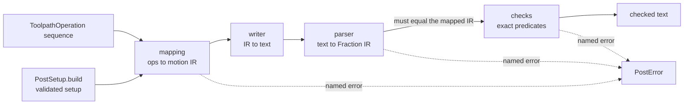

# The fail-closed post: first test cut

`compas_cgal.post` turns a `pipeline` toolpath into a LinuxCNC program and
hands out text only after it has written it, parsed it back and proved every
check over the emitted decimals. Anything it cannot prove raises a named
`PostError`; it never warns and never returns unchecked text. It is the
minimal slice of Task 3.1 needed for the first physical test cut:
`rect_12x8` at the 120° cap, scaled ×3 (6 mm tool, 36 × 24 mm pocket, one
Z level).

!!! warning "Status: built and tested; not yet run on a machine"
    Every machine parameter is a placeholder until the user answers the ten
    setup questions below; the machine envelope has no default at all. The
    helix mapping waits for the Task 1.2 generator to be committed with it.

## Stages

`fail_closed.post_operations` runs the chain. The checks read the parsed
text, not the in-memory program, and a parse that does not reproduce the
mapped program exactly raises `RoundTripMismatchError`.

## Dialect and safety header

- **One dialect, `Dialect.LINUXCNC`.** It is the only member until the
  machine is named (Q1). The writer dispatches on dialect and arc mode with
  exhaustive chains ending in `Never`-typed raises
  (`UnsupportedDialectError`, `UnsupportedArcModeError`).
- **Header** `G21 G90 G94 G40 G80 G17 G91.1 G54`: mm, absolute, feed per
  minute, no cutter compensation, no canned cycle, XY plane, incremental
  I/J, work offset 1. The parser accepts exactly this header; `G93`, `G41`
  or a missing word raises.
- Spindle `S… M3` with a `G4 P…` spin-up dwell (required by the parser),
  then `M5`, `M30`.
- **Stateless blocks**: X, Y, Z on every motion, F on every feed. I/J are the
  quantised centre minus the emitted position.
- A full circle is two half-arcs from its exact `entry_xy`, never one 360°
  block (controllers disagree on those).
- **Heights are mapped, not scaled.** Source cut Z maps to −Q7 below stock
  top, source clearance to Q8 above it; any other source height raises
  `UnmappedHeightError`.

## Exact checks

All values are quantised once, half-even, to the declared quantum
q = 0.0001 mm: the boundary injection. Every check is an exact `Fraction`
predicate on the emitted decimals.

| check | rule | error |
| --- | --- | --- |
| winding | sign of `cross(centre→start, start tangent)` must match `clockwise`; the geometry alone is never the direction source | `WindingDisagreementError`, `MissingStartTangentError` |
| arc radius | emitted start and end radii agree within the controller tolerance, compared squared; worst case 2√2·q, so q = 0.001 mm could not guarantee Q3 | `ArcRadiusMismatchError`, `ArcToleranceBelowQuantumError` |
| controller resolution | the quantum is a whole multiple of it | `ControllerResolutionError` |
| envelope | every point and every arc's swept bounding box | `OutOfEnvelopeError` |
| stock fit | tool disc at every feed target and each arc's extent grown by r | `PocketOutsideStockError` |
| rapids | no G0 below clearance except the declared approach and the vertical final retract | `UnsafeRapidError` |
| feeds off the plane | a non-helical feed off the cut plane | `OffPlaneFeedError` |
| plunges | at most `PostSetup.accepted_plunges` (required, no default) | `UnacceptedPlungeError` |
| continuity | each block starts where the last ended | `DiscontinuousPathError` |
| helix | structure, uniform descent, ramp angle (below) | `HelixStructureError`, `HelixDescentMismatchError`, `HelixRampAngleError` |

## Helix mapping

A `HELIX` operation becomes 2·n half-turn G2/G3 blocks (entry → exact
antipode → entry), with Z_k = quantise(top + (bottom − top)·k/2n) in
`Fraction`, then two flat half-arcs at the bottom for the closing turn, all
at `ramp_feed`. The sense comes from `Helix.clockwise`, checked against the
tangent winding first.

**The ramp is recounted in program units.** The source turn count does not
carry over: the source helix descends 4 gate units (19 turns at 2°), but the
program descends from clearance 12 mm above stock top to −1.5 mm on a 3 mm
radius, which at 19 turns is 2.16° and fails the 2° cap. The post therefore:

1. rapids to clearance above the entry;
2. feeds in Z at plunge feed, through air, to
   Z_ramp = top + `ramp_start_above_top` (placeholder 1 mm); a Z-only feed
   that ends at or above stock top is an air descent, not a plunge;
3. ramps from Z_ramp to the cut plane with `ramp_turns` recomputed by the
   same exact rule as `Helix.build`, on program inputs (4 turns at the
   defaults: 2.5 mm on r = 3 mm), plus `HELIX_CLOSING_TURNS` flat turn.

Centre, entry, phase and sense stay the pipeline's. A program helix whose
radius or heights are not exact doubles raises `InexactProgramHelixError`.
The ramp check is `D² ≤ K²·r²` per turn with `K = ramp_cap.exact`: no square
root, no arctangent. Rejected: raising the clearance placeholder so the
source count fits, which ties a safety height to a turn count.

## Evidence

- **Back-plot**: the parsed G-code equals the pipeline path within
  5.03e-5 mm (q = 1e-4 mm).
- **G-code replay through the gate**: posting rect_12x8 at 120° and 40°,
  parsing it back and re-surveying gives every gated cell identical to the
  source; three reported length cells move by one unit in the last stored
  digit, explained by the quantum. This was measured on the plunge-entry
  generator; it is **under verification** for the helix entry.
- **Defect injection**: reading direction from geometry fails 4 tests; the
  unsquared radius form fails 7, including the real program.

## Commit coupling

The post references `OperationType.HELIX`, so it commits with or after Task
1.2's `toolpath.py`, never alone (Ruling N1).

## Setup questions, pending the user

Each answer replaces a placeholder in `post/testcut_defaults.py`.

| # | question | placeholder |
| --- | --- | --- |
| Q1 | machine and controller dialect | LinuxCNC; resolution 0.0001 mm |
| Q2 | arc mode | I/J incremental (G91.1), G17 |
| Q3 | controller arc radius tolerance | 0.002 mm |
| Q4 | tool | 6 mm, 3 flutes, centre-cutting carbide |
| Q5 | scale of the unitless gate pocket | ×3 → 36 × 24 mm |
| Q6 | stock material and blank | 6061 aluminium, 60 × 50 × 15 mm, min corner (−12, −13); wax or MDF dry run first |
| Q7 | axial depth, single Z level | 1.5 mm (0.25 D) |
| Q8 | spindle, feeds, heights | 10000 rpm; cut 600, plunge 100, ramp 300 mm/min; clearance 12 mm above top; ramp start 1 mm above top; dwell 2 s |
| Q9 | work offset and origin | G54, XY at pocket min corner, Z0 at stock top |
| Q10 | machine envelope in the work frame | **none: required from the user** |

The ramp cap uses the pipeline's 2° placeholder (`DEFAULT_MAX_RAMP_ANGLE_DEG`).
After the answers: air cut at Z+5, then wax or MDF, then aluminium, and
measure walls, floor and corner residue against the gate's residual-stock
prediction.
