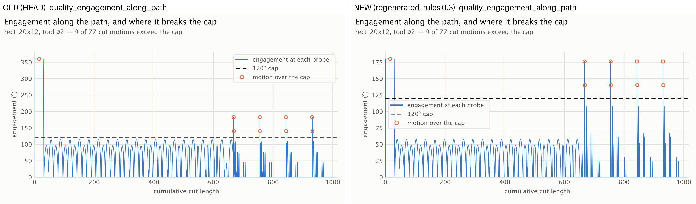
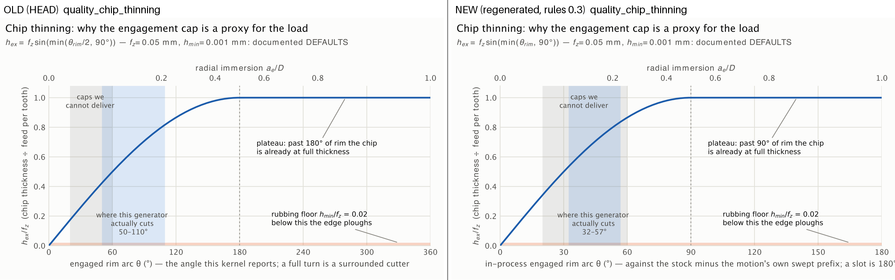
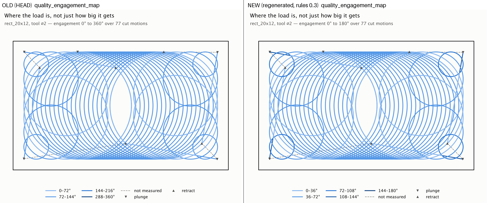
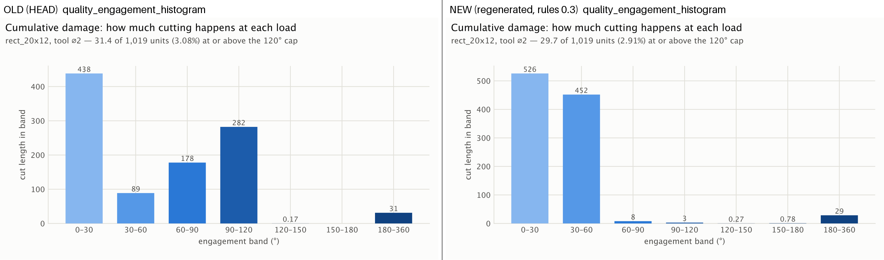
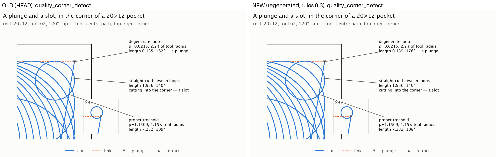
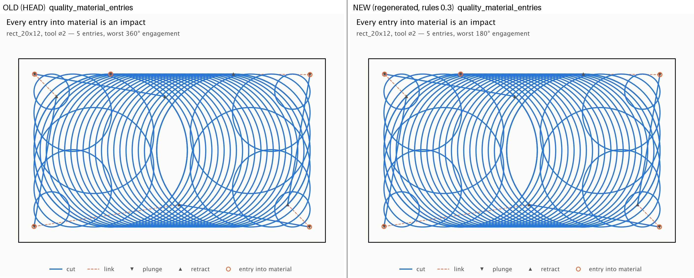

# Stage 0: the gate measures physics

Stage 0 of the product pipeline changed the instrument, not the generators:
in-process engagement (Task 0.1), exact idempotent sweeps in the replay
(Task 0.2), and gate rules 0.3 with the ratchet (Task 0.3). The current
figures and numbers live on [Machining Quality](../machining_quality.md); this
page keeps the before/after record.

Each pair below is the figure as committed before Stage 0 (left) and as
regenerated with `pixi run figures` after Task 0.3 (right). In every pair the
tool path is identical. Only the engagement read off it changed, and all of
that comes from Task 0.1: engagement is now measured against the stock minus
the motion's own swept prefix, so a full slot reads 180°, not 360°. None of
the visible change comes from the 0.2 or 0.3 rules.
`quality_coverage_residual`, `quality_curvature_feed` and
`quality_length_vs_time` regenerate byte-identical and are not shown.

## Engagement along the path

rect_20x12, 120° cap. The same 9 of 77 cut motions exceed the cap; the scale
halves (slot 360° → 180°) and steady trochoids drop from about 100° to about
50°.

## Chip thinning

The rim arc axis runs 0–180°, so the full-thickness plateau starts at 90°, not
180°. The band where the generator actually cuts moves from 50–110° to 32–57°.

## Engagement map

Colour bins run 0–180° instead of 0–360°. Corner loops and corner cuts now sit
in the darkest bins.

## Engagement histogram

Cut length moves into the 0–30° and 30–60° bands; 60–120° is nearly empty. The
top band keeps its 180–360 name because it is the gate criterion
`engagement_length_180_360_deg`.

## The corner defect

The degenerate loop reads 176° instead of 182°; a proper trochoid reads 108°
instead of 109°.

## Entries into material

The worst entry reads 180° instead of 360°.

