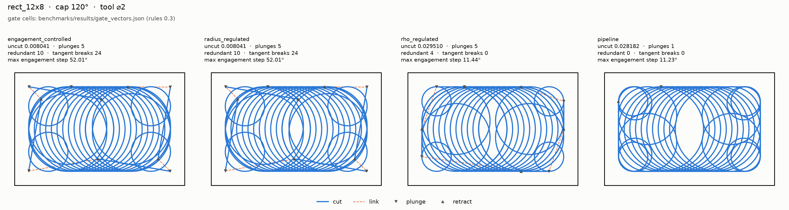
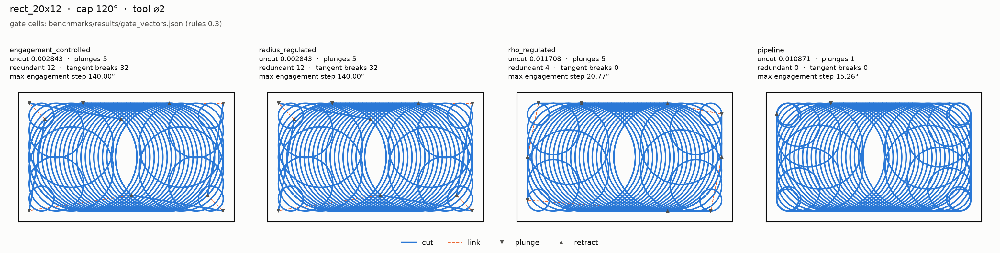
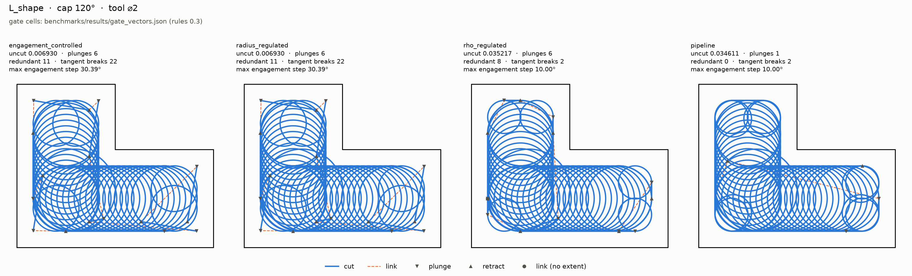
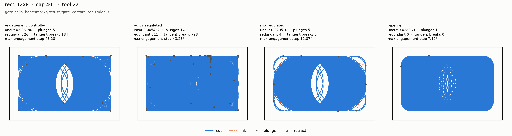
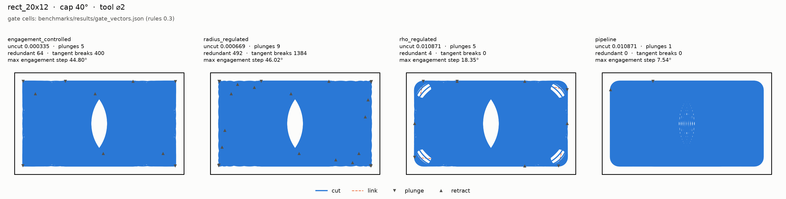
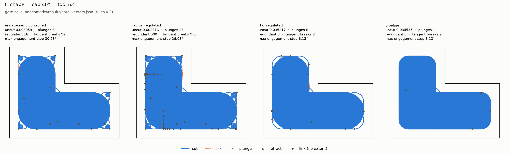

# Stage 1: the narrow-regime generator

Task 1.1 adds the first generator of the product pipeline,
`compas_cgal.pipeline`. It machines each gate pocket with one plunge into
material: it walks a straight-skeleton chain with the narrow ladder, reaches
the next chain at cutting depth through stock the earlier chains cleared, and
lifts only where no admissible link exists or the radius-step bound splits a
chain. It is measured by the gate as the `pipeline` column, beside the frozen
columns and the `rho_regulated` reference.

At the 120° cap it meets the Task 1.1 acceptance on all three pockets:

- one plunge into material per pocket;
- no redundant operations, no degenerate loops;
- tangent breaks no more than rho's;
- no gated cell worse than `rho_regulated`'s at 120° and at 40° (the
  reference rule, which the plan's "no criterion worse" became).

The reference rule now binds `pipeline` on every commit. The stage-0 rows
(misplaced plunges, unsafe rapids, zero-length motions) are zero on every
pipeline case. How the stages work is on
[The product pipeline](../pipeline.md); this page keeps the Stage 1 record.

## Measured

The pinned vectors, rendered by `tools.gate_table`. Compare the `pipeline`
column with `rho_regulated` at the same cap and pocket:

--8<-- "benchmarks/results/gate_vectors.md"

The gate measures its cases in a process pool of at most one worker per core
(`tools.gate_measure.pool_workers`), so the `generation_s` rows above are
parallel wall-clock and are not the time gate.
`pixi run pipeline-timing` is the time-gate authority; see
[Generation time](#generation-time).

## Design

Typed stages, each held to the gate's own model of the stock. The package
imports nothing from `benchmarks` and no frozen generator.

| stage | module | what it decides |
| --- | --- | --- |
| guide | `guide.py` | Ordered skeleton stations from the C++ guide. A truncated guide raises `GuideTruncatedError`. |
| direction | `direction.py`, `narrow.py` | The chain's direction is typed as `Direction2`. Each walk orientation that clears the floor is offered. The floor ρ > r and the slope guard are decided exactly. The entry radius is placed so the bridge between consecutive entries lies on the external common tangent. |
| narrow ladder | `ladder.py`, `narrow.advance_ladder` | The furthest admissible station, scanned furthest-first, never bisected (engagement is not monotone in the advance). |
| admissibility | `admissibility.py` | Exact cap verdicts at the gate's sample set, exact centre-domain containment, and the gate's removal bracket. It never mutates the stock. |
| linking | `linking.py` | The one link constructor, `link_between`. |
| emit | `emit.py`, `generate.py` | Operations and stock depletion through the gate's replay dispatch. |
| ledger | `result.py`, `errors.py` | `ForcedEntry`, `DeclinedRun`, `ForcedAdvance`, and one named exception per failure mode. |

### The narrow ladder and its condition order

A candidate station is taken when every condition passes. They run in this
order:

1. the radius step `|ρ' − ρ| ≤ 2r`, exact. `advance_ladder` prepends it
   itself; callers cannot drop it, because it is the overlap invariant;
2. rho's at-rest probe ring: the loop entry plus `LOOP_PROBE_COUNT_AT_REST`
   positions, phased on the advance and read against the stock as it stands;
3. the bridge: in the centre domain and under the cap, in process;
4. the full loop past its entry: under the cap, in process, at stations
   k ≥ 1. Station 0 is the empty prefix at the loop's exact entry, the same
   exact query on the same stock as the ring's first probe, so the
   conjunction is that of the full loop.

The ladder takes the conjunction of side-effect-free reads of one unchanged
stock, and no condition is named in any record, so the order cannot change a
verdict; it sets the cost. (The ring raises on coincident centres; native
deduplication makes that unreachable for any physical tool.) Cheapest refusal
first: the ring stops at its first refusing probe, while the bridge decides
`GATE_SAMPLES_PER_MOTION` + 1 in-process stations.

When no floor-clearing station in the window keeps the radius-step bound, the
walk splits the chain: the gap becomes a `DeclinedRun` with cause
`RADIUS_STEP` and the walk re-enters past it as a `ForcedEntry`. The bound is
never broken. rho takes `origin + 1` there and leaves an unreported uncut
patch.

### Admissibility at the gate's sample set

Loops are decided at the gate's `k/45`, k = 0..44; straights and arcs at
k = 0..45 (`GATE_SAMPLES_PER_MOTION`, pinned equal to the survey's). A decided
motion therefore cannot exceed the cap at a sample the gate reads. Every arc
piece (overrun, approach, same-circle) is decided on the endpoints of the
operation that will be emitted. A test pins that the only cap-exceeding
motions are the loop after a plunge and the bridge and loop of a recorded
`ForcedAdvance`.

The cap decisions call decision-only native queries
(`engagement_{line,arc,circle}_exceeded`): the same station placement as the
reporting prefix calls, probed last station first, exiting at the first
station that exceeds, with no reporting spans. A test fails if a decision
calls a reporting prefix entry point, and property tests pin the verdict
equal to `any()` over the prefix call's flags
(`tests/test_swept_prefix_decision.py`).

Straights (bridges and link tangents) are kept in the centre domain by an
exact segment predicate, `CutterCentreDomain2.contains_segment`: the start
point is contained, and the squared distance from the segment to every outer
and island edge is at least r², compared exactly over the injected binary64
coordinates. It replaces sampled containment, which admitted a chord whose
ends were legal but whose middle cut through the disk of a reflex corner.

### Linking

`link_between` returns one of:

- `SameCircleArc`, only when centre and authored radius are exactly equal and
  both loops turn the same way;
- `StraightLink`, the in-chain chord between neighbouring loops;
- `BeltLink` between chains: overrun arc, external common tangent, approach
  arc. Belt existence and an exact touch at the authored entry (which needs no
  arc) are decided in `Fraction`. The side follows from the turn direction
  with no comparison, and the tangent points are a construction that decides
  nothing;
- `NoLink` when the loops turn opposite ways or no external tangent exists.

A link is admissible when every piece is, and when the root loop of the chain
it reaches is under the cap. Both are judged on the pre-link stock, the stock
the ladder judges a bridge and its target loop on; it holds at least the
material of the post-link stock, so the verdict is conservative. A refused
arrival falls through to the next candidate, and to a `ForcedEntry` if none
remains.

A lift with a `ForcedEntry` of reason `NO_ADMISSIBLE_LINK` happens only when
no pending chain has an admissible link.

`choose_next` prefers an admissibly linked chain, then the shortest link, then
guide order. Links are checked lazily in (length, guide order) order and the
first admissible one is the choice; a Hypothesis test pins this equal to the
eager rule, ties included (`tests/pipeline/test_choose_next.py`).

### Emit

Each loop is authored as an `IncidentLoop` and carries its exact entry in
`ToolpathOperation.entry_xy`, which the survey reads instead of
`Circle.point_at(0)`. The entry stage is the plunge and the root loop in one
step. A loop whose removal bracket is NOTHING is not emitted. A cut-plane
motion is labelled `LINK` only when its bracket is NOTHING.

## The named exception: the at-rest ring

Plan ruling R1(a) says engagement is measured in process, in the gate and in
every generator decision. Condition 2, `Admissibility.loop_within_cap_at_rest`,
is the one exception (user ruling, 2026-10-16). It reads each ring position
against the stock as it stands, without the loop's own swept prefix.

It stays because it closes the engagement-step gaps. With in-process checks
alone, the in-process loop discounts its own swept prefix, the spine advanced
well past rho's, and the step at the bridge-to-loop junction or at a belt line
entering material put `pipeline` above rho on `max_engagement_step_deg`. The
ring is AND-ed with the in-process checks, so it can only refuse more. Three
tests pin it:

- the ring refuses a toy candidate whose bridge and loop pass in process;
- the ring short-circuits before any bridge or loop method is called;
- on a fresh generation of each gate case, `max_engagement_step_deg` stays
  within rho's committed cell.

The arriving root loop of a link is not ring-checked: a link arrival has no
advance direction to phase the ring on.

## Generation time

Fix round 1 moved the bridge's cap decision onto the gate's full sample set.
That was correct, but the bridge still ran before the at-rest ring, so every
candidate paid the full set of exact stations, and generation slowed by
several times. The root cause was condition order, not repeated work: the
stock changes on every advance, and repeated native queries are a negligible
share of cap-evaluation time. Perf round 1 runs the ring first.

Perf round 2 removed cost without changing a decision:

- **Decision-only native queries with early exit.** The ladder and link
  decisions ask only whether any station exceeds the cap, probing the last
  station first and stopping at the first exceedance (see
  [Admissibility](#admissibility-at-the-gates-sample-set)).
- **Clip monotonicity.** The in-process clip only removes pieces of the static
  engaged arcs, so every in-process run lies inside a static run, and
  "span > cap" is monotone under inclusion. A station within the cap at rest
  is therefore within the cap in process, and the clip runs only on static
  exceedances. The lemma is stated in `src/swept_prefix_engagement_2.h` and
  pinned by per-station Hypothesis agreement and a clip-flip fixture in
  `tests/test_swept_prefix_decision.py`.
- **Station 0 asked once.** The loop condition checks k ≥ 1; the ring's first
  probe is station 0 (condition 4 above).
- **Lazy `choose_next`.** Links are checked in key order and the first
  admissible one ends the search.
- **Straight domain before cap.** Inside a link's admissibility check, the
  centre-domain checks of all straight pieces run before any cap check; it is
  a pure conjunction.

The final fix wave adds one cap check per candidate link (the arriving root
loop) and replaces per-straight point sampling with one native segment query.

`pixi run pipeline-timing` (`tools.pipeline_timing`) is the time gate: every
gate generator, `pipeline` and `rho_regulated` included, one case at a time,
a fresh process per run, median of 3, on a machine with nothing else running.
Runs that disagree on the operation digest or count fail the task. Seconds are
machine-specific, so compare within one run. The table is regenerated from the
tree, so it always describes the code it ships with.

--8<-- "benchmarks/results/pipeline_timing.md"

## Known limits

- **One plunge holds because no gate pocket splits a chain.** A radius-step
  split re-enters as a `ForcedEntry` with reason
  `ForcedEntryReason.RADIUS_STEP_SPLIT`, which is a plunge. On every gate case
  the ledger (`ForcedDecisionLedger` in
  `src/compas_cgal/pipeline/result.py`) holds no such entry, and every
  `DeclinedRun` has cause `DeclineCause.FLOOR`, none
  `DeclineCause.RADIUS_STEP`. The one mid-path lift is the L's second
  `ForcedEntry`, at both caps: reason `NO_ADMISSIBLE_LINK`,
  `into_material=False`. It is a plunge into air, into stock the first chain
  cleared, so it is not a plunge into material. Pockets with necks (Task 1.7)
  will exercise the split path.
- **Link arrivals are judged on the pre-link stock.** The arriving root loop
  is decided against the cap before the link's own removal, which can only
  refuse more. It is not ring-checked (see
  [the at-rest ring](#the-named-exception-the-at-rest-ring)).
- **In-chain tangency is assumed, not certified.** The G1 guarantee covers the
  inter-chain belt. The in-chain `StraightLink` chord leaves each loop along a
  normal estimated from the neighbouring stations. The L's tangent breaks
  equal rho's; Task 1.6 owns them.
- **No headroom where `pipeline` ties `rho_regulated`.** Any rise in a cell
  where the two columns are equal in the table above fails the reference
  rule.
- **Still red in the product test.** Uncut material at declined corners (Task
  1.3), the cap exceedance of the entry loop after the plunge (Task 1.2), and
  the L's tangent breaks (Task 1.6).

## Figures

`pipeline` beside the frozen generators and `rho_regulated`, each panel
captioned with its pinned gate cells. `pixi run gate-figures`
(`benchmarks/gate_figures.py`) draws them; it refuses a caption the current
code no longer reproduces, and the PNGs are byte-reproducible: redrawing the
same paths rewrites the same bytes (`benchmarks.plotting.save_figure` pins
the metadata and the resolution). [The product pipeline](../pipeline.md)
embeds the same files.

### 120°

### 40°

