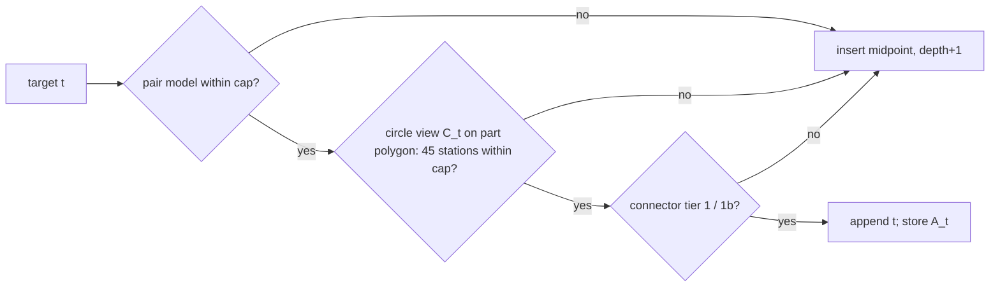

# Actual-stock engagement in refinement (design)

Status: DESIGN, nothing implemented. Worktree `compas_cgal_prs-held-task5-continuation` at `ea4703bb`.
Ruling: USER 2026-11-04, decision (b) = YES (ledger `.superpowers/sdd/2026-10-13-product-pipeline/progress.md:1169`).
The actual-stock engagement decision moves into refinement. The last-16 stock certificate is retired as a
per-path check and kept as a test oracle, off the production path.

Revised 2026-11-04 after the adversarial review `2026-11-04-actual-stock-refinement-review.md` (see the
revision section at the end).

**Recommendation.** Refinement accepts a target circle only if all 45 of its loop stations are within the
cap. The stock for that test is the **part polygon P** (`case.projection.points`) minus the swept annuli
of every circle emitted before it, with connectors left out. P is the certificate's material domain, not
the tool-centre offset polygon. That stock contains the actual stock, so the certificate's property holds
by construction (clip monotonicity). It is unaffected when NOTHING circles are removed or repair circles
are inserted.

The decision runs in a new native engine without an arrangement. It intersects each station's tool rim
with the candidate annuli and P's edges, giving a 1D set of rim arcs, and reuses the existing exact run
and cap machinery. The views are tiered, with an interval filter that keeps both legs of the exact cap
test and falls back to exact.

No C++ is written before unit U-1 has measured, on the existing exact engine, how often the filter would
fall back and what one exact station-0 decision costs. The budget is stated as ceilings derived from the
headroom. The only per-item numbers used are measured ones.

## 1. Current state

### 1.1 What refinement decides

Refinement acceptance lives in `_Emission.advance`
(`benchmarks/held_figure5_engagement_refinement.py:96-133`). A target is appended only if both of these
hold:

1. **The pair model is within the cap.** `_transition_engagement` → `exact_predecessor_engagement`
   (`benchmarks/held_standard_placement.py:406-446`; the check is at
   `held_figure5_engagement_refinement.py:114`). Held's Section 2.3 maximum is decided exactly over the
   injected doubles. The model "evaluates a candidate machining circle only against the immediately
   preceding swept disk" (`held_standard_placement.py:1-7`): its stock is ℝ² minus the predecessor's
   disk B(cᵢ₋₁, ρᵢ₋₁ + r).
2. **The connector is certified** by tier 1 or 1b (`_ConnectorGate.certifies`,
   `benchmarks/held_figure5_connector_gate.py:85-113`; the check is at
   `held_figure5_engagement_refinement.py:115`). Tier 1 bounds Ω minus one prior annulus; tier 1b uses
   any prior annulus per sub-piece (`docs/held_connector_engagement.md:1-12`, `:612-616`). Both are
   continuous along the motion.

Either refusal inserts a midpoint, depth-bounded (`:127-133`). The seam goes through the same path
(`close_seam`, `:147-167`).

The only polygon refinement holds is `_Emission.boundary` (`:89`). The generators fill it with
`components[0]`, which is the one-tool-radius **inward offset** of the part, i.e. the tool-centre domain
(`benchmarks/held_toolpath_benchmark.py:306`, `:388-392`). Coverage-repair splices re-enter through
`EngagementContinuation` (`benchmarks/held_coverage_repair_splice.py:69-140`). Their early stop relies on
`EngagementTrace.last_influenced` over the recorded footprints
(`benchmarks/held_figure5_engagement_trace.py:170-178`, `:209-221`). The refinement's inputs are keyed by
`EngagementRefinementKey` (`:186-195`).

The Ω\* lane uses the same pair predicate in `refine_omega_engagement` / `refine_omega_boundary_ordered`
(`benchmarks/held_omega_refinement.py:87`, `:257`) and in connector repair
(`benchmarks/held_omega_connector_repair.py:254`). Its stages are at
`benchmarks/held_omega_toolpath.py:244-255`.

NOTHING runs after refinement as a post-pass (`benchmarks/held_toolpath_benchmark.py:325-327`;
`benchmarks/held_nothing_circles.py:1-48`). A circle is removed when its annulus lies in the union of the
annuli of earlier circles, with connectors ignored. Before removing it, the pass re-decides the successor
pair on the pair model (`held_nothing_circles.py:635`, `:701`). Connectors are built after NOTHING from
the surviving circles (`held_toolpath_benchmark.py:328-332`).

### 1.2 What the last-16 certificate checks

The certificate is `Last16Oracle` (`benchmarks/held_actual_stock_last16.py:130-259`), with the batch
runner in `benchmarks/held_actual_stock_last16_batch.py`. It runs on the emitted polygon path only:
`ReplayWorkload.from_path` takes a `GeneratedToolpath` (`tools/actual_stock_profile.py:185-202`). It is
not called from any generator. It is run per path through the pixi tasks `actual-stock-last16` and
`actual-stock-last16-slow` (`pyproject.toml:328-329`).

**Property P (the certified property).** For every emitted circle i, let

Sᵢ = **P** minus every prior sweep,

where P is the part polygon `case.projection.points` (`tools/actual_stock_profile.py:193`, `fresh_stock`
`:207`). The prior sweeps are the exact annuli of circles 0..i−1 (`full_turn_annulus_bounds`,
`src/stock_2.cpp:427-433`) plus the connector chords, each removed as `Stock_UNDER`
(`subtract_line_sweep`, `src/stock_2.h:213-217`). The property: on Sᵢ, none of circle i's 45 loop
stations has a max-run engagement over the cap.

- **Station count:** `GATE_SAMPLES_PER_MOTION`, `src/compas_cgal/pipeline/admissibility.py:75-90`.
- **Station 0** is the entry e itself (`src/engagement_2.cpp:780-788`). Stations k > 0 lie on the guide
  circle.
- **Own prefix:** each station is clipped by circle i's own swept prefix
  (`src/swept_prefix_engagement_2.h:1-23`).
- **Gap closure:** none.
- **Cap ratio:** the native `cap_chord_ratio` (`tools/actual_stock_profile.py:203`).

The decision chain is `ReplayWorkload.exceeded` (`:219-226`) → `engagement_circle_exceeded`
(`src/engagement_2.cpp:926-936`) → `arc_prefix_exceeded` (`:674-695`). Nothing is claimed between
stations.

The certificate decides circle i in up to two views:

1. **Last-16 view:** P minus circles i−16..i−1 and their connectors (`certify`, `:229-233`). That stock
   contains Sᵢ, so a pass here is a pass on Sᵢ.
2. **Full window,** only after a last-16 refusal (U1, 2026-10-22). A refusal here is a true violation at
   the stations.

The window clip is admitted only by an exact proof (`:147-157`). A sweep is left out only on an exact
disjointness proof (`:166-192`).

Measured cost (ledger; load 35–600, indicative):

| run | fig5 | Monstera | source |
|---|---:|---:|---|
| C1 certificate, CPU | 83.5 s | 171.6 s (wall 82.4 s vs 30 s budget: MISSED) | progress.md:675 |
| C1F fig5 differential, CPU | 89.2 s, 2004/2004 equal | — | :690 |
| MD2 production path, circle CPU | — | 160.3 s (wall 152.4 s, 8 processes) | :782 |
| full exact reference replay, CPU | — | ~2,350 s | :782 |
| verdicts vs full replay | 0 mismatches | 0 mismatches, 0 bound breaks, 29 last-16 false refusals recovered by escalation | :675, :782 |
| refusals | circle 0 (plunge) | circle 0 (plunge) | :675, :782 |

Engine constants (`benchmarks/results/actual_stock_profile.md`, load ~100):

- warm 45-station query: 14.6 ms on a last-16 window, 19.8 ms on the exact window, which is 0.38–0.52 ms
  per station;
- per sweep on a small arrangement: 0.5–0.8 ms.

### 1.3 The gap

The pair model does not imply P. Its stock ℝ² ∖ B(cᵢ₋₁, ρᵢ₋₁ + r) cannot be compared with Sᵢ:

- it ignores every earlier sweep (which makes it a superset of Sᵢ);
- it treats the hole |x − cᵢ₋₁| < ρᵢ₋₁ − r as cut, which only an earlier circle can make true;
- it is a single analytic maximum, not 45 in-process stations with own-prefix clipping.

NOTHING's successor re-check uses the same model. Connectors are not part of the gap: the tiers bound
Ω minus one prior annulus, which contains Sᵢ. So the gap is circle loop stations only.

Today P holds empirically on fig5 and Monstera for every circle except circle 0, but no stage of
generation decides it (`docs/superpowers/state/performance-decisions-2026-10-22.md:107-120`).

Commit `73d5372` (swept-annulus guard plus adaptive arc certification) is **not an ancestor of HEAD**. It
is incomplete and unreviewed by its own message. HEAD has `certify_segment_tea`
(`src/engagement_2.cpp:940`) and a fixed-density Python arc mirror (`src/compas_cgal/engagement.py:308`)
in the audit module, and Held generation uses neither.

## 2. Formulation

### 2.1 The material domain, typed

There are two polygons in play, and confusing them is a silent false-acceptance path:

- **Part polygon P** (`case.projection.points`) is the **material domain**. The engine decides on it.
- **Tool-centre polygon** (`components[0]`, today's `boundary` argument) is the **placement domain**.
  Midpoints, corner limits and connectors use it.

Both are typed (engineering bar 1): `PartPolygon` and `CentreDomainPolygon` are distinct frame-tagged
types over `Point2[WorldXY]`, so `mypy --strict` refuses a swap.

P is passed through a new required parameter, `part: PartPolygon`, on these entry points:

- `refine_figure5_engagement`;
- `continue_figure5_engagement`;
- `EngagementContinuation`;
- `refine_boundary_ordered_path`.

The generators supply it from `case.projection.points` (`held_toolpath_benchmark.py:306`, `:388-392`),
which is the same source the certificate reads. `EngagementRefinementKey` gains `part`, so a splice
cannot adopt across different material domains (`held_figure5_engagement_trace.py:186-195`).

Two guards back this up:

- **Red test** `test_engine_decides_on_part_not_offset`. On a wall-hugging fixture, a station-0 wall band
  of width r carries the only material that pushes the circle over the cap. The test asserts that the
  production decision refuses, and that the same decision computed on the offset accepts. The test fails
  if the offset reaches the engine.
- **R6 injection** "material domain = offset polygon" must be killed.

### 2.2 The decision

Notation:

- t is the emission index of the target;
- Aⱼ = {x : max(ρⱼ − r, 0) ≤ |x − cⱼ| ≤ ρⱼ + r} is the closed swept annulus of emitted circle j, built
  exactly as `full_turn_annulus_bounds`;
- C_t = P ∖ ⋃_{j<t} Aⱼ is the **circle view** (ruled Q1, connectors left out).

Refinement accepts target t only if all three of these hold:

1. **Pair model within the cap.** Unchanged; it sets Held spacing.
2. **`ActualStockDecision(t)`:** no station of t's 45 is exceeded on C_t. The stations, entry, own-prefix
   clip and gap closure 0 are the certificate's. The cap ratio is `EngagementCap.chord_ratio`
   (`src/compas_cgal/motion.py:78-83`), the same native `cap_chord_ratio` the certificate uses.
3. **Connector gate certifies.** Unchanged.

Any refusal inserts a midpoint, exactly as today. Depth exhaustion on (2) raises
`ActualStockEngagementResolutionError`, a sibling of `ConnectorEngagementResolutionError`.

Since C_t ⊇ S_t, a pass on C_t is a pass on S_t at every station (the clip-monotonicity lemma,
`src/swept_prefix_engagement_2.h`). The engine is called about once per final circle: 2,010 calls for
2,004 circles on fig5 and 1,623 for 1,621 on skis (review probe, `build/actual-stock-review/probe_{fig5,skis}.log`).

**Circle 0** is the entry circle. Its stock is P, so it engages fully. It is exempted by name as
`EntryCircle`, and its engagement is owned by the entry move (ruling R3, helix entry). The oracle must
still report it REFUSED.

**Semantics (USER ruling 2026-11-04, M3).** The model is exact. A sub-ulp crossing of the tool rim with
a wall is real stock in that model. No tolerance is applied, and there is no "near-tangent" class.

### 2.3 Stock state, path order and incremental maintenance

The state is an append-only `AnnulusStore`: for each emitted circle, (cⱼ, ρⱼ) as injected binary64,
keyed by `EmissionIndex`, plus a dynamic spatial index of outward-rounded boxes. There is no arrangement.

View C_t is every entry with index < t. The index filter is applied at query time over the candidates
the spatial index returns, so truncation never edits the index. Stale entries are skipped by index, and
the index is compacted lazily when stale entries exceed half the store. The real truncation cost is
O(stale candidates) per query until compaction, and U2 times it.

Why the view is final when t is decided:

- **Refinement only appends** (`_Emission`, `:86-95`). Each circle's stations depend only on its own c,
  ρ and e, so no other circle's removal or insertion moves them.
- **NOTHING removal leaves every view pointwise unchanged.** A_k ⊆ ⋃_{l<k} A_l pointwise, because a
  regular closed annulus that is regularized-contained in the union is contained point by point. So for
  j > k, ⋃_{l<j, l≠k} A_l = ⋃_{l<j} A_l. This holds inductively over chains of NOTHING circles. The
  post-pass, its pair re-check, the stage order and ruling D1 therefore stay as they are.
- **Insertions only shrink later views,** which is monotone. This covers coverage-repair circles,
  Ω\* repair midpoints and seam circles.
- **Removals are where splices can break the claim (review M1).** A splice continuation can drop
  reference circles Y (`changed` includes `reference.circles[start+1:end-common]`,
  `held_coverage_repair_splice.py:110`, `:155-158`). If a later adopted circle t was accepted on a view
  that contained A_y, the final stock at t is larger than the view t was decided on. Insertions X are
  harmless.

The rule for footprints:

1. **Record a footprint on every decision that reaches the engine, refusals included.** A refusal that
   inserted midpoints can flip once X adds annuli. The footprint is the read disk
   B(c_t, ρ_t + r) ∪ B(e_t, r), as an outward-rounded box.
2. **`last_influenced` tests it against X ∪ Y,** the whole `changed` set. Adoption stops at the last
   footprint either set meets.

### 2.4 The station decision without an arrangement

Today, `exact_engaged_arcs` (`src/audit_exact_station_2.cpp:70-123`) zone-walks the tool rim through the
stock arrangement. `maximal_exact_runs` / `classification_from_arcs` then merge runs by exact endpoint
equality and apply the gap and cap tests (`:125-171`, `:445-485`). The swept-prefix clip consumes arcs
through `classify_audit_filtered_station_exact` (`src/swept_prefix_engagement_2.cpp:279`, `:399`).

The new harvest replaces the zone walk. For a station centre s, it computes the rim arcs in
int P ∖ ⋃_{j∈V} Aⱼ:

- **Station centres.** s is the entry e for station 0, which is injected exactly. For k > 0, s is c + ρ·u
  with an exact rational u (`circle_prefix_motion`, `src/engagement_2.cpp:756-788`). Both are rational.
- **Events.** These are the rim's intersections with ∂Aⱼ (two circles) and with P's edges. Each is a
  one-root point.
- **Order.** Events are ordered along the rim with the upper/lower half split and the x-order inside each
  half, as `maximal_exact_runs` does (`src/audit_exact_station_2.cpp:129-151`). `compare_xy` alone does
  not give angular order. Events are compared only, never combined, so there is no cross-root arithmetic.
- **Cells.** Each open cell between consecutive events is decided at a rational witness strictly inside
  it. A cell is material iff its witness is in int P and outside every closed Aⱼ, which is a rational
  squared-distance compare.
- **Downstream.** The material cells are emitted as `ExactRimArc2` into the clip, run and cap code, which
  is unchanged on the exact path.

Doubles enter once, at the binding: c, ρ, r, e, P's vertices and the caller's cap ratio. There is no
epsilon.

**Parity with `Stock2`.** U1 pins two semantics with fixtures rather than assuming them:

- regularized behaviour at measure-zero contacts: a sweep tangent to the rim splits nothing, and runs
  with equal endpoints merge;
- rim overlap with ∂Aⱼ.

Where `Stock2` has no defined verdict, both sides raise a named error.

### 2.5 Views, candidates and the filter

**Tiered views.** The engine tries last-1 first (A_{t−1} and P's edges), then last-16, then the full
view. The views are nested, so a pass at any tier is a pass on C_t. Only a full-view refusal refuses.
Measured circle-view last-1 refusals: 1/101 on fig5 and 0/108 on skis (review probe). Monstera is
unmeasured; U-1 measures it. Full views can hold up to 313 prior circles (fig5 circle 680,
`build/actual-stock-design/probe_fig5.log`).

**Candidates.** Candidates are selected by outward-rounded `to_interval` boxes in a dynamic index. CGAL
spatial search comes first: `Point_set_2` over centres with an interval upper-bound query radius, or a
uniform grid if U2 measures it faster. Box disjointness proves exact disjointness, so selection is never
a decision.

**Filter.** The filter follows the `Filtered_predicate` pattern. Each station is evaluated in
`Interval_nt` under one `Protect_FPU_rounding`, and every ambiguous sign is bracketed:

- **Harvest events.** An event whose order or membership sign is ambiguous is treated pessimistically
  for the upper bound on max-run: merge across the ambiguous gap, and keep an ambiguous sliver as
  material. It is treated optimistically for the lower bound: split, and drop the sliver.
- **Own-prefix clip (M2).** The clip removes material: the start disk, plus the sector or rear half-disk
  (`src/swept_prefix_engagement_2.h:1-23`). The bounds therefore run in the opposite direction. The
  **upper bound under-clips**: an arc portion whose clip membership is ambiguous counts as material. The
  **lower bound over-clips**: the same portion counts as clipped. The clip runs on interval arcs in the
  filter and on exact arcs on fallback, never mixing the two types.
- **Cap test, both legs (H2).** The exact test is `run_exceeds_cap` (`src/exact_cap_certificate_2.h:84-120`):
  start == end means exceeded; orientation NEGATIVE (θ > π) means exceeded; otherwise chord² is compared
  with the cap ratio. Chord² is not monotone past π. The filter therefore certifies **within** only when,
  for the pessimistic maximal run, start ≠ end is certified, orientation is certified POSITIVE, and the
  upper chord² is certified below the cap ratio. It certifies **exceeded** when either leg is certified
  for the optimistic run: a certified full loop, a certified NEGATIVE orientation, or a lower chord²
  certified above the cap. In every other case it falls back to exact.

Soundness: under the rules above, the pessimistic material set contains the exact one and the optimistic
set is contained in it, so clip monotonicity covers both bounds.

**The station-0 population (review M3).** On 95 % of circles, station 0's rim meets a part wall with
|d² − r²|/r² < 1e-12, with material on both sides of the wall event:

| | fig5 | skis |
|---|---|---|
| circles | 1,902 / 2,004 | 1,560 / 1,621 |
| p50 of \|d² − r²\|/r² | 9e-15 | 5e-15 |

Source: `build/actual-stock-review/probe_*.log`.

The filter decides such a station only when the run merged across the wall is itself within the cap.
Otherwise the exact path decides, and under the ruling the exact verdict stands even when it splits the
run at a sub-ulp crossing. U-1 measures that fallback rate before any C++ is written (§4, §5).

### 2.6 Interaction with the swept-annulus guard and adaptive arc certification

- **Connectors.** Tiers 1 and 1b (the single-swept-annulus guard of
  `docs/held_connector_engagement.md`) are unchanged and remain the connector part of P.
- **Line motions.** `certify_segment_tea` (`src/engagement_2.cpp:940`) is audit-side and untouched.
- **Arc certification.** The adaptive arc certification of `73d5372` is not in this branch, and nothing
  here depends on it. If it ever lands, its guarded cap and merge closure can consume the same harvested
  arcs on `AnnulusStore`. Ruled Q3 keeps P at 45 stations for now.

### 2.7 Ω\*: scoped out of U4, own unit U6

**Reasons for scoping Ω\* out of U4:**

1. The published path is the polygon lane (`generate_on`, `benchmarks/held_toolpath_benchmark.py:433-445`).
2. Ω\* generation is already 1.8–2.5× over budget, pending decision (c), and this conjunct adds to it.
3. The store needs re-keying for Ω\* repair (below).
4. No Ω\* certificate has ever run.

**U6 plan:**

- **Material domain.** P\* is the declared part boundary `declared_boundary_from_reference(case.name,
  case.boundary)` (`benchmarks/held_omega_toolpath.py:216`), typed `PartPolygon`. It is never Ω\*, which
  is the centre domain.
- **Decision sites.** The decision is wired at `refine_omega_engagement` (`:257`),
  `refine_omega_boundary_ordered`, and `repair_omega_connectors` (`held_omega_connector_repair.py:254`).
- **Store re-keying.** Ω\* repair runs after NOTHING on the final list and re-streams `emitted`
  (`held_omega_connector_repair.py:246-262`), so an `AnnulusStore` keyed by the refinement's
  `EmissionIndex` does not index that list. The repair pass therefore builds a fresh store keyed to the
  re-streamed list by appending each circle as it is re-emitted. That costs one append per circle, timed
  in U6.
- **D2-Ω\*.** An end-to-end check: a circle-only `Stock2` replay of the final Ω\* path on P\* (the
  circle-view stock is the decision itself), with every circle t ≥ 1 within the cap. The full actual
  stock with ∂Ω\* arc connectors stays out of reach: `Stock2` cannot subtract one-root arc pieces.
- **Cost ceiling (L6).** With the polygon per-decision ceilings (§4) and Ω\* circle counts of about
  1,808 / 1,430 / 3,935 (progress.md:572), the ceiling is ≤ 0.14 / 0.13 / 0.44 s added. That lands on a
  lane that is red, so U6 is sequenced after decision (c).

## 3. Correctness and oracle

**By-construction claim (polygon lane).** For every emitted circle t ≥ 1, the decision accepted t on C_t,
decided on the part polygon P. By §2.3, C_t contains the final path's view at t:

- NOTHING removal is invariant;
- insertions only shrink later views;
- every splice removal re-decides each footprint it meets.

S_t ⊆ C_t, because the actual stock also subtracts connectors, and `Stock_UNDER` chords subtract subsets
of their capsules (`src/stock_2.h:200-216`). The 45-station max-run is monotone under stock inclusion.
So every station of t is within the cap on S_t, which is P.

The claim rests on two things: that the engine decides C_t exactly, and that every refinement site calls
it. D1 and D2 check those.

**Oracle (off the production path).** `Last16Oracle`, the full replay and the batch runner stay. The
pixi tasks `actual-stock-last16{,-slow}` become test-only.

| test | content | tier |
|---|---|---|
| D1 engine == `Stock2` | every station of every circle of fig5 and skis, and every 20th Monstera circle: the engine verdict and reported max-run equal `engagement_circle_prefixes` on a `Stock2` built from the same circle-only window on P | slow |
| D2 production ⇒ certificate | fig5 and skis every circle, Monstera every 20th: every emitted t ≥ 1 is `CERTIFIED_LAST16` or `CERTIFIED_FULL_WINDOW`, and circle 0 is `REFUSED` (**U4 exit gate**) | slow |
| D2-all | Monstera every circle | slow, U5 |
| D3 full replay | Monstera vs `held_actual_stock_last16_reference` (~2,350 s CPU) | opt-in, quiet window |
| D4 circle view vs actual | per workload, circles accepted on S_t but refused on C_t = 0 (design probe: 0 of 180) | slow |
| H1 Hypothesis | random polygons and annulus sequences, including integer fixtures and a generic-double witness: engine disposition == `classify_audit_unguarded_station_exact` on the `Stock2` replay | fast |
| H2 Hypothesis | nested-view monotonicity (0 breaks), and the box filter never drops an annulus that meets the rim | fast |
| H3 Hypothesis | NOTHING invariance of every later view | fast |
| H4 | splice with Y ≠ ∅ inside a later read disk: early stop == full re-refinement | fast |

**R6 defect injections, per unit.** Each injection must be killed, and the kill rate is reported in the
unit's handback:

- **U1:** the engine is fed the offset polygon; A_t is included in its own view; A_{t−1} is dropped; a
  closed annulus is treated as open at tangency; station 0 is placed on the circle instead of at e.
- **U2:** the box filter drops an annulus that meets the rim; the view index filter is off by one after
  truncation.
- **U3:** the filter decides on interval midpoints; the pessimistic merge is turned optimistic; the
  orientation leg is removed from within; the clip over-clips in the upper bound.
- **U4:** the conjunct is skipped in `close_seam`; footprints are tested on X only; no footprint is
  recorded on refusals; the exemption is applied to some t > 0; the generator passes `components[0]` as
  `part`.

## 4. Budget before code

The generation budget is 1.7 / 2.2 / 9.0 s (performance-decisions (b)), measured as min-of-5 CPU on a
quiet machine.

| | fig5 | skis | Monstera | source |
|---|---:|---:|---:|---|
| polygon generation, min CPU (load 11–13) | 1.72 | 2.00 | 7.63 | performance-decisions (b) table |
| headroom today | −0.02 | 0.20 | 1.37 | |
| … after the parked F5 no-ruling levers | 0.25 | ≈ 0.32 | ≈ 2.0 | `W/f5-fig5-levers-report.md` |
| **added-cost ceiling (this unit)** | **≤ 0.15** | **≤ 0.15** | **≤ 0.50** | set here |
| engine calls per run (measured) | 2,010 | 1,623 | ≈ 4,430 (U-1 measures) | review probe |
| **per-decision ceiling** = ceiling ÷ calls | **75 µs** | **92 µs** | **113 µs** | |

Figure 5 fits only after the F5 levers land, so they are a prerequisite of U4. Skis fits today with
0.05 s to spare.

Measured inputs, and nothing else, feed the feasibility check:

| quantity | value | source |
|---|---|---|
| engine calls / final circle | 1.00 (fig5 2,010 / 2,004; skis 1,623 / 1,621) | `build/actual-stock-review/probe_{fig5,skis}.log` |
| circle-view last-1 refusals | 1/101 fig5, 0/108 skis | same |
| largest full view | 313 prior circles (fig5 circle 680) | `build/actual-stock-design/probe_fig5.log` |
| station-0 rims with an ambiguous wall event | 95 % (fig5 1,902 / 2,004; skis 1,560 / 1,621) | review M3 |
| exact station on today's `Stock2` engine | 0.38–0.52 ms (warm) | `benchmarks/results/actual_stock_profile.md` |
| native call floor (trivial binding) | 0.071 µs | `build/actual-stock-design/probe_call_overhead.log` (load ~60–100) |

**What this rules out, by measurement alone:**

- **Today's engine.** At 0.38–0.52 ms per station, 45 stations per decision cost 17–23 ms, which is 230×
  the fig5 per-decision ceiling.
- **The exact fallback on station 0.** If every ambiguous station 0 fell back to an exact path costing as
  much as today's station, fig5 would pay 1,902 × 0.38 ms = 0.72 s, five times the whole ceiling.

So the fallback rate on station 0 decides feasibility, and the first unit measures it.

**The feasibility rule, applied by U-1.** Let f be the measured fraction of decisions that fall back,
c_x the measured exact cost per fallback, and N the number of calls. The fallback term f · N · c_x must be
at most one third of the ceiling: 0.05 / 0.05 / 0.17 s.

- On fig5, with c_x = 0.38 ms, that means f ≤ 6.6 %.

The remaining two thirds of the ceiling is the filtered-path allowance: ≤ 50 µs per decision on fig5,
which is about 1.1 µs per station. U3 gates that as a measured red test.

**No added-cost estimate is claimed until U-1 and U3 have measured it.** The first draft's
0.10–0.20 s fig5 estimate exceeded its own ceiling and rested on unmeasured unit costs. It is withdrawn.

## 5. Staged plan

Every unit follows the same pattern: a failing test first, its own R6 list (§3), an exit gate, then a
review.

Commands go through pixi only. Python units run with `pixi run --no-install` and `SKBUILD_EDITABLE_SKIP`.
**All pyproject edits (C++ build config and every pixi task line from U-1, U0, U5 and U6) go to the single
pyproject slot.** That slot applies them in one edit while no Python agent is running (ledger :700).
Until then, Python units run their scripts through `build/pyrun.sh`.

| unit | content | lives in | red test first | exit gate |
|---|---|---|---|---|
| **U-1** | Probe on the EXISTING exact engine (`Stock2` + `engagement_circle_prefixes`), on fig5, skis and Monstera every circle: (a) station-0 exact max-run and verdict on the circle-view window on P; (b) the run merged across the wall event (pessimistic: the same call with a gap-closure ratio that closes only the sub-ulp wall gap, a measurement parameter, never a decision); (c) fallback = pessimistic exceeded ∧ exact within, plus the orientation-leg ambiguity count; (d) CPU of one exact station-0 decision (warm, `parameters=[0.0]`); (e) the same over all 45 stations on every 20th circle; (f) engine calls / final circle and last-1 refusals on Monstera | Python (`tools/`) | the probe's record test (schema, workloads present) | f and c_x per workload recorded with load; feasibility rule §4 evaluated. **Gates U1.** |
| U0 | Oracle harness: the circle-view and part-polygon options in `Last16Oracle`, D2 / D4 harnesses for skis, the design probe ported to `tools/` | Python | D4 on skis (no harness yet) | D4 = 0 on fig5 and skis every circle and on Monstera every 20th |
| U1 | `AnnulusView2` exact harvest (§2.4), exact path only, with binding | C++ | H1; tangency, rim-overlap, station-0-at-wall and offset-vs-part fixtures | D1 on the first 200 fig5 circles, every station equal |
| U2 | `AnnulusStore`: append, query-time index filter, lazy compaction, box index, tiered views | C++ | H2; index time test | candidate superset with 0 misses; query ≤ 5 µs per decision at Monstera size (fig5 and Monstera store); 0 bound breaks |
| U3 | Interval filter (§2.5: harvest, clip and cap legs bracketed) with fallback counters | C++ | filtered == exact on every station of fig5; injected filter failure; generic-double witness | per-decision CPU ≤ the §4 ceiling on fig5 and skis; fallback rate ≤ U-1's |
| U4 | Wiring (polygon lane): the conjunct in `_Emission.advance` and `close_seam`; `part: PartPolygon` through the refinement entry points and `EngagementRefinementKey`; footprints on every engine-reaching decision; `last_influenced` over X ∪ Y; `EntryCircle`; `ActualStockEngagementResolutionError`. Prerequisite: F5 levers landed | Python | `test_engine_decides_on_part_not_offset`; an unseen-hole fixture (pair model and gate accept, C_t refuses, so a midpoint is emitted and `Last16Oracle` passes); H3; H4 | **D2** (fig5 and skis every circle, Monstera every 20th); **call count**: engine decisions ≥ final circles − 1, with a non-zero counter at each wired site (`advance`, `close_seam`, continuation); polygon digests and gate vectors IDENTICAL on all five workloads, or the delta goes to the user; generation min-of-5 quiet ≤ 1.7 / 2.2 / 9.0 s |
| U5 | Demote the certificate: D2-all and D3 to the slow tier; drop the C1 budget asserts (reference-test edit, **user gate**); docs (`held_actual_stock_engine.md` §3/§5/§7, the performance-decisions property table row, the mkdocs page) | Python + docs | `tests/docs` included-records guard: the property table row must name the generation decision, not the per-path certificate (red until the docs change) | strict mkdocs passes with 0 warnings; R6 kill rate 100 % across U1–U4 |
| U6 | Ω\* (§2.7): P\* typed, three decision sites, a per-pass store for repair, D2-Ω\* end to end. After decision (c) | Python | D2-Ω\* on fig5 Ω\* (no decision wired yet) | D2-Ω\* on all three; call count per site; Ω\* added CPU ≤ §2.7 ceilings |

**If U-1 finds the budget infeasible** (the fallback term exceeds a third of the ceiling on any workload),
the engine must not re-decide whole stations exactly. Instead it resolves **only the ambiguous wall
event** exactly, which is a targeted lazy-exact step:

1. The existence of the crossing is the exact rational sign of d²(s, edge line) − r² together with the
   foot-parameter test, in integer arithmetic over the injected doubles.
2. The crossing's order relative to its two neighbouring events is decided by one-root comparison of
   those events alone.
3. The other events stay on interval values.

U-1 also measures the cost of this targeted step, with Python `Fraction` as an upper bound. If the
targeted step still breaks the ceiling, the spec stops there and goes back to the user with the
measurements, before any C++ is written. The choice then is between a generation budget row for this
decision and a different station-0 semantics. A tolerance is never an option (ruling M3).

**Risks.**

1. **Figure 5 headroom is negative today.** U4 waits for the F5 levers.
2. **The station-0 fallback rate** is now measured first (U-1) and gates U1.
3. **`Stock2` regularization parity at degenerate contacts** is pinned by U1 fixtures. Where no verdict is
   defined, both sides raise a named error.
4. **The circle view is looser than the actual stock (up to 21°).** A future workload may get extra
   midpoints. They are safe but change the path; D4 and the digests catch it.
5. **The material-domain mix-up (H1)** is caught by types, a red test and an R6 injection.
6. **Splice removals (M1)** are covered by footprints on every engine decision, by X ∪ Y, by H4 and by
   R6.
7. **Ω\* has no full actual-stock oracle.** D2-Ω\* is circle-only.
8. **`73d5372` is outside this branch.** There is no dependency.

## 6. Open questions

Q1–Q3 of the first draft are ruled: the circle view, the rim engine replacing S1–S5, and 45 stations
(progress.md:1173-1175). No new controversial question is open. The one decision deferred to the user is
conditional: what to do if U-1 shows the budget is infeasible even with the targeted exact wall event
(§5). The options are a dedicated generation budget row or a different station-0 semantics. A tolerance
is excluded by ruling M3.

## Revision 2026-11-04

These changes respond to `2026-11-04-actual-stock-refinement-review.md` and the binding ruling on M3.

- **H1:** the material domain is the part polygon P (`case.projection.points`), not the offset Ω. It is
  typed `PartPolygon` against `CentreDomainPolygon`, passed through the refinement entry points and
  `EngagementRefinementKey`, and backed by a red test (offset vs part) and an R6 injection (§2.1).
  **Why:** the offset leaves out the r-wide wall band that station 0 reads.
- **H2:** the filter's "within" requires certified start ≠ end, certified POSITIVE orientation and the
  chord² upper bound, as in `run_exceeds_cap` (`exact_cap_certificate_2.h:84-120`). "Exceeded" may come
  from either leg. An R6 injection was added (§2.5). **Why:** chord² is not monotone past π.
- **H3:** U4's exit gate now includes D2 (fig5 and skis every circle, Monstera every 20th) and a
  per-site call-count assertion. **Why:** identical digests pass a vacuous or mis-wired conjunct.
- **M1:** footprints are now recorded on every engine-reaching decision, refusals included, and are
  tested against X ∪ Y, with the dropped reference circles Y as the unsound case. H4 and R6 were added
  (§2.3). **Why:** insertions are monotone; removals are not.
- **M2:** the own-prefix clip has its own bracket: under-clip for the upper bound, over-clip for the
  lower, interval arcs and exact arcs never mixed (§2.5).
- **M3 (ruling):** exact semantics are stated (§2.2). New unit U-1 measures the station-0 fallback rate
  and exact cost on the existing engine and gates U1. A targeted exact wall-event path is the fallback
  design if the budget proves infeasible, and the user is consulted if that is infeasible too (§5).
- **M4:** Ω\* is scoped out of U4, with reasons. U6 has a typed P\*, three decision sites, a store
  rebuilt per pass keyed to the re-streamed list after NOTHING, and D2-Ω\* end to end (§2.7).
- **M5:** the guessed unit costs and the 0.10–0.20 / 0.08–0.15 / 0.25–0.45 s estimates are withdrawn.
  The budget is now ceilings from headroom, measured inputs (including a new call-floor probe) and a
  feasibility rule that U-1 evaluates (§4). **Why:** the fig5 upper estimate (0.20 s) exceeded its own
  ceiling (0.15 s).
- **L1:** station 0 is the entry e. **L2:** rim order uses the upper/lower split of
  `maximal_exact_runs`. **L3:** the cap ratio is pinned to `EngagementCap.chord_ratio`, the native
  `cap_chord_ratio`. **L4:** truncation is a query-time index filter with lazy compaction, and its cost
  is stated. **L5:** U5 has a red test, U2 has an index time gate, R6 is listed per unit, and all
  pyproject and pixi-task edits go to the single pyproject slot. **L6:** the Ω\* cost ceiling is stated
  (§2.7).
- §6: Q1–Q3 are recorded as ruled. The one remaining user decision is conditional on U-1.

## Revision 2026-11-05 (units U2 and U3, as built)

- **The filter is one-sided (§2.5).** It builds only the pessimistic set M+ and certifies only "within". There is no optimistic set and no certified "exceeded": a station no view certifies goes to the exact path, whose verdict stands. **Why:** a refusal then costs one exact station, a refused decision is rare, and half the bracketing code is gone. The H2 and M2 rules stand for what remains: both legs of the cap test, and an under-clipping own prefix.
- **Escalation is per station (§2.5).** A last-1 failure re-reads only that station, on the larger view. Only a station no view certifies reaches exact.
- **Covers replace cells in the filter (§2.5).** Each disk covers one rim arc, so M+ is the complement of a sorted union of key intervals, with no witness. A rim with no certain wall crossing counts as inside P, which is only pessimistic, so the filter needs no point location. The exact path still works as §2.4 says.
- **The own prefix is the rear half-rim plus the start disk at every extent.** Proof in `src/annulus_filter_2.h`; only the inclusion "these are covered" carries the filter's soundness.
- **The store's index is the uniform grid (§2.5).** Point_set_2 fails the §5 query ceiling and merges coincident centres. A flat prefix scan is faster over a whole run, because the full view is queried on about 1 % of decisions, but it grows with the store.
- **A view's static AABB tree stays** beside the store for `AnnulusView2::build`, until its removal is approved.
